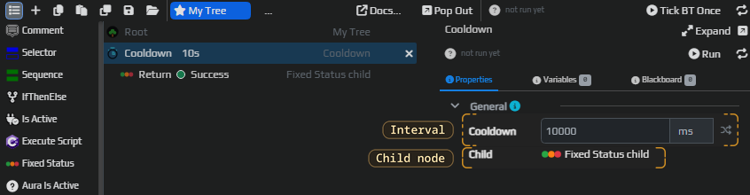

# Cooldown — limit how often a successful step repeats

`Cooldown` keeps its child from running more often than the interval you set. The countdown starts **after the child returns Success**. Until it runs out, Cooldown returns `Failure` and does not call the child.

## Admit your check once every five seconds

Take a separate tree that you start by hand: `Activation → Is Loaded` and `Execution → When Activated → Do nothing`.

1. Use `Add new Node` to add `Cooldown` and `Fixed Status`. Connect the tree entry to Cooldown, then Cooldown to Fixed Status.
2. On Fixed Status choose `General → Status → Success`. On Cooldown set `General → Cooldown = 5000 ms` and turn off randomization with the shuffle button. Check the child's name in `Child`.

```text
My Tree
└─ Cooldown: 5000 ms
   └─ Fixed Status: Success
```

3. Click the upper `Tick BT Once`. The child runs, the result is `Success`, and the countdown starts.
4. Click again before five seconds have passed. Cooldown returns `Failure` and does not call the child. The node shows how much time is left.
5. When the countdown ends, click again. The child succeeds and starts a new interval.

| Setting or outcome | Effect |
| --- | --- |
| Cooldown | Interval after child Success, in milliseconds |
| Random Min / Max | A new interval is picked after each child Success, for example 4000–6000 ms |
| Child | The work you are limiting. Group several steps in a child Sequence |
| Child Success | Cooldown returns Success and starts the countdown |
| Child Failure | Cooldown returns Failure and the countdown is cleared |
| Child Running | Cooldown returns Running and no new countdown starts |
| Call during the countdown | Failure, the child is not called |



If you change the Cooldown value, the current countdown is cleared. Clearing the displayed statuses does not cancel the countdown. A structural reset clears both the timer and the children's state.

<details>
<summary>Where to put Cooldown in a larger tree</summary>

When a branch with Cooldown sits inside a [Selector](/en/behavior-trees/nodes/selector), it returns Failure during the countdown, and Selector takes the fallback branch. This is how you split a rare reaction and a regular one between two Selector children.

```plaintext
Selector
    ├─ Cooldown (10 sec)
    │    └─ Use "Fireball"
    └─ Use "Basic Attack"
```

```plaintext
Selector
    ├─ Sequence
    │    ├─ AuraIsActive HP < 30%
    │    └─ Cooldown (30 sec)
    │         └─ Use "Healing Potion"
    └─ Use "Basic Attack"
```

Cooldown placed as a **sibling before** an action in a Sequence works differently. With no child of its own, it gets Success right away and starts the countdown before the next step runs. If that step fails, the interval is not undone. To count from the action's success, make the action a child of Cooldown. [Wait](/en/behavior-trees/nodes/wait) does a different job: it pauses the current pass and returns Running.

</details>
