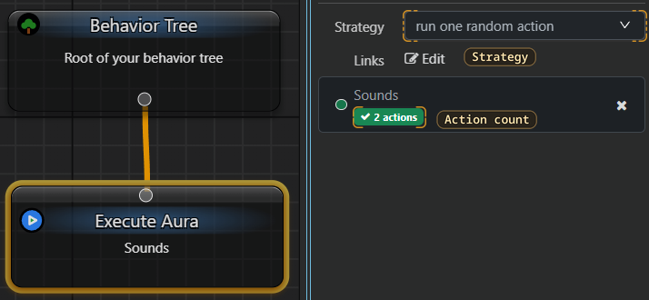

# Run Aura — invoke actions you have already configured

`Run Aura` runs, inside a tree, the actions you have already set up in an aura. The earlier editor called this node `Execute Aura`. It ignores the aura's triggers: the actions run even when the aura is inactive. If you need that check, add [Aura Is Active](/en/behavior-trees/nodes/aura-is-active) separately.

## Run two delays from one inactive aura

You need your own loaded aura named `Reusable pause`, with no input, sound or other external actions. Give it a [Fixed Value](/en/triggers/fixed-value) and leave it on `Is NOT Active`. Then the aura itself will not run these actions in parallel with the tree.

1. In the aura, add a [Delay](/en/actions/delay) to `On Enter`: `Delay, ms = 1000`, randomization off. Add a second Delay of `2000` ms to `On Exit`. Leave `While Active` empty. The aura must have no other actions.
2. Create a separate tree with `Activation → Is Loaded` and `Execution → When Activated → Do nothing`. Through `Add new Node`, add `Run Aura` and connect it to the entry.
3. Open the node's `General → Auras → Links`, select only `Reusable pause` and confirm. The link row should show two actions, not `NO ACTIONS`.

   

4. In `General → Strategy`, choose `run 1-by-1 in order of addition`. Click the upper `Tick BT Once` and wait for it to finish.

The node runs both Delays in turn: first the one from On Enter, then the one from On Exit. That takes about three seconds plus a little for the execution itself. The editor shows the duration of the last tick. Run Aura returns `Success`, even though the aura stayed inactive the whole time.

| Setting or source | Effect |
| --- | --- |
| Auras → Links | Actions from one or more linked auras. The triggers of those auras are not evaluated |
| Strategy — run 1-by-1 in order of addition | All collected actions, one after another. The node waits for each one to finish |
| Strategy — run one random action | One random action from the pooled list of all linked auras, not every action of a random aura |
| On Enter → While Active → On Exit | The order in which each aura's three action lists are collected. While Active runs once per pass, not in a loop until deactivation |
| Action count / NO ACTIONS | Shows whether the linked aura has any actions. A link to an aura does not yet mean there is something to run |

If several auras must run in a strict order, put separate Run Aura nodes in a [Sequence](/en/behavior-trees/nodes/sequence). Do not rely on the order of links inside one node.

Context, completion and limits

The actions run with the context and settings of their own aura. The tree does not put its own window, variables or input backend into them. Set the target of each real action in the source aura. A disabled action may fail the call with an error instead of being skipped quietly.

The node passes cancellation to the actions it called and waits for them to finish by their own rules. What has already run is not rolled back. Success means the calls completed, not that everything worked in the other application.

In sequential mode an empty action list can return Success without doing anything. Random mode needs a nonempty list. If Run Aura has a child, it runs after the calls succeed, and the overall result can become the child's Running, Failure or Success.

