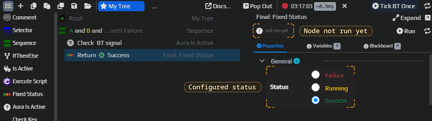

# Set a test condition's result

Fixed Status returns the result you pick yourself: Success, Failure or Running. It does not watch a window, key or application state. Put it in for a while to check the tree's route before the real condition is ready.

## See which child is reached

Take your own loaded tree with **When Activated → Do nothing**. Connect its entry to Sequence, then connect Sequence to two Fixed Status children, left to right.

1. Set the first to **General → Status → Failure** and the second to **Success**. Do not connect children to the Fixed Status nodes yet.
2. Click the upper **Tick BT Once**. The first child and Sequence return Failure. The second does not run.
3. Set the first node's **Status** to Success and tick again. Both children run and Sequence returns Success.
4. You can also set the first to Running and tick once more. Sequence stops on it with Running. Set it back to Success and click the same button, and Sequence moves on.

**Status** sets a future answer. Changing it does not run the tree and does not change the result shown from the previous tick.



| Status with no child | Fixed Status returns |
| --- | --- |
| `Success` | Success. Sequence moves on to the next child. |
| `Failure` | Failure. Sequence ends this pass. |
| `Running` | Running on every call. It does not change on its own over time. |

Two leaves on their own:

```
   Fixed Status: Success
   ```

```
   Fixed Status: Running
   ```

## Account for a connected child

Fixed Status follows the general rules of a condition node. On Success it runs its single enabled child and returns **that child's result**. So Status can say Success while the result is Failure or Running.

```text
Fixed Status: Success
└─ Wait: 1500 ms
```

Here the first tick returns Running from Wait. The next tick continues the child. If you change the parent's Status in the meantime, the child is not necessarily interrupted. For several steps, connect a [Sequence](/en/behavior-trees/nodes/sequence).

Be careful with Running: [Selector](/en/behavior-trees/nodes/selector) and Sequence remember this child and do not move on for now, neither to the next options nor to the next steps.

Once you have checked the route, replace Fixed Status with a real condition such as [Aura Is Active](/en/behavior-trees/nodes/aura-is-active).
