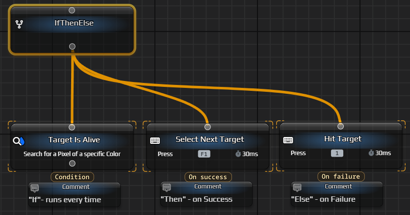

# Choose one branch after a condition

IfThenElse checks a condition once and runs one of two branches. The first child is the condition, the second is the branch for success, the third is the branch for failure. If, Then and Else are roles of the children, not fields for C# expressions.

## Test both routes without input

In your own loaded behavior tree, turn off automatic execution: **When Activated → Do nothing**. Add IfThenElse and connect three Fixed Status nodes to it, left to right:

```text
My Tree
└─ IfThenElse
   ├─ Fixed Status: Success    ← If
   ├─ Fixed Status: Failure    ← Then
   └─ Fixed Status: Success    ← Else
```

1. Set each child's **General → Status** as shown. In the IfThenElse panel, check **General → If**, **Then**, **Else**. They should show your nodes, not **not set**.
2. Click the upper **Tick BT Once**. The condition returns Success, Then runs and returns Failure. Else is not called. The result of IfThenElse is Failure: it is the branch's result, not the condition's.
3. Set the first child to Failure and click **Tick BT Once** again. Now Else runs and the result is Success.

Now replace the condition with a real check, and the branches with the actions you need or with a Sequence.

| Role or result | Behaviour |
| --- | --- |
| `If` / Condition | First enabled child. It selects the branch. |
| `Then` | Second enabled child. Runs after Condition Success. |
| `Else` | Third enabled child. Runs after Condition Failure. |
| Condition returns Running | IfThenElse returns Running. Neither branch starts yet. |
| Chosen branch returns Running | That branch continues on the next tick. Condition is not checked again. |
| Chosen branch completes | Its Success or Failure becomes the result of IfThenElse. The next pass starts at Condition again. |
| Chosen branch is absent | Failure. For example, a false condition without Else does not become Success. |

If you disable a child, it drops out of the list and the roles of the nodes after it can shift. You cannot set the condition to Failure this way. With no condition the node has nothing to check: fix the structure using the **If** / **Then** / **Else** panel.

If an aura already checks the condition, put [Aura Is Active](/en/behavior-trees/nodes/aura-is-active) in the **If** role and link it to that aura. Call ready-made actions through [Run Aura](/en/behavior-trees/nodes/execute-aura) in **Then** or **Else**: under **Auras → Links**, choose the aura where they are set up.

## Compare with Selector and Sequence



`Selector → Sequence(Condition, Then), Else` looks similar, but behaves differently when Then returns Failure: Selector can move on to Else. IfThenElse does not try the other branch after it has chosen Then.


An EyeAuras condition can itself pass execution to its single child after Success. So the old example can be written shorter:


Use [Sequence](/en/behavior-trees/nodes/sequence) when every step is required, [Selector](/en/behavior-trees/nodes/selector) when you need to go through options, and IfThenElse when there is one explicit decision.

<details>
<summary>Earlier abstract examples</summary>

Two sketches of choosing a strategy. The checks and actions are placeholders: you build them yourself from your own data.

```
IfThenElse
├── Condition: "Is the target a boss?"
├── Then: "Use special boss skills"
└── Else: "Use regular skills"
```

```
IfThenElse
├── Condition: "Is the character in a dangerous zone?"
├── Then: "Leave the dangerous zone"
└── Else: "Follow the regular route"
```

</details>
