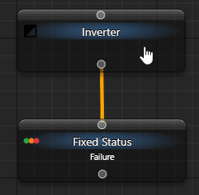

# Continue when a condition fails

Inverter flips its child's result: Failure becomes Success and the other way round. Use it when the next step should run after a check fails, for example when your aura's condition is not met.

## Inspect the mapping

Take a separate loaded tree with **When Activated → Do nothing** from [the first example](/en/behavior-trees/gettings-started). Add and connect:

```text
My Tree
└─ Inverter
   └─ Fixed Status: Failure
```

1. Set Fixed Status to **General → Status → Failure**. In **Inverter → General → Child**, check that this is the connected child.
2. Click the upper **Tick BT Once**. The child returns Failure. Inverter and the tree return Success.
3. Set the child to Success and tick again. Inverter returns Failure.
4. Set it to Running and tick again. Running stays Running. To finish, set the child back to Success or Failure and click the same button.



| Child result | Inverter result |
| --- | --- |
| `Success` | Failure. |
| `Failure` | Success. |
| `Running` | Running. |

Inverter needs one enabled child. Without it the editor shows an execution error, not one of the results from the table.

## Use your own condition

If you need the opposite of your own aura's result, replace Fixed Status with [Aura Is Active](/en/behavior-trees/nodes/aura-is-active) linked to that aura. For example, the aura can check that a window is there with Window Exists. Inverter flips **the node's result**, so first look at what the chosen node returns for Unknown and for source errors.

Inside a [Sequence](/en/behavior-trees/nodes/sequence), this Inverter lets later steps run only after the child's Failure. If the child has its own chain, the result of the whole chain is flipped, not just the first check.
