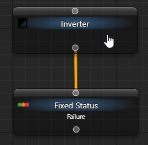

# Continue when a condition fails

Wrap a check in Inverter when your next step needs its opposite result. It swaps Success and Failure; it does not change the source aura's state.

## Inspect the mapping

Use a separate loaded tree with **When Activated → Do nothing**, following [the first example](/en/behavior-trees/gettings-started). Add and connect:

```text
My Tree
└─ Inverter
   └─ Fixed Status: Failure
```

1. Set Fixed Status to **General → Status → Failure**. In **Inverter → General → Child**, verify that this child is connected.
2. Click the upper **Tick BT Once**. The child returns Failure; Inverter and the tree return Success.
3. Change the child to Success and tick again: Inverter returns Failure.
4. Change it to Running and tick: Running passes through unchanged. Restore a terminal child status and use the same control to complete that route.



| Child result | Inverter result |
| --- | --- |
| `Success` | Failure. |
| `Failure` | Success. |
| `Running` | Running. |

Connect one enabled child. With none, execution reports an error rather than another status-table case. Inverter does not turn exceptions or cancellation into a successful check.

## Use your own condition

Replace Fixed Status with [Aura Is Active](/en/behavior-trees/nodes/aura-is-active) linked to your own aura—for example, one using Window Exists. First check how that node translates Unknown and source errors; inverting its result is not a generic boolean conversion of every aura state.

Inside [Sequence](/en/behavior-trees/nodes/sequence), Inverter admits later steps only after child Failure. If the child executes its own continuation, its complete result is inverted. Do not attach an input action to a check if your intent is only to read a condition.
