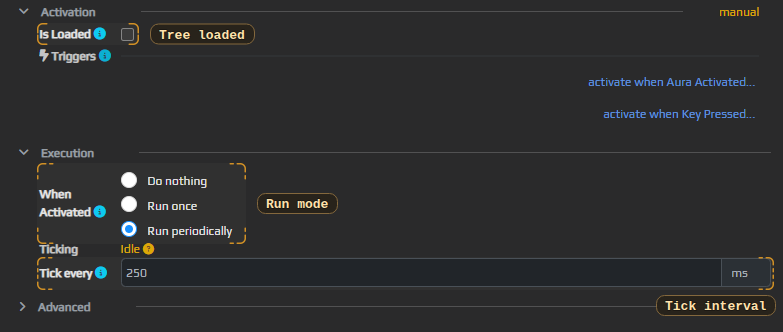

# Control when the main tree runs

Root is the tree's container. It holds the shared settings: whether the tree is loaded, what condition starts it and how often it runs. You cannot remove it like an ordinary child. One Root can hold several trees. **My Tree** on the graph is the entry of one tree, not the whole container.

| Object | What it selects |
| --- | --- |
| Root container | Loading, activation, period, shared settings and the set of trees. |
| Selected tree | The tree you are editing now and run with the upper **Tick BT Once**. |
| MainTree | The starred tree. It runs automatically. Opening another tab does not change it. |

## Enable periodic ticks with your own condition

First build a separate tree from the [no-input example](/en/behavior-trees/gettings-started) and run it by hand. You also need your own aura named `BT enabled` with one [Fixed Value](/en/triggers/fixed-value) and no actions. Leave it on **Is NOT Active** to start with.

1. Open the tree you need in the upper selector. Select its **My Tree** entry, and the shared settings appear.
2. **General → Is Main** should say **This Tree is the Main one**. If it does not, click **Make this Tree the Main one**. The star in the selector marks the tree that runs automatically.
3. Enable **Activation → Is Loaded**. Click **activate when Aura Activated...**, then select `BT enabled` in **Enabling Condition → Links**.
4. Set **Execution → When Activated → Run periodically**, with **Tick every = 250 ms**.

   

5. Switch your aura to **Is Active**. If activation and the global pause permit work, **Ticking...** appears and MainTree receives ticks. To stop automatic ticks, switch the aura back to **Is NOT Active**.

If **Pause Everything if Active** is on in the EyeAuras window settings, automatic work is paused while the main window is active. Move focus away from EyeAuras and watch how your tree behaves.

| Setting or state | Behaviour |
| --- | --- |
| `Is Loaded` | Permits execution. On unload, new ticks are rejected and running ones get a cancellation request. After they finish, the execution state is reset. The graph and saved data remain. |
| `Enabling Condition` | Linked auras permit automatic start. With no links and no triggers the mode is **manual**, not “always allowed”. |
| `activate when Key Pressed...` | Adds a **Hotkey Is Active** trigger to this container. Set its gesture and mode in its own editor. |
| `Do nothing` | No automatic calls. You can still tick a loaded selected tree by hand. |
| `Run once` | One tick when IsActive changes from false to true. It is not a loop until Running completes. |
| `Run periodically` | MainTree is ticked again and again while the conditions are met. |
| `Tick every` | The pause after a periodic tick has been processed, not a fixed-FPS guarantee. The real interval also includes the time the nodes take. |
| `Ticking` / `Idle` | Whether periodic ticks are going now, and why not. This is not the last node's result. |

Folder conditions, loading and the pause also affect execution. When you see **Idle**, read the explanation, such as **manual**, **paused**, **no main tree** or **no nodes to run**.

Manual entry, stopping and reset

The upper **Tick BT Once** runs the **selected tree** once. **Run** in a node's footer runs the **selected node**. A manual call can bypass the automatic activation conditions, so try it on a separate tree without input. **Is Loaded** is required here too.

The repeat button next to it keeps issuing manual ticks until you stop them. **Stop** cancels the call started from this panel, not all trees. Do not mix manual and automatic runs of an unfinished tree: the other caller can get Failure while the first one still holds its continuation.

**Reset node status** clears the displayed result, but not the timers or the route. Stopping automatic ticks is not a full reset of all nodes either. Unload requests a full cleanup after the current work finishes. An action that ignores cancellation can delay it.

Shared settings and additional trees

| Field or group | Purpose |
| --- | --- |
| `Settings → Target Window` | The shared target window for the nodes that use it. It is not a permission for background input. |
| `Settings → show more...` | More shared properties from connected modules, such as **Input Simulator**. Inheritance and bindings are covered in [default properties](/en/features/default-properties). |
| `Advanced → Is Shared` | The selected tree can be reused as a separate node. |
| `Advanced → References → Links` | Shared classes and other declarations from linked projects. Declarations outside `Script.csx` can be shared. Local values in `Script.csx` do not become another tree's global variables. |
| Selector's `New Behavior Tree` | Adds another tree to this container. To make it run automatically, set it as Main separately. |

The tree is shown as a graph or as a nested list, depending on what is saved in the configuration.

