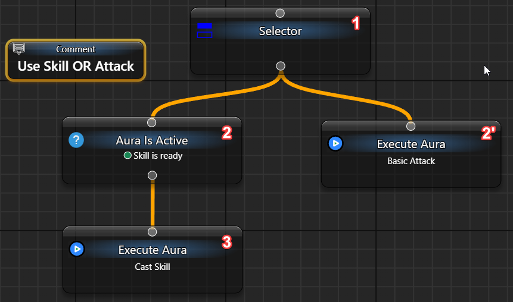
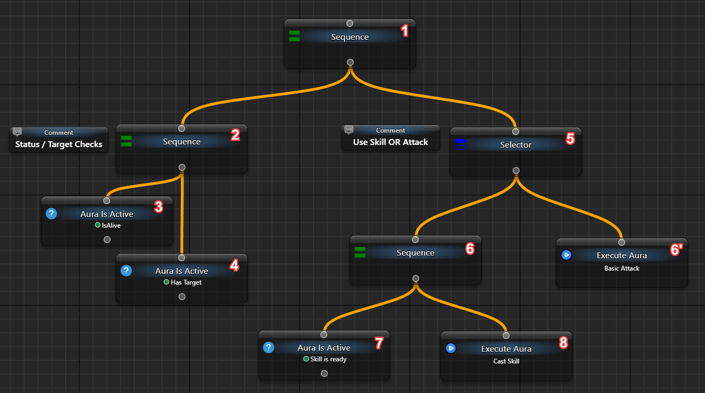

# Selector — choose the first successful branch

A Selector tries alternatives in priority order. A failed child lets it try the next one; a successful child ends the choice. Start with fixed results to see the order without sending input or depending on game data.

Use a separate **Behavior Tree**, following the [first-tree setup](/en/behavior-trees/gettings-started). This is a behavior-tree control-flow node, not a Macro Block.

## Observe one choice

1. Create **New Behavior Tree** and select its **My Tree** entry. Enable **Activation → Is Loaded** and set **Execution → When Activated → Do nothing** so the test uses manual ticks.
2. Add a **Selector** and three **Fixed Status** nodes through **Add new Node**. Connect My Tree to Selector and its children left to right. Name them `First`, `Second` and `Fallback`.
3. In **General → Status**, set First to **Failure**, Second to **Success**, and Fallback to **Success**.

```text
My Tree
└─ Selector
   ├─ First: Fixed Status = Failure
   ├─ Second: Fixed Status = Success
   └─ Fallback: Fixed Status = Success
```

4. Click the upper **Tick BT Once**. First fails, Second succeeds, and Fallback is not ticked. Selector returns **Success**.
5. Change Second to **Failure** and tick again: Fallback now supplies Success. Set all three to Failure for a Selector Failure result. These statuses describe node execution, not aura Active/Inactive/Unknown.

| Child result | Selector's next step |
| --- | --- |
| `Failure` | Tries the next enabled child; returns Failure if none succeeds. |
| `Success` | Returns Success and skips later alternatives in this pass. |
| `Running` | Returns Running immediately, retains that child and resumes there on the next tick. |
| No enabled children | Returns Failure. |

The graph's horizontal order determines traversal; vertical placement alone does not set priority. Disabled children are excluded. There is no separate numeric priority setting.

## Observe continuation with Wait

Replace Second with **Wait**, set **General → Delay = 1500 ms**, and turn randomisation off if Min/Max are shown. Keep First = Failure and Fallback = Success. The first tick returns **Running** at Wait and does not reach Fallback. After at least two seconds, use the same **Tick BT Once** again: Wait completes and Selector returns Success. The elapsed interval is not a promise of exact wall-clock scheduling.

While a child is Running, earlier alternatives are not retested. A new higher-priority condition therefore does not preempt retained work automatically. After a terminal result, the next pass starts from the first enabled child. Structural Reset clears the cursor; clearing displayed statuses alone does not. Unload closes tick admission, drains admitted work and resets owned execution before reload. Loaded-inactive or paused automatic execution is different from an unloaded root.

Cancellation and exceptions are separate from ordinary Failure, and effects already performed are not rolled back. A later failing condition cannot undo an input event already delivered.

<details>
<summary>Apply the same choice to your configured auras</summary>

The earlier example chooses a skill action when a separately configured “skill ready” aura is active, otherwise a basic action:

```text
Selector
├─ Sequence
│  ├─ Aura Is Active → your tested ready-condition aura
│  └─ Run Aura → your configured skill action aura
└─ Run Aura → your configured fallback action aura
```

[Sequence](/en/behavior-trees/nodes/sequence) keeps the condition and its reaction in one alternative. Without it, a successful condition directly under Selector would end the choice before the action. [Run Aura](/en/behavior-trees/nodes/execute-aura) calls the configured action collection; it does not discover readiness or guarantee that a game accepted an action.



The larger rotation first checks whether an action is appropriate, then chooses how to act. Its “alive”, “has target”, HP/MP, cooldown, town and target-priority checks require actual configured data sources. They are not built-in game facts. A configured action may use [Send Sequence](/en/actions/sendinput/send-sequence), with its own recipient and input requirements.



Unlike Selector, Sequence stops on the first Failure. Neither should be assumed to recheck previous conditions continuously while a later child is Running.


</details>
