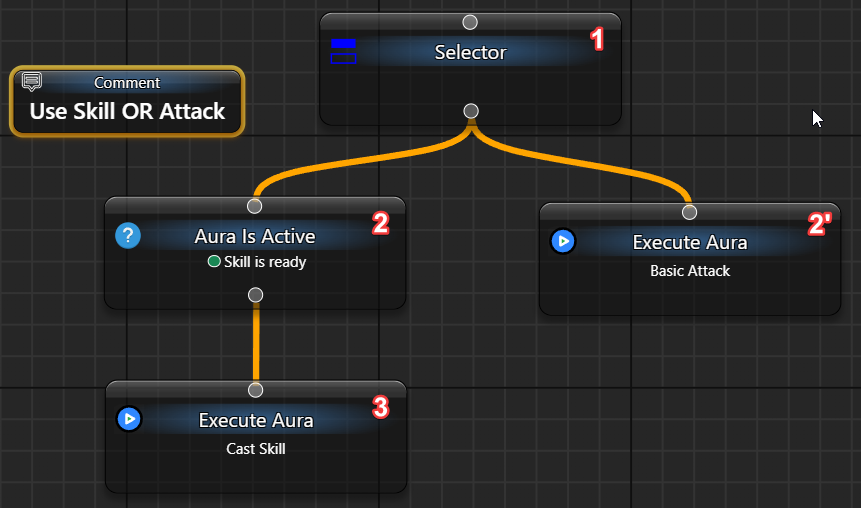
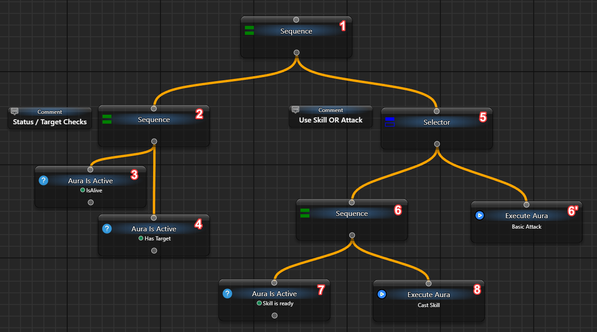

# Selector — choose the first successful branch

Selector goes through its children in order and stops at the first one that succeeds. If a child fails, it tries the next one. A typical task: use a skill if it is ready, otherwise make a basic attack.

First check the order with fixed results, without sending input or relying on game data. Use a separate **Behavior Tree** set up as in the [first-tree setup](/en/behavior-trees/gettings-started). This is a behavior-tree node, not a Macro Block.

## Observe one choice

1. Create **New Behavior Tree** and select its **My Tree** entry. Enable **Activation → Is Loaded** and set **Execution → When Activated → Do nothing**, so that the test uses manual ticks.
2. Through **Add new Node**, add a **Selector** and three **Fixed Status** nodes. Connect My Tree to Selector, and Selector to its children left to right. Name them `First`, `Second` and `Fallback`.
3. In **General → Status**, set First to **Failure**, Second to **Success** and Fallback to **Success**.

```text
My Tree
└─ Selector
   ├─ First: Fixed Status = Failure
   ├─ Second: Fixed Status = Success
   └─ Fallback: Fixed Status = Success
```

4. Click the upper **Tick BT Once**. First fails, Second succeeds, and Fallback is not ticked. Selector returns **Success**.
5. Set Second to **Failure** and tick again. Now Fallback gives the Success. Set all three to Failure, and Selector returns Failure.

| Child result | Selector's next step |
| --- | --- |
| `Failure` | Tries the next enabled child. Returns Failure if none succeeds. |
| `Success` | Returns Success and skips the later options in this pass. |
| `Running` | Returns Running right away and remembers that child. The next tick continues from it. |
| No enabled children | Returns Failure. |

The order is set by the children's horizontal position on the graph. Moving a child up or down does not change its priority. Disabled children are skipped. There is no separate numeric priority setting.

## Observe continuation with Wait

Replace Second with **Wait** and set **General → Delay = 1500 ms**. If Min/Max are shown, turn randomisation off. Keep First = Failure and Fallback = Success. The first tick returns **Running** at Wait and does not reach Fallback. Wait at least two seconds and click the same **Tick BT Once** again. Wait completes and Selector returns Success.

While a child is Running, Selector does not recheck the earlier options. Keep this in mind if you want to add an urgent branch with a higher priority: it will not interrupt the work already in progress. When the choice is finished, the next pass starts from the first enabled child again.

A structural Reset clears the remembered child. Clearing the displayed statuses does not. Unload rejects new ticks, lets the accepted work finish and resets the execution state before the next load. A loaded tree that is inactive or paused is not the same as an unloaded one.

Cancellation and errors are separate from an ordinary Failure. What has already been done is not rolled back: a condition that fails later cannot undo a key press that was already sent.

<details>
<summary>Apply the same choice to your configured auras</summary>

The earlier example runs a skill action when a separately configured “skill ready” aura is active, and a basic action otherwise:

```text
Selector
├─ Sequence
│  ├─ Aura Is Active → your tested ready-condition aura
│  └─ Run Aura → your configured skill action aura
└─ Run Aura → your configured fallback action aura
```

[Sequence](/en/behavior-trees/nodes/sequence) glues the check and its reaction into one option. Without it, the check would be a separate child of Selector, and its success would end the choice before the action. [Run Aura](/en/behavior-trees/nodes/execute-aura) calls the actions configured in the aura.



The larger rotation first checks whether it makes sense to act, then chooses how. Its “alive”, “has target”, HP/MP, cooldown, town and target-priority checks each need a data source that you configure yourself. A configured action may use [Send Sequence](/en/actions/sendinput/send-sequence), which has its own target and input requirements.



Unlike Selector, Sequence stops on the first Failure. Neither of them keeps rechecking earlier conditions while a later child is Running.


</details>
