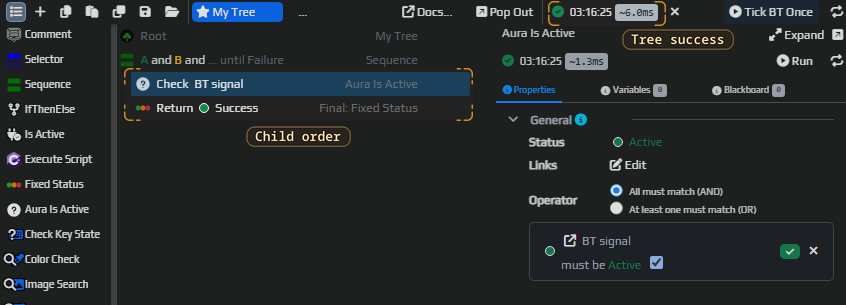
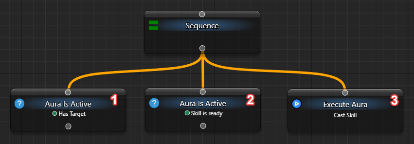
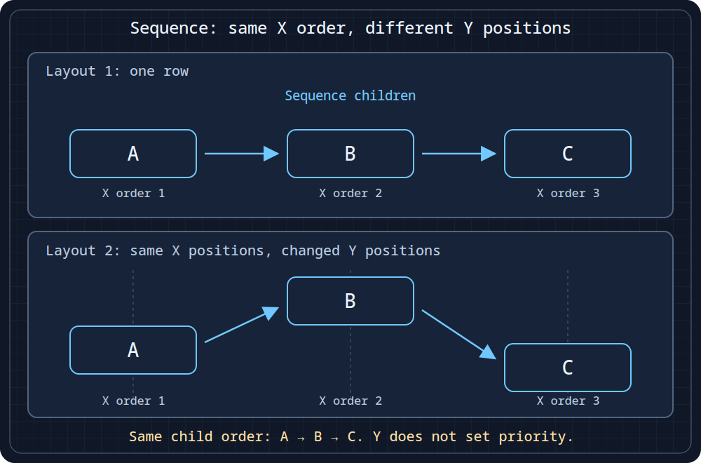
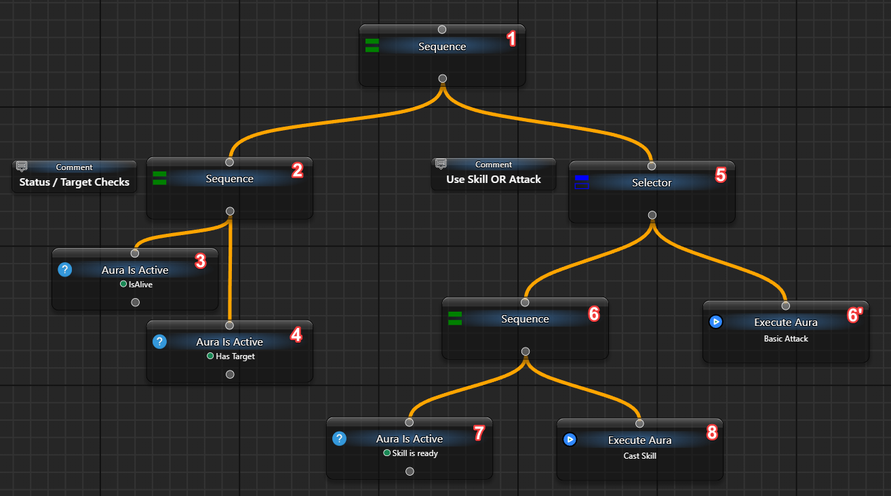
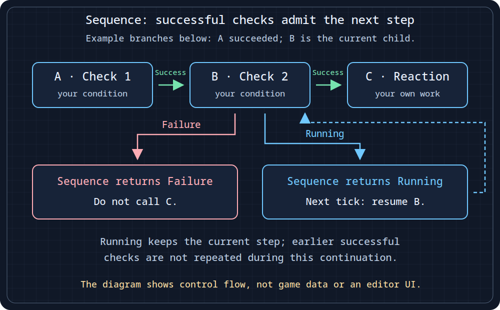

# Run required steps in order

Sequence runs its children one after another: the next step starts only after the previous one succeeds. For example, first check a permission, then wait, and only then go on.

## Observe stopping and continuation

Take your own loaded tree with **When Activated → Do nothing**, as in [the first example](/en/behavior-trees/gettings-started). Add the nodes, connect them and place Sequence's children left to right:

```text
My Tree
└─ Sequence
   ├─ Fixed Status: Failure
   ├─ Wait: 1500 ms
   └─ Fixed Status: Success
```

1. Set the first child to **General → Status → Failure** and the last one to **Success**. Give Wait a fixed **Delay = 1500 ms**.
2. Click the upper **Tick BT Once**. Sequence stops at the first child with Failure. Wait and the last child do not run.
3. Change the first child's **parameter** to Success and click **Tick BT Once** again. Now execution reaches Wait and returns Running.
4. Wait two seconds and click the same button once more. Sequence continues from Wait, runs the last child and returns Success.

The first child, already passed, is not checked again on continuation. A tick after completion starts the sequence from the beginning.

| Child result or structure | Sequence result |
| --- | --- |
| `Success` | Moves on to the next child in the same tick. |
| `Failure` | Returns Failure right away. Later children do not run. |
| `Running` | Returns Running and remembers this child for the next tick. |
| All enabled children succeed | Success. The next pass starts with the first child. |
| No enabled children | Success, but nothing is done. |
| Disabled child | Left out of execution, not counted as Failure. |

In a graph, the order of children follows their horizontal position, left to right. Moving a child up or down does not change it. In a nested list, the order is the order of the rows and the nesting.



**Important:** while Sequence continues a Running child, it does not recheck the earlier conditions. If a permission can disappear during long work, build the interruption separately.

<details>
<summary>Conditions, child order and historical examples</summary>

Instead of Fixed Status you can put **Aura Is Active** linked to your own aura.



A tree laid out vertically works the same way, as long as the horizontal order is kept:



[SVG source](/assets/wiki-media/m051-concept.svg).

A large task is easier to split: the first Sequence gathers the common permissions, then [Selector](/en/behavior-trees/nodes/selector) picks a priority action or a fallback.



Here the `Is Alive` and `Has Target` checks are already set up in their own auras. The ready branch calls Execute Aura, which can contain [Send Sequence](/en/actions/sendinput/send-sequence). The other branch is the fallback.

How checks in a row work before a reaction:



[SVG source](/assets/wiki-media/m052-concept.svg).

</details>

To pick the first successful alternative, you need Selector. For an explicit choice on one condition, use [IfThenElse](/en/behavior-trees/nodes/ifthenelse) instead of repeating the same condition in several branches.
