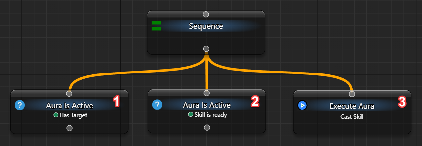
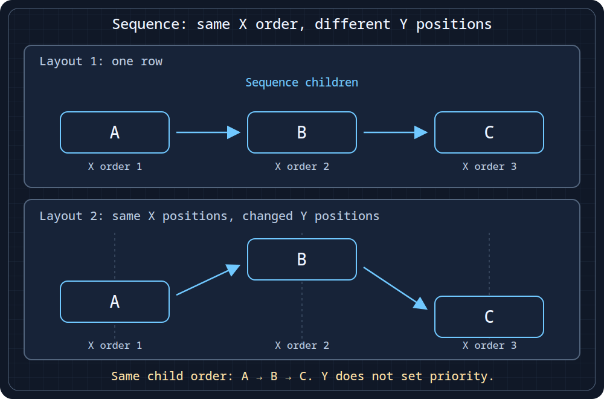
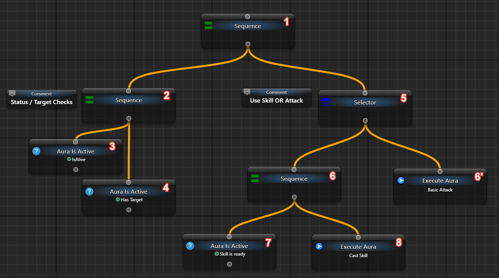
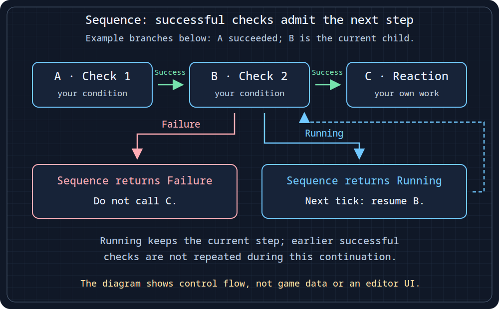

# Run required steps in order

Use Sequence when the next step should run only after the preceding step succeeds. Start with a test condition, an elapsed-time wait and a final result, without external actions.

## Observe stopping and continuation

Use your own loaded tree with **When Activated → Do nothing**, as in [the first example](/en/behavior-trees/gettings-started). Add, connect and arrange the children left to right:

```text
My Tree
└─ Sequence
   ├─ Fixed Status: Failure
   ├─ Wait: 1500 ms
   └─ Fixed Status: Success
```

1. Set the first child's **General → Status → Failure** and the final child's **Success**. Give Wait a fixed **Delay = 1500 ms**.
2. Click the upper **Tick BT Once**. Sequence returns Failure at the first child; Wait and the final child do not execute.
3. Change the first child's **parameter** to Success and tick again. Execution reaches Wait and returns Running.
4. Wait two seconds, then click the same **Tick BT Once**. Sequence resumes Wait, runs the final child and returns Success.

You have observed different routes in the same tree. The already successful first child is not retested during continuation. After terminal completion, another tick starts from the beginning.

| Child result or structure | Sequence result |
| --- | --- |
| `Success` | Continue to the next child in this tick. |
| `Failure` | Return Failure immediately; skip later children. |
| `Running` | Return Running and retain this child for the next tick. |
| All enabled children succeed | Success; the next pass starts with the first child. |
| No enabled children | Success, without performing work. |
| Disabled child | Excluded from execution, not treated as a failed check. |

In a graph, child order follows horizontal position, left to right. Moving a child vertically alone does not change it. In a nested list, follow the displayed order and nesting.

An ordinary Sequence does not continuously recheck earlier successful conditions while resuming Running work. If permission can disappear during a long action, design interruption separately. Clearing displayed status does not clear the retained cursor; stopping ticks alone is not a full reset. Completing the pass or fully unloading and draining your own tree permits a fresh run. Use the same entrypoint to continue: another caller can be refused while the route is owned.

<details>
<summary>Conditions, child order and historical examples</summary>

Replace Fixed Status with **Aura Is Active** linked to your own configured aura when ready. The earlier example checks two prepared conditions before **Execute Aura**:



The data must come from those auras, such as real pixel search; the nodes do not supply game state themselves.



Conceptual diagram: A, B and C keep the same horizontal order despite different heights. Arrows show child order, not a promise that every child executes regardless of its result. This is not an editor screenshot. [SVG source](/assets/wiki-media/m051-concept.svg).

A larger route can group common permissions in one Sequence, then use [Selector](/en/behavior-trees/nodes/selector) to choose a priority action or fallback:



Here `Is Alive` and `Has Target` are already configured aura checks. A ready branch calls Execute Aura, which can contain [Send Sequence](/en/actions/sendinput/send-sequence); the other branch is the fallback. HP, resource, cooldown or target-priority checks likewise need actual sources. This example does not introduce a built-in rotation or HP reader.



Conceptual diagram: after A succeeds, B is checked. B's Success admits C; Failure ends Sequence without C; Running retains B for the next tick without replaying successful A. Checks can read your own auras. The diagram specifies neither their data source nor a ready program or editor interface. [SVG source](/assets/wiki-media/m052-concept.svg).

</details>

[Selector](/en/behavior-trees/nodes/selector) stops at the first successful alternative; Sequence requires all admitted steps to succeed. For one explicit conditional choice, use [IfThenElse](/en/behavior-trees/nodes/ifthenelse).
