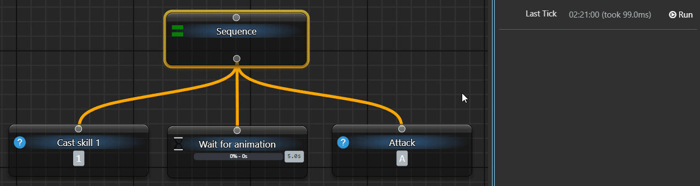

# Wait before the next step

Wait measures elapsed time from its first call and returns Running until the interval ends. It does not observe whether an image appeared or another application's operation finished.

## Complete a delay with manual ticks

Use a separate loaded tree with **When Activated → Do nothing**. Add and connect:

```text
My Tree
└─ Sequence
   ├─ Wait: 2000 ms
   └─ Fixed Status: Success
```

1. Set **Wait → General → Delay = 2000** in the **ms** field. If Min/Max appear, turn randomisation off with the shuffle button.
2. Set **Fixed Status → General → Status → Success**.
3. Click the upper **Tick BT Once**. Wait and Sequence return Running; the second child is not called. The control becomes available again rather than blocking the application for two seconds.
4. Wait more than two seconds and click the same **Tick BT Once**. Wait succeeds, Fixed Status executes and the pass succeeds.
5. Tick after completion to start a new interval: Wait returns Running again.

Elapsed time alone does not run the next step in this manual example; another tick is required. With periodic execution, [Root](/en/behavior-trees/nodes/root) supplies later ticks.

| Field or operation | Behaviour |
| --- | --- |
| `Delay`, `ms` | Fixed duration in milliseconds; 2000 ms is two seconds. |
| Shuffle button | Enable a random duration and show Min/Max. |
| `Min` / `Max` | Bounds for a duration selected once at interval start, not again on every tick. |
| Changing Delay | Clears the current interval. The next call uses the new setting. |
| `Delay = 0` | Can return Success immediately, without adding a pause. |

Wait compares its deadline with the application's monotonic elapsed clock, without sleeping synchronously for the whole interval. Before expiry it returns Running; after expiry it clears its start and returns Success. Actual continuation depends on the next tick, not an exact wall-clock scheduling guarantee.

## Know what is waiting

Later Sequence children wait for this route. Other auras, trees and independent work keep running. Earlier successful conditions need not be replayed when the parent resumes.



The earlier skill/attack animation illustrates order and a delay. It does not establish completion of a game animation or arrival of an external event. Use a real condition for those observations. [Cooldown](/en/behavior-trees/nodes/cooldown) limits frequency rather than delaying the next step; it is not an interchangeable replacement for every Wait.

<details>
<summary>Child continuation, stopping and cleanup</summary>

After the interval, Wait can execute its single enabled child under the action-node contract. If that child returns Running, later ticks continue it without starting the delay again. There is no independent forced-result field in Wait's editor; Fixed Status is a separate test node.

**Reset node status** only clears display. Stopping periodic ticks does not guarantee a fresh timer. For another experiment, finish the pass, change Delay or unload/reload your own tree after cleanup completes.

Unload closes tick admission, requests cancellation and resets the timer after active calls drain. Footer **Stop** cancels only the call issued by that panel, not all auras. Cancellation cannot instantly terminate arbitrary child code that ignores it.

</details>
