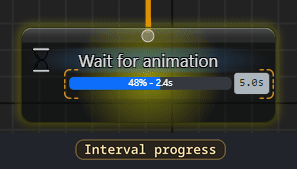
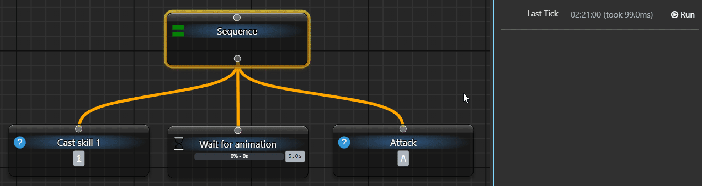

# Wait before the next step

Wait is a pause in a sequence. It measures time from its first call and returns Running until the interval ends. Wait only waits for time: it does not check whether an image appeared or an operation in another application finished.

## Complete a delay with manual ticks

In a separate loaded tree, choose **When Activated → Do nothing**, so that automatic ticks do not get in the way. Add Sequence, Wait and Fixed Status and connect them:

```text
My Tree
└─ Sequence
   ├─ Wait: 2000 ms
   └─ Fixed Status: Success
```

1. In **Wait → General → Delay**, enter 2000 in the **ms** field. If Min/Max appear, turn randomisation off with the shuffle button.
2. Set **Fixed Status → General → Status → Success**.
3. Click the upper **Tick BT Once**. Wait and Sequence return Running, and the second child does not run. The button becomes available again: waiting does not block the application.

   

4. Wait more than two seconds and click **Tick BT Once** again. Wait returns Success, Fixed Status runs and the whole pass succeeds.
5. One more click after completion starts a new interval: Wait returns Running again.

When you tick by hand, time alone does not start the next step. A new tick is needed. With periodic execution, the [Root](/en/behavior-trees/nodes/root) container gives that tick.

| Field or operation | Behaviour |
| --- | --- |
| `Delay`, `ms` | Fixed pause in milliseconds. 2000 ms is two seconds. |
| Shuffle button | Turns on a random pause and shows Min/Max. |
| `Min` / `Max` | Bounds of the random interval. The value is picked once when the wait starts, not on every tick. |
| Changing Delay | Clears the current interval. The next call starts waiting with the new setting. |
| `Delay = 0` | Wait can return Success right away, with no pause. |

Wait does not “sleep” the whole time. It compares the deadline with the application's clock. Continuation depends on the next tick, so Wait does not fire at the exact millisecond.

If the next step depends on the state of your indicator, use [Until Success](/en/behavior-trees/nodes/until-success) with [Aura Is Active](/en/behavior-trees/nodes/aura-is-active) linked to its aura. Choose the expected state in that check.

## Know what is waiting

While Wait returns Running, the later Sequence children do not run. Other auras, trees and independent work go on as usual. The parent continues from the same place and does not necessarily recheck all earlier conditions.



If you only need to limit how often something repeats, look at [Cooldown](/en/behavior-trees/nodes/cooldown). It does a different job.

<details>
<summary>Child continuation, stopping and cleanup</summary>

Wait can have one child. It starts running after the pause, by the general rules of an action node. If the child returns Running, the next tick continues the child and does not start the pause again.

**Reset node status** clears the displayed result, not Wait's deadline. Stopping periodic ticks does not guarantee a fresh countdown on the next entry either. To start the experiment over, finish the current pass, change Delay, or unload and reload the tree after cleanup completes.

Unload rejects new ticks and requests cancellation of the current work. When the calls finish, the full reset clears the timer too. The **Stop** button in the panel cancels only the call started from that panel.

</details>
