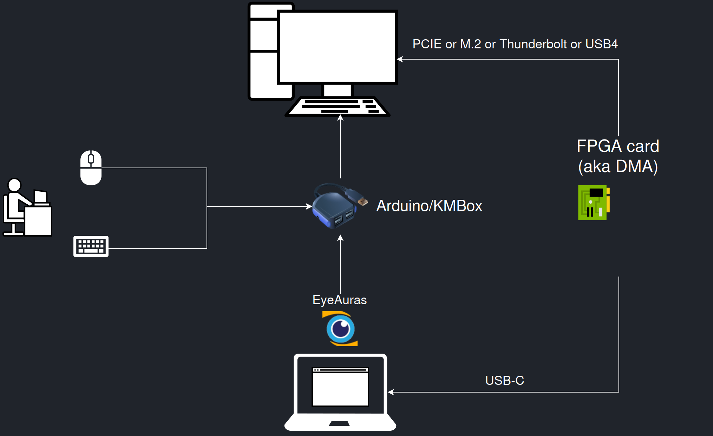
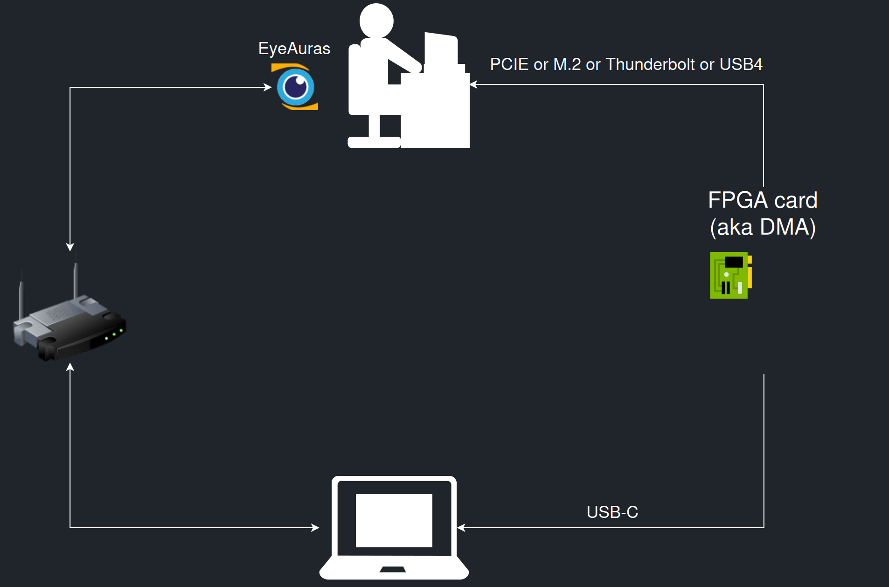

# Prepare EyeAuras for a DMA source

FPGA access needs two separate prerequisites: a prepared memory-acquisition source and an EyeAuras distribution containing **EyeAuras.Memory.MPFS**. An ordinary Memory API reference or a board alone does not make that source ready.

Start by identifying the computers' roles and checking module loading. The [DMA example](/en/features/dma) then lists visible processes. Connecting hardware does not create game-state indicators or actions.

## Check a prepared environment

1. Identify the **target computer** whose memory you intend to inspect, and the computer running the reader. Start with your own prepared system and a known test process.
2. Obtain a compatible distribution containing **EyeAuras.Memory.MPFS**, its MemProcFS/LeechCore native libraries and support for your acquisition device. Its module directory must include **x64/bin-mpfs**, including `vmm.dll` and `leechcore.dll`. Do not assemble it from unrelated DLL versions.
3. In that distribution, open the status-bar item whose tooltip is **Open module monitor**, then select **Modules**. Find **MpfsMemoryModule** and inspect its loading state and errors. **Assemblies** separately lists **EyeAuras.Memory.MPFS**; an assembly's presence does not establish hardware readiness.
4. Compare your topology with the figures below. For a device locally connected to the analysis computer, the script source starts with **LCProcess.FPGA()**. Remote acquisition needs its own prepared endpoint; the target computer's IP address alone is insufficient.
5. Continue to the [process-list example](/en/features/dma) once the module and source are ready. A module-loading error calls for checking the compatible distribution before changing addresses in a script.

The preparation result is an identified module and understood device roles. It is not yet a successful memory read or a write test. Module access and licensing must match the distribution supplied to you; a source file, SDK reference or method name does not grant access or initialize a provider.

| Prerequisite | Why it matters |
| --- | --- |
| Windows and application architecture | This module's native set is under `x64/bin-mpfs` and must match the application. |
| FPGA and connections | LeechCore and the environment must support the device. PCIe, M.2, Thunderbolt or USB4 labels do not make every adapter compatible. |
| Device USB driver | FT601 on Windows needs the appropriate FTDI driver. A bundled `FTD3XX.dll` does not demonstrate that driver installation. |
| MemProcFS / LeechCore | Acquires memory and reconstructs a process view, rather than supplying an API for a particular game's data. |
| MPFS module | Initializes the native environment and adds its assembly to script references. A `using` directive does not load it. |
| Test-process PID | Must identify the target system's process, not an unrelated process with the same PID on another computer. |

## EyeAuras on the analysis computer

The upper computer is the target; the lower computer runs the analysis program. The FPGA path acquires memory. The separate **Arduino/KMBox** path handles input in the illustrated setup; DMA itself does not send keyboard or mouse events. Mouse and keyboard arrows feed that separate device.

The two paths have different roles: FPGA memory acquisition and Arduino/KMBox input. [Original SVG diagram](/assets/wiki-media/m070-original.svg).

## EyeAuras on the main computer

Here EyeAuras is beside the main computer, while the other computer and router connections are shown separately. Such a setup needs an agreed data-transfer path between its components. The figure does not mean that local `LCProcess.FPGA()` automatically discovers a device connected to another computer.

Main-PC placement with the other computer's connections shown separately. [Original SVG diagram](/assets/wiki-media/m071-original.svg).

Consult the [LeechCore author](https://github.com/ufrisk/LeechCore) for acquisition-source and device requirements. If you only need your own ordinary local process, start with [reading a known value](/en/scripting/examples/advanced/memory/rpm-read), which does not require DMA.
