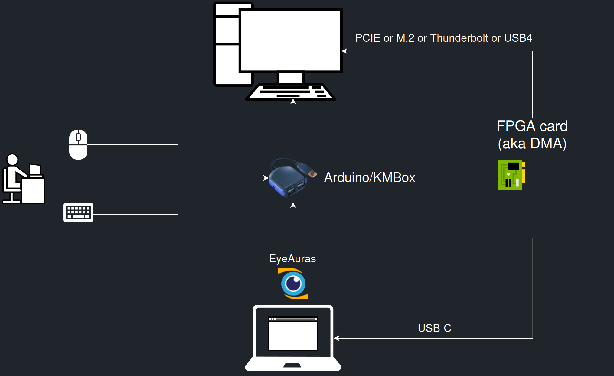
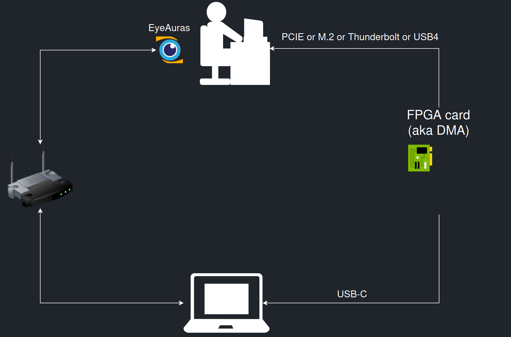

# Prepare EyeAuras for a DMA source

To read memory through an FPGA you need two things: a prepared memory source and an EyeAuras distribution that contains the **EyeAuras.Memory.MPFS** module.

On this page you work out the roles of the computers and check that the module has loaded. The [DMA example](/en/features/dma) shows how to get a process list for the first time.

## Check a prepared environment

1. Decide which is the **target computer** (the one whose memory you inspect) and which computer runs the memory reader. For a first try, use your own prepared system and a known test process.
2. Get a compatible distribution with **EyeAuras.Memory.MPFS**, the MemProcFS/LeechCore native libraries and support for your device. Its module directory must include **x64/bin-mpfs** with `vmm.dll` and `leechcore.dll` inside. Do not assemble it from DLLs of random versions.
3. Start that EyeAuras distribution. In the status bar, click the item with the **Open module monitor** tooltip and select **Modules**. Find **MpfsMemoryModule** and check whether it has loaded and whether there are errors. On **Assemblies** you can separately check that the **EyeAuras.Memory.MPFS** assembly is there.
4. Compare your setup with the diagrams below. If the device is connected directly to the analysis computer, the script starts with **LCProcess.FPGA()**. To get memory over the network you need a separately prepared remote source. The target computer's IP address alone is not enough.
5. When the module and the source are ready, go on to the [process-list example](/en/features/dma). If the module did not load, fix the distribution first.

| Prerequisite | Why it matters |
| --- | --- |
| Windows and application architecture | The module's native files are in `x64/bin-mpfs` and must match the application. |
| FPGA and connections | Your LeechCore and environment must support the device and its interfaces. The PCIe, M.2, Thunderbolt and USB4 labels on the diagram do not mean any adapter will fit. |
| Device USB driver | FT601 on Windows needs the right FTDI driver. A bundled `FTD3XX.dll` does not mean the device driver is installed. |
| MemProcFS / LeechCore | Get the memory and rebuild the picture of processes. |
| MPFS module | Initializes the native environment and adds its assembly to script references. An SDK reference or a `using` directive does not load the module. |
| Test-process PID | Must belong to a process on the target system, not to a process on another computer that happens to have the same PID. |

## EyeAuras on the analysis computer

In the first diagram EyeAuras runs on the analysis computer. One path goes to the data through the FPGA, the other to a separate input device. DMA itself does not press keys or move the mouse.

[Original SVG diagram](/assets/wiki-media/m070-original.svg).

## EyeAuras on the main computer

In the second diagram EyeAuras runs on the main PC, and the connections to the other computer are shown separately. In this setup the data has to travel between the computers somehow, and you need to set up that path. A local `LCProcess.FPGA()` will not find a device connected to another computer on its own.

[Original SVG diagram](/assets/wiki-media/m071-original.svg).

For memory sources and hardware preparation, see the [LeechCore author](https://github.com/ufrisk/LeechCore). If you only need an ordinary process on your own computer, start with [reading a known value](/en/scripting/examples/advanced/memory/rpm-read). You do not need DMA for that.
