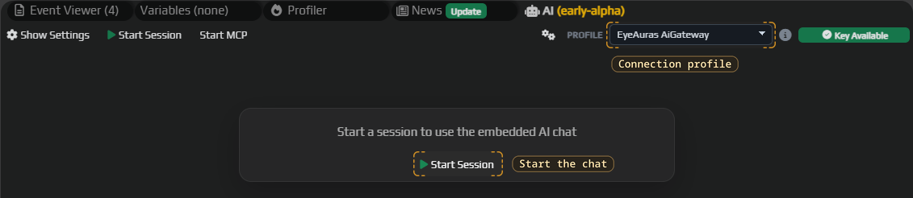
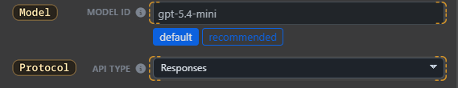
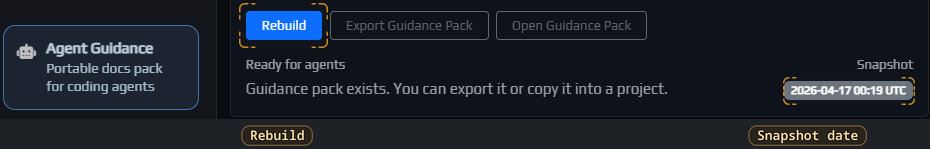

# AI Assistant

AI Assistant is the chat in the **AI** tab. Ask it how to set something up in EyeAuras, have it find an article, or go through a script with it. For the chat to work, you need to choose a connection profile for a model.

The feature is still changing. Answers and code can contain mistakes, so check them before you use them. For chats that edit a project, see [AI Codex Coding Assistant](/en/features/ai-codex-coding-assistant).

## How to start

1. Open **AI**, select **Chat** and choose a profile. The profile sets the model, the server address and the way you sign in.
2. If you need your own key, open **Manage Profiles** and enter it in **API Key**. You can enter an environment variable instead. Do not paste a key into the chat itself, and do not attach sensitive images or files.
3. Click **Start Session**.
4. Ask a specific question, for example: “Which trigger and overlay show my own text only while a chosen window is active?” If you are sorting out an error, add its full text and your EyeAuras version.

A `Ready` or `Key Available` status only means the key was found. It does not check the server, access to the model or account limits.

If your question is about the active window, compare [Window Is Active](/en/triggers/window-is-active) with [Enabling Conditions](/en/features/enabling-conditions). While you check the answer, show a [Text overlay](/en/overlays/text) first and add input later.



## Which profile to choose

| Profile | Connection |
| --- | --- |
| OpenAI | Your own API key. Take the profile from a template. Costs depend on your account with the provider. |
| EyeAuras Gateway | The EyeAuras server. **API Key** is `%EYEAURAS_TOKEN%`, **Endpoint** is `https://eu.openai.eyeauras.net`. It uses the token of your EyeAuras account. |
| Ollama | A model on your own computer. Start Ollama, set **Endpoint** to `http://localhost:11434/v1`, **API Type** to `ChatCompletions` and put the name of an installed model, such as `llama3`, in **Model Id**. A key is normally not needed. |
| Another compatible server | Its address, model name and key, if the server asks for one. |

You do not have to use Gateway. For questions about access to it, see [support contacts](/en/contacts).


The **Manage Profiles** window:

| Setting | What it does |
| --- | --- |
| `Name` | Profile name in the list. For example, OpenAI or Ollama local. |
| `API Key` | An access key or an environment variable. A key typed here is stored in the profile. |
| `Endpoint` | API address. For OpenAI keep the one from the template. For another server enter its address. |
| `Model Id` | Model name at the provider, such as `gpt-5.4`, `gpt-5.4-mini` or `llama3`. Start with the value from the template. |
| `API Type` | `Responses` or `ChatCompletions`, whichever the server supports. |
| `Reasoning Effort` | How much effort the model puts into thinking over the answer. To begin with, keep the value from the template. |
| `Max Context Tokens` | Context size. EyeAuras uses it to show how full the context is. It does not change the model's own limit. |
| `Function Calling` | Gives the model EyeAuras tools, including documentation search. Usually best left on. |



An environment variable in **API Key** looks like this:

```text
%OPENAI_API_KEY%
```

`ChatCompletions` works with OpenAI, Azure OpenAI, Ollama and compatible servers. Anthropic models need an OpenAI-compatible proxy. `Responses` does not work with Azure OpenAI. The protocol itself is described in [OpenAI's API reference](https://developers.openai.com/api/reference/responses/overview).

Streaming, images and tools also depend on the model and the API type.

## Context and tools

A chat session keeps its own conversation and profile. **IDE Context** in **Show Settings** also gives the model the current EyePad workspace. It is off until you turn it on.

Connected tools can change things even if you asked the model only to look. Review what it did.

To stop an answer you do not want, use the cancel button in the chat. Switching to another view does not stop it.

Top-level script names such as `Log`, `AuraTree` and `Variables` are not available in ordinary C# classes or Razor components, even if an AI answer uses them there. See [scripting practices](/en/scripting/best-practices).

Codex is a separate mode with its own threads. It does not see the history of the ordinary **Chat**. Browser login for Codex shows `Unavailable` in EyeAuras.

<details>
<summary>Show Settings</summary>


For an ordinary chat you usually do not need to change these.

| Setting | What it does |
| --- | --- |
| `Docs Knowledge Base` | Connects the documentation to the AI chat and MCP. |
| `Docs Repository` / `Docs Path` | Documentation repository and the folder of its local cache. |
| `Artifact Store` | Lets the chat save artifacts if the server supports it. |
| `MCP Port` / `Enable MCP On Startup` | MCP server port and whether it starts automatically. |
| `Enable Browser Automation` / `Browser Debug Port` | Turns on browser tools and sets the debug port. Restart EyeAuras after changing browser automation. |

</details>

## Agent Guidance

Agent Guidance collects EyeAuras documentation, examples, SDK notes and MCP status into one folder for an external agent such as Codex, Claude Code or Cursor. It does not install the agent.

1. Open **AI → Show Settings → Agent Guidance** and click **Rebuild**.
2. Open the result with **Open Guidance Pack** or save it as an archive with **Export Guidance Pack**.
3. To add it to a project, click **Add to C# Project** or **Add to Solution**. For a solution, EyeAuras looks for a C# project with the same name as the solution.
4. Point the agent to the copied folder and the `AGENTS.md` inside it.



The pack contains `AGENTS.md`, `README.md`, `manifest.json`, `mcp-status.json` and `docs/`. In the project it goes here:

```text
generated/ai
```


When you add the pack again, this folder is replaced completely, so keep your own files elsewhere. The project's existing `AGENTS.md` is not overwritten.


If the agent needs to query a running EyeAuras, turn on MCP. After you turn MCP on or off, click **Rebuild** again to update the pack.

## If the session does not start

| Symptom | What to check |
| --- | --- |
| `Unavailable` or missing key | Check **API Key** and the value of the environment variable, if you used one. Gateway needs an available EyeAuras token. |
| Connection error | Check **Endpoint** and the network. For Ollama, make sure the local server is running. |
| Model or API error | Compare **Model Id** and **API Type** with your provider's settings. |
| An answer that sounds right but is wrong | Ask for the source, give your build and task, and check the article before you use the answer. |

Related pages: [Codex](/en/features/ai-codex-coding-assistant), [Discord Bot](/en/features/discord-bot), [scripting basics](/en/scripting/getting-started) and [scripting practices](/en/scripting/best-practices).
