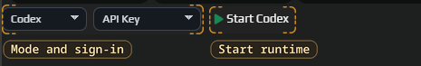
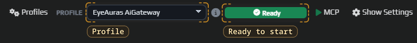
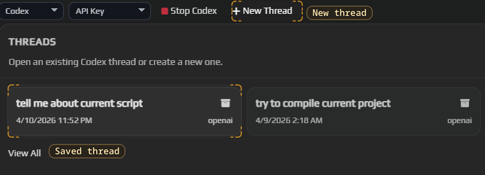

# Go through your script with Codex in EyePad

Codex is an AI assistant mode for working with code. It sees the project open in EyePad and can use EyeAuras tools. Ask it to explain how your script works or to make a small change. For a question about a setting or the documentation, the regular [AI Assistant](/en/features/ai-assistant) is usually enough.

What you need:

- a build with the `AI` tab and `Codex` mode
- a compatible **OpenAI** profile that uses **API Key**. Direct OpenAI works, and so does a compatible `EyeAuras Gateway / AiGateway`
- a model available through that connection

The endpoint address must not have parameters after `?`. Codex works through the Responses API, so an arbitrary Chat Completions address will not do. Azure, Anthropic and Ollama profiles are not automatically compatible with this mode, even if they work in the ordinary chat.

## Start by asking about your own project

1. Open a small `Script.csx` of your own in [EyePad](/en/features/eyepad). For the first try, take a copy of the project that you do not mind changing.
2. Open `AI`, switch `Chat` to `Codex`, and select the profile and `API Key`. If you need to, set the endpoint and key in `Show Settings`, as described in [AI Assistant](/en/features/ai-assistant).

   
3. Make sure the status is `Ready`, then click `Start Codex`. A separate Codex runtime starts. Wait for the list of models and conversations.
4. Click `New Thread` and choose a model from the list. Write: “Explain what Script.csx does in the current EyePad project. Name the files and dependencies you use. Do not edit code yet.”
5. Compare the answer with the open files. In the same thread you can then ask for one small change and review the changed code.
6. When you are done, click `Stop Codex`. Going back to the thread list does not stop the work.

| Setting | What it is for |
| --- | --- |
| OpenAI profile and `API Key` | Set the endpoint and access to the model. |
| Model | Chosen from the models of the connection. |
| `reasoning` | Reasoning level available for the chosen model. |
| `Docs Knowledge Base` | Gives the assistant the EyeAuras documentation, so it can look up exact API details there. |
| IDE / EyePad context | Passes the working project and the tools for viewing and changing it. |
| `Start Codex` / `Stop Codex` | Start and stop the runtime the assistant works in. |

`ChatGPT Login` shows `Unavailable` in a normal build for now. Use `API Key`. This mode has nothing to do with signing in to your EyeAuras account through an [external provider](/en/features/external-providers). With an API key, usage is charged as [API billing](https://learn.chatgpt.com/docs/agent-configuration/speed), not through a ChatGPT subscription.

## Threads and working files

A `Thread` is a separate task with its own history, state, model and reasoning level. In the list you can reopen a thread or archive it, and show the remaining and archived entries. It is handy to keep an error investigation and a new feature in different threads.

If you switch to another thread, the task in the previous one keeps running. To stop it, stop it yourself. The history of the ordinary `Chat` is not carried over to Codex.

In EyePad the agent gets the current working context. The context and the set of tools are refreshed before each request. The agent may be able to write to a connected project folder. A file attached to a message for reading is a different thing: it does not let the agent change the whole folder. Do not expect the agent to ask before every edit. Inside the allowed working area it can change files on its own. Review the result afterwards and save the project as usual.

Sometimes Codex asks for extra permission to run a command or change files beyond what it already has. For now the integration declines such requests, and there is no dialog to choose. Writing is limited to the configured working areas. Reading is not: do not assume the agent reads only those folders. If sensitive files are nearby, think ahead about which project and context you open.

What to ask Codex

Codex can explain a compilation error, look through an EyePad or multi-file script project, plan a refactor, or work on code used by a behavior tree, macro or mini-app. Say what result you expect and which files matter. If the change touches several things at once, ask for a plan first.

Which features are available depends on the model list and the installed runtime. For reference questions, the ordinary Chat is still useful.

Agent Guidance and external editors

`Show Settings` contains [Agent Guidance](/en/features/ai-assistant#agent-guidance). For an external agent, click `Rebuild`, then `Add to C# Project` or `Add to Solution`. A `generated/ai/` folder appears with instructions, a documentation snapshot and metadata. Its `AGENTS.md` is the entry point of this pack. It does not replace your project's root instructions.

The built-in Codex gets the documentation anyway. External agents such as Codex, Claude Code or Cursor need their own connection and setup. See [IDE integration](/en/scripting/ide-integration) and [scripting practices](/en/scripting/best-practices). MCP gives a connected client tools for working with EyeAuras context.

EyeAuras talks to the Codex process through [App Server](https://developers.openai.com/codex/app-server). Features of its newer versions arrive only with a new EyeAuras build. If you need a quick hint without a local project, there is [Discord Bot](/en/features/discord-bot).

