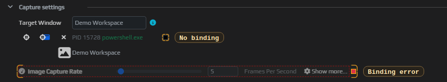
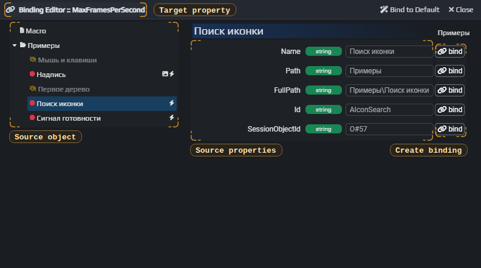

# Bindings — edit a shared value in one place

A binding links one property to another. Say the same reminder is needed in two places on screen. Bind the text of two overlays: you change the first and the second updates by itself. A binding passes only the property value. Each aura keeps its own visibility conditions.

## Show the same text in two overlays

1. Create two auras named “Original reminder” and “Copy reminder”. Give each a [Fixed Value](/en/triggers/fixed-value) trigger set to Is Active and a [Text](/en/overlays/text) overlay.
2. In the first overlay, set **Content** to “Check the microphone before recording”. Place the two overlays apart so you can see both.
3. In the second overlay, click the small binding indicator beside **Content**. **Binding editor** opens.
4. In the tree on the left, select “Original reminder”. On the right, expand **Overlays → Text**, find **Content** and click **bind** on that row.
5. Change Content in the first overlay to “Check complete”.

Both overlays show the new text. The second field is now controlled by the binding, so change the text in the first one. The link works one way: from the first Content to the second.

To give the second overlay its own text again, open the context menu of its indicator, choose **Un-bind** and enter the value by hand.

## Read and change a binding

| Control | What it means or does |
| --- | --- |
| Black indicator | The property is not bound. Click it to open Binding editor. |
| Property row and bind | Chooses where the value comes from. The editor shows compatible types and available conversions. |
| Variables | Takes the value from a variable instead of a component property. |
| Bind to Default | Connects the matching [default value](/en/features/default-properties). |
| Un-bind | Removes the binding from the selected property. |
| Red indicator or error message | The binding is not working. Open the editor and read the cause, for example the source is gone or the value cannot be converted. |

A source can be a trigger, action or overlay property, a variable, or a default value. If you just need one window for a whole folder, start with default values.

## Pass a found region to an action

Another example: the click position in [Send Sequence](/en/actions/sendinput/send-sequence) comes from the result of [Image Search](/en/triggers/images/image-search). First set up the search and make sure it finds the right image.

In the next screenshot, Binding editor is open for the action's coordinates. The source is **BoundsScreen**, the region of the found image in screen coordinates. **BoundsWindow** is the same region relative to the window. Do not swap one for the other unless the action's coordinate settings match.

The binding only supplies coordinates. Put the action into a suitable group yourself, such as On Enter of the search aura, and check its [coordinate system](/en/features/coordinate-system) settings.

Bindings work inside one EyeAuras instance. Export and import keep them together with the configuration, but remember to transfer the source objects too.
