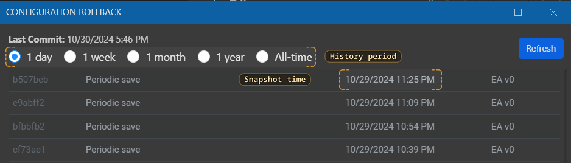
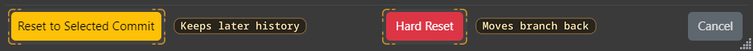

# Restore an earlier configuration

EyeAuras saves snapshots of the profile configuration from time to time. If something breaks after your changes, **Version history** lets you go back to an earlier snapshot. For example, you can get back a folder's old name, along with all other settings as they were then. The whole configuration is restored, and then EyeAuras restarts.

Practise in your own test profile. Saving the configuration to files and **File system version control** must be enabled. First make a [local export](/en/features/export-import) of anything you need to keep: the history lives on the same disk and is not a separate backup.

## Make a change and undo it

1. Name your test folder `History — original`. Exit EyeAuras normally and reopen the same profile. On exit, this state goes into the history.
2. Open **Version history**. It is the main-window button with that tooltip. Find the snapshot of the original state and note its **Commit ID** and time. Close the window with **Cancel**.
3. Rename the folder to `History — changed`. Exit and reopen EyeAuras again. If you also need the newer changes, export them before you restore.
4. Open **Version history**. If you do not see the snapshot, select **All-time** and click **Refresh**. Select the snapshot you noted, not the latest one with the new name.
5. Click **Reset to Selected Commit**, check the date in the confirmation and confirm. EyeAuras writes the current data to disk, restores the files of the selected snapshot and restarts.
6. After the restart the folder should again be `History — original`. Later commits stay in the history, and a new restoration commit appears. This is how it differs from **Hard Reset**.

The bottom of the [full history window](https://s3.eyeauras.net/media/2024/10/EyeAuras_Y3P3cw9Pi1E0WkMc.png) shows the Commit ID, message and date of the selected snapshot.

## Choose the restoration scope

| Command | What it does |
| --- | --- |
| Reset to Selected Commit | Brings back the files from the selected snapshot. The existing history stays, and a new restoration commit is added on top. It can remove untracked files inside the configuration directory. |
| Hard Reset | Moves the head of the history to the selected commit and resets tracked files. Later states disappear from the normal list of that branch. Do not count on undoing this from the dialog. |
| Refresh | Reloads the commit list. It does not save a snapshot of current edits. |
| 1 day / 1 week / 1 month / 1 year / All-time | Limits the period for which commits are shown. |
| Cancel | Closes the window without restoring. Auras do not run while this window is open. |

Older descriptions call the first operation **Soft Reset**. It is not Git's `reset --soft`: EyeAuras restores the files and records a new commit. [Git](https://git-scm.com/) only stores the snapshots here, and you do not need to know its commands.

The confirmation title can say Hard-reset even for **Reset to Selected Commit**. Go by the description of the operation.

When to use Hard Reset

Choose it only if you want to throw away everything after the snapshot, not just get old values back. Before you confirm, export the newer auras and settings you still need.

1. Select the commit in **Version history**.
2. Click **Hard Reset** and check the time, the description and the warning about losing later changes.
3. Confirm. After the restart, check the configuration and the history list.

## What is saved automatically

The history is kept for the `config` directory of the current profile. Changes are recorded about every **15 minutes** and on normal exit. A commit appears only if something changed.

The history is stored on your disk, not on a server. If the profile folder is gone, so is its history.

| Normal release profile | Usual config location |
| --- | --- |
| Standalone | `%appdata%\EyeAuras\release\config`. |
| Portable / Pack | `data\release\config` beside the application bundle. |
| Another profile or custom data directory | Its own directory. |

Scripts and other tracked objects have a separate **Local History** window. It has **Commit**, **Apply** and a comparison with the current text. It restores only the objects passed to that window and can take an unsaved document into account.
