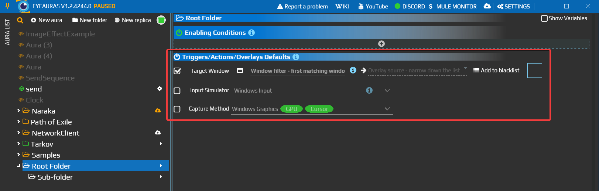
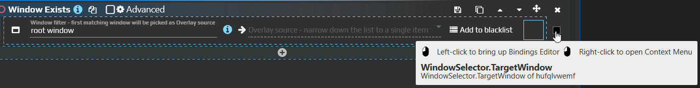
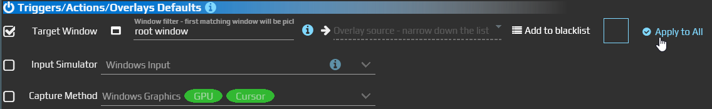

# Default Properties — choose one window for a folder

When several auras watch the same application, set its window once on their folder. Trigger and action properties bound to that default follow later changes, so you do not have to edit each target separately.

Open the folder's **Triggers/Actions/Overlays Defaults** section. Available properties depend on the installed features; start with **Target Window**.

The checkbox lets this folder supply a value. In this older editor, Target Window is enabled while the other properties have no local override.

## Share a target between two checks

1. Open an application you want to monitor and create a folder for its auras. Add two auras inside it: one with [Window Exists](/en/triggers/window-exists), the other with [Window Is Active](/en/triggers/window-is-active).
2. Select the folder. Under **Triggers/Actions/Overlays Defaults**, check **Target Window**, select the application's window and inspect the displayed target.
3. For **Target Window** in each trigger, open the small binding indicator's context menu and choose **Bind to Default**. This explicitly connects both properties to the folder value.
4. Return to the folder and choose a different open window for Target Window.

Both checks now receive that target. Window Exists checks whether it exists; Window Is Active checks whether it is in the foreground. You no longer need to change their window expressions separately.

Left-click the indicator to open the binding editor; right-click for its menu. Older interfaces used Reset to Default or Bind to Default for the default connection.

## Connect existing components

New triggers, actions and overlays receive supported default bindings when created. An existing property may have a manual value or another binding: changing the folder does not silently replace it.

| Method | When to use it |
| --- | --- |
| Bind to Default on a property | Connect one trigger, action or overlay property to its corresponding default. |
| Default / Bind to Default in the older binding editor | The older header-button route to the same connection. In the current interface, use the property indicator's context menu. |
| Apply to All in the folder | Rebind matching properties in descendant auras and subfolders. The current editor applies every checked default; the older editor had a button for each row. |

**Apply to All replaces existing individual bindings for the matching properties.** Leave only the defaults you intend to standardize checked. For auras that need their own targets, connect properties individually instead.

A nested folder can supply its own value. Without a local value, the binding looks up the hierarchy. For a lasting setup, use a [window matching expression](/en/features/window-matching-expressions) that can survive reopening the application: a temporary window handle selected from a list may change.

Use [Bindings](/en/features/bindings) for other property-to-property connections. Script values and inheritance have a separate [variables contract](/en/scripting/api/scripting/variables).
