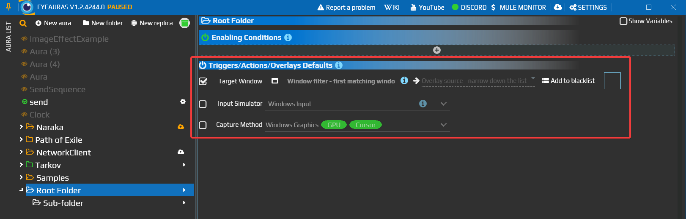
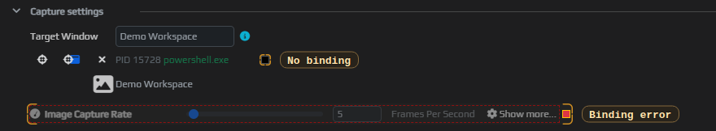
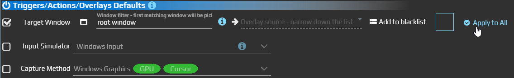

# Default Properties — choose one window for a folder

If several auras watch the same application, it is easier to choose its window once, on the folder. Triggers and actions bound to that default get the new window as soon as you change it.

The setting is on the folder, in the **Triggers/Actions/Overlays Defaults** section. The list of properties depends on the installed features. Start with **Target Window**.

The checkbox on the left lets the folder set this value.

## Share a target between two checks

1. Open the application you want to watch and create a folder for its auras. Add two auras to it: one with [Window Exists](/en/triggers/window-exists), the other with [Window Is Active](/en/triggers/window-is-active).
2. Select the folder. Under **Triggers/Actions/Overlays Defaults**, check **Target Window** and select the application's window. Make sure the right window is shown.
3. In each of the two triggers, open the context menu of the small binding indicator beside **Target Window** and choose **Bind to Default**.

   Before binding, the indicator beside Target Window is black.

   

4. Go back to the folder and choose a different open window for Target Window.

Both triggers should get the new window. Window Exists checks whether it exists, and Window Is Active checks whether it is in the foreground.

Left-click the indicator to open the binding editor. Right-click it for the menu.

## Connect existing components

New triggers, actions and overlays get the supported default bindings when you create them. An existing property may have its own value or another binding. A change on the folder does not replace it.

| Method | When to use it |
| --- | --- |
| Bind to Default on a property | Connect one trigger, action or overlay property to the folder value. |
| Default / Bind to Default in the older binding editor | The same thing, but with a button in the header. In the current interface, use the context menu of the property indicator. |
| Apply to All in the folder | Switch matching properties in child auras and subfolders to the defaults in one go. The current editor applies every checked default. The older editor had a button on each row. |

**Apply to All replaces existing individual bindings for the matching properties.** Before you click it, leave checked only the properties you really want to share. If an aura needs its own target, bind its properties one by one instead.

A nested folder can set its own value. If it has none, the binding takes the value from the folder above. For a lasting setup, pick a [window matching expression](/en/features/window-matching-expressions) that still works after the application is reopened. A window chosen from the list has a temporary handle that may change.

Other property-to-property links are covered in [Bindings](/en/features/bindings). Script values and their inheritance have a separate [variables page](/en/scripting/api/scripting/variables).
