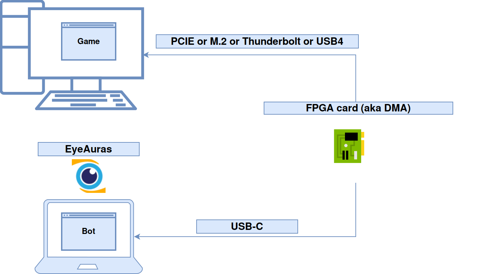
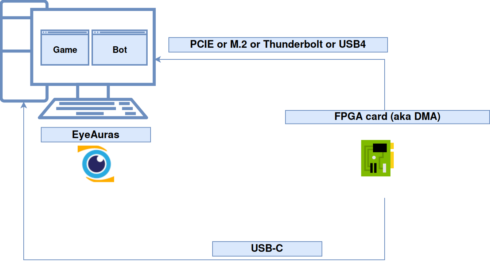

# List processes through a prepared FPGA source

EyeAuras can read memory through **MemProcFS/LeechCore** and the **EyeAuras.Memory.MPFS** module. For a first check, list the processes the source can see. This shows that data gets through at all. After that you can read a known value from your own test application.

You need a compatible Windows distribution with MPFS loaded and its native libraries, a prepared FPGA source and your own target system. How to prepare everything and which computer does what is described in [preparation and computer roles](/en/dma/getting-started). On an ordinary PC without this hardware it does not work.

## Make one process-list request

1. Check that MPFS is loaded and the memory source is prepared for your board and system. The device must be connected to the computer where this call opens the source.
2. Create a **C# Script** in [EyePad](/en/features/eyepad) and put the whole program in `Script.csx`.

```csharp
using EyeAuras.Memory;
using EyeAuras.Memory.MPFS;

{
    cancellationToken.ThrowIfCancellationRequested();
    var processes = LCProcess.FPGA().GetProcesses();
    Log.Info($"Visible processes: {processes.Count}");
    foreach (var process in processes)
        Log.Info($"PID={process.Id}; name={process.ProcessName}");
}
```

3. Click **Run** once. The log shows the count, PIDs and names of the processes on the **target system** that the source can see. Find your test process among them.
4. After printing the list the script ends. `GetProcesses` returns a copy of the list and closes the VMM created for this request. The list does not update itself. If initialization or reading fails, the request ends with an error, not with an empty result.

`Log` and `cancellationToken` are available only in a top-level EyeAuras script. Pass dependencies to ordinary classes explicitly. The call is synchronous: the token is checked before it, but this does not instantly cancel initialization already running inside the native library.

| Choice | Effect |
| --- | --- |
| `LCProcess.FPGA()` | Sets up the FPGA source. |
| `GetProcesses()` | Returns a snapshot of visible PIDs and names. |
| `ByProcessId(pid)` / `ByProcessName(name)` | Opens a separate process object. Dispose it when you are done. |
| `LCProcess.WinPMEM()` / `HyperV()` / `Custom(...)` | Other sources. Each needs its own setup. |
| `WithRemote(...)` | A remote source that is prepared separately. |

## Follow the source of the data

In the two-computer setup, the target application and the analysis program run on different machines. Memory is passed through the board.



Two computers: Game is the target application, Bot is the analysis program. [Original SVG diagram](/assets/wiki-media/m072-original.svg).

In the second setup, EyeAuras and the target application are on one computer. Access is limited by the board, its firmware, the operating system and its DMA protection.



[Original SVG diagram](/assets/wiki-media/m073-original.svg).

[LeechCore](https://github.com/ufrisk/LeechCore) gives access to physical memory. MemProcFS rebuilds processes and their virtual address spaces from it. An address in `process.Memory` belongs to the opened process, so it is virtual. You cannot put a physical address there instead, even though the data came through DMA. For compatible hardware and connection requirements, see the author's [FPGA documentation](https://github.com/ufrisk/LeechCore/wiki/Device_FPGA). Not every board or USB adapter will do.

<details>
<summary>Read a known integer after obtaining its PID and address</summary>

You need the current PID of your own test application, the **absolute virtual address** of the value and the exact `int` type. Take the address from the test application itself or its known layout. The snippet below is a function, not a whole program:

```csharp
using System;
using EyeAuras.Memory;
using EyeAuras.Memory.MPFS;

static int ReadKnownInt32(int processId, IntPtr virtualAddress)
{
    using var process = LCProcess.FPGA().ByProcessId(processId);
    return process.Memory.Read<int>(virtualAddress);
}
```

Call it with your PID and address and compare the result with the known number. `process.Memory` belongs to the process, and you must not use it after the process is disposed. Disposing the process object does not close the target application. Read an ordinary number with `Read<T>`. You can write a known value with `Write<T>`, but whether the write works and completes depends on the source.

`process.Memory.BaseAddress` is zero here. It is not the base of a game module. Take the module base from the process module information. An offset such as `0x1C4` is tied to one version of the target: layout, type and address can all change.

The high-level memory operations are shared by several access methods, but not all process control carries over between them. There is no automatic switch to `ReadProcessMemory`. Details are in the [Memory API](/en/scripting/api/memory). A simple example without the hardware is the [known-value local example](https://wiki.eyeauras.net/en/scripting/examples/advanced/memory/rpm-read).

</details>
