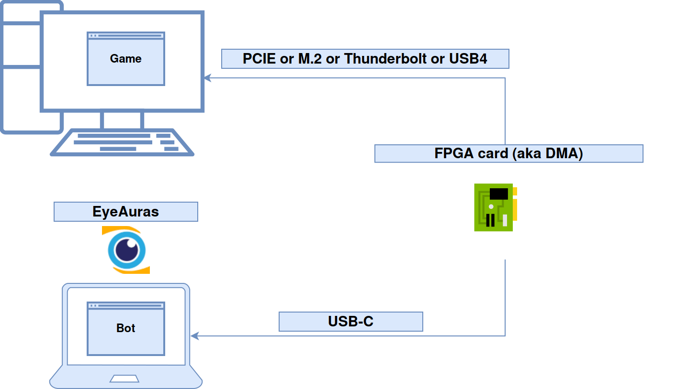
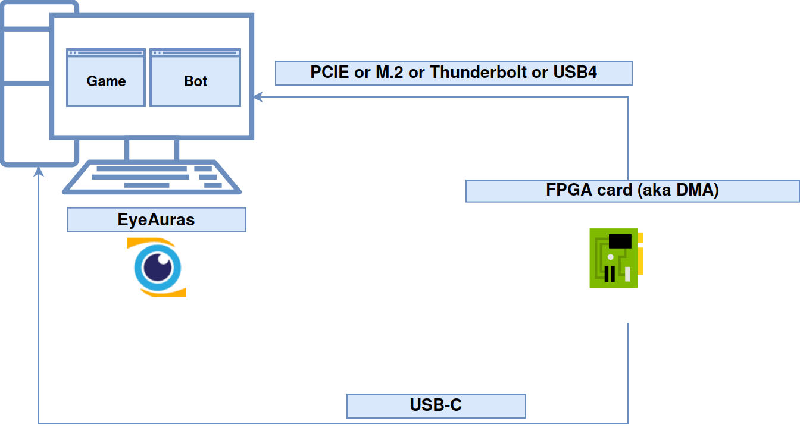

# List processes through a prepared FPGA source

EyeAuras can access memory through **MemProcFS/LeechCore** and **EyeAuras.Memory.MPFS**. Listing the processes visible to the source is a useful first request before reading a known value in your own test application.

You need a compatible Windows distribution with MPFS loaded, its native libraries, a prepared FPGA source and your own target system. See [preparation and computer roles](/en/dma/getting-started). This is not a capability of an unprepared ordinary PC or a guarantee of access to every process.

## Make one process-list request

1. Check that MPFS is loaded and the source is prepared for your board and system. The device must be connected where this call opens its acquisition source.
2. Create a **C# Script** in [EyePad](/en/features/eyepad) and put the complete program in `Script.csx`.

```csharp
using EyeAuras.Memory;
using EyeAuras.Memory.MPFS;

{
    cancellationToken.ThrowIfCancellationRequested();
    var processes = LCProcess.FPGA().GetProcesses();
    Log.Info($"Visible processes: {processes.Count}");
    foreach (var process in processes)
        Log.Info($"PID={process.Id}; name={process.ProcessName}");
}
```

3. Click **Run** once. Expect a count, PID and name for processes on the **target system** visible to that source. Compare a known test process with that system; an absent process does not establish access to its memory.
4. The script ends after enumeration. `GetProcesses` returns a copied list and disposes the VMM created for that request. It is a snapshot, not a live list. Initialization or acquisition errors are not successful results.

`Log` and `cancellationToken` belong to top-level EyeAuras script context; pass dependencies explicitly to ordinary classes. The call is synchronous, so checking the token before it does not instantly cancel native initialization already in progress.

| Choice | Effect |
| --- | --- |
| `LCProcess.FPGA()` | Configures the FPGA source; it does not discover every board on a network. |
| `GetProcesses()` | Returns visible PIDs and names without reading an arbitrary game field. |
| `ByProcessId(pid)` / `ByProcessName(name)` | Opens a separate process object that you must dispose after use. |
| `LCProcess.WinPMEM()` / `HyperV()` / `Custom(...)` | Other sources requiring their own setup. A method does not install its driver, enable Hyper-V or select a fallback automatically. |
| `WithRemote(...)` | Configures a separately prepared remote source, with that source's address and access requirements. |

## Follow the source of the data

In the two-computer topology, the target and analysis program run separately. **Game** means the target application and **Bot** means the analysis program in the earlier figure; neither label creates a ready-made game integration.



Two computers: Game is the target and Bot is the analysis program. The FPGA arrows lead into their corresponding computers. [Original SVG diagram](/assets/wiki-media/m072-original.svg).

In the second topology, the target and EyeAuras run on one computer. Placement alone promises neither invisibility nor bypass of protections or identical performance. Device, firmware, operating-system and DMA-protection limits still apply.



One computer contains both roles; the FPGA and USB-C paths remain separate connections. [Original SVG diagram](/assets/wiki-media/m073-original.svg).

[LeechCore](https://github.com/ufrisk/LeechCore) supplies physical-memory acquisition sources; MemProcFS reconstructs processes and their virtual address spaces. An address passed to `process.Memory` belongs to the opened process. Physical and virtual addresses are not interchangeable simply because the data arrived through DMA. Check device and connection requirements in the author's [FPGA documentation](https://github.com/ufrisk/LeechCore/wiki/Device_FPGA); not every FPGA board, bridge or USB adapter is compatible.

<details>
<summary>Read a known integer after obtaining its PID and address</summary>

You need the current PID of your own test application, the **absolute virtual address** of its value, and the exact `int` type. Obtain the address from that application or its known layout. This helper is a function, not a program that discovers an address:

```csharp
using System;
using EyeAuras.Memory;
using EyeAuras.Memory.MPFS;

static int ReadKnownInt32(int processId, IntPtr virtualAddress)
{
    using var process = LCProcess.FPGA().ByProcessId(processId);
    return process.Memory.Read<int>(virtualAddress);
}
```

Call it with your own PID and address and compare the result with the known integer. The owned process holds the acquisition resources; its borrowed `process.Memory` must not outlive it. Disposing the reader does not terminate the target application. Prefer `Read<T>` for an ordinary scalar. `Write<T>` is also part of the memory surface, but source support and completeness of writes differ; larger binary transfers need their result checked.

For this backend, `process.Memory.BaseAddress` is zero, not an automatically selected game's module base. Use process module information for a module base. An offset such as `0x1C4` does not establish a character's health: layout, type and address belong to a specific target version.

The shared high-level memory operations do not make all process-control features portable. Do not assume automatic recovery, arbitrary protected-process access or hot-swapping to `ReadProcessMemory`. See the [Memory API](/en/scripting/api/memory) for operation contracts and the [known-value local example](https://wiki.eyeauras.net/en/scripting/examples/advanced/memory/rpm-read) for an experience without acquisition hardware.

</details>
