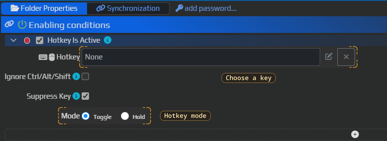
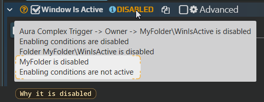

# Enabling Conditions — run a group only when needed

Sometimes a set of reminders or checks is needed only for one task. Put those auras in a folder and give the folder **Enabling conditions**. While the condition is not met, the auras in the folder are off and their ordinary triggers are not calculated.

This is handy, for example, for a group of image and text searches. An ordinary trigger answers “is this aura's condition met?” An enabling condition decides “should this aura run at all?”

## Hold a key to enable a group of reminders

1. Create a folder named “Inspection mode”. In its **Enabling conditions**, add [Hotkey Is Active](/en/triggers/hotkey-is-active), choose the F8 key if it is free and select **Hold**. Do not add other enabling conditions for now.

   

2. Inside the folder, create a “Reminder” aura. In its ordinary **Triggers**, add [Fixed Value](/en/triggers/fixed-value) set to **Is Active**.
3. In **Overlays**, add [Text](/en/overlays/text). Set **Content** to “Check the selected region”, place the text on screen and turn on **Locked**.
4. Select any aura outside the folder and switch to your working application. Hold F8, then release it.

While the key is held, the folder lets the aura run and the reminder is visible. Release the key and the reminder disappears.

Now you can put a configured [Text Search](/en/triggers/images/text-search) into the same folder. It will work only in this mode. First make sure the search works correctly on its own.

If the group is needed only in a certain window, replace the key in Enabling conditions with [Window Is Active](/en/triggers/window-is-active). If that window check is already set up in another aura, reuse it through [Aura Is Active](/en/triggers/aura-is-active) instead of creating it again.

## Choose the scope

| Location | What it affects |
| --- | --- |
| Folder Enabling conditions | The auras and nested folders inside it. |
| Aura Enabling Conditions | That one aura. |
| Aura Triggers | Its Active / Not Active while it is allowed to run. A false trigger does not stop the other triggers from being calculated. |

If there are no enabling conditions, there is no restriction. If there are several, look at the group header to see how they are combined. When the result is unknown, the aura is not allowed to run. The object must also be loaded.

Normally a disabled parent also stops the enabling conditions of its children from being checked. There is one exception for editing: the object selected in the active EyeAuras window can keep being calculated. So test the restriction with another object selected and your working application in front. An unlocked overlay also stays visible so you can place it. Turn on Locked before you test.
