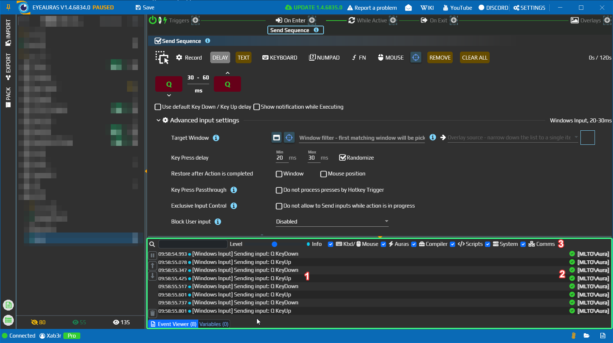

# Event Viewer — see what an aura actually did

When an action does not produce the expected result, open Event Viewer to see whether execution reached it and whether an error was reported. Each entry has a timestamp, importance level, message and context identifying its source.

## Find your script's message

1. In the main window, use the button with the **Show event log** tooltip and open the **Event Viewer** tab. Open the panel before running the check.
2. Add **C# Script** to an aura's On Enter actions. In its top-level script editor, use this one-line program:

   ```csharp
   Log.Info("Event viewer check");
   ```

3. In Event Viewer, use the magnifying-glass button to show filters. Set **Level — Info**, enable **Scripts**, clear the text filter and make sure the panel is not paused.
4. Click **Run** in the C# Script editor. Enter `Event viewer check` in the Event Viewer text filter.

An entry with that message and its aura/action context should appear. It confirms that the Log.Info line ran, not that any later work succeeded. Clear the filter before looking for different messages.

`Log` is supplied by the top-level C# Script host; it is not a global available to an ordinary C# class. See [Getting started with scripting](/en/scripting/getting-started).



In this older screenshot, 1 marks key-delivery messages, 2 their context, and 3 the filters. Those entries come from input actions rather than the script above.

## Filters and controls

| Control | What it does |
| --- | --- |
| Text filter | Matches a substring of the message, ignoring case. A context name alone is not message text. |
| Level | Minimum importance shown. Info also includes Warning and Error; Debug adds more detail. The default is Info. |
| Kbd/Mouse, Auras, Compiler, Scripts, System, Comms, Console | Enables the respective event categories. Choose Scripts for script messages and Compiler for compilation diagnostics. |
| Pause | Stops this panel from accepting new entries. Events missed while paused do not arrive later. |
| Up/down arrows | Scrolls to the beginning or end of the list. |
| Trash button | Clears the panel's entries. |

## Choose a level

| Level | Typical use |
| --- | --- |
| Trace | Very detailed technical messages, potentially including network traffic details; often numerous. |
| Debug | Operation progress, loading/unloading and intermediate states. |
| Info | Ordinary events and work performed, such as input or notification actions. |
| Warning | Something needs attention, but execution may have recovered or continued. The UI may call this Warn. |
| Error | An execution or configuration error. Read both the message and its context. |

The panel keeps the latest 250 accepted entries. Disabling a category prevents new entries in that category from entering its history; enabling it later cannot recover them. A collapsed panel also stops collecting. Open the panel, set its filters, then repeat the action you want to diagnose.

Display filters are not settings for application log files. To send diagnostic information to the developer, use a [problem report](/en/features/problem-reports); Event Viewer is not a complete archive.
