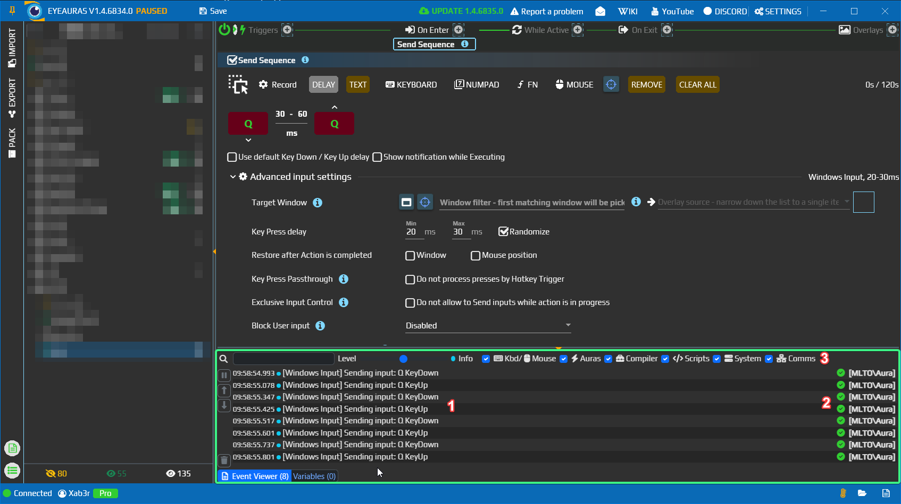
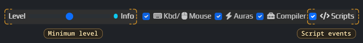

# Event Viewer — see what an aura actually did

Event Viewer is the EyeAuras event log. If an action did not work as expected, open it and see whether execution reached the right place and whether there was an error. Each entry has a time, an importance level, a message and a context: the object that created it.

## Find your script's message

1. In the main window, click the button with the **Show event log** tooltip and open the **Event Viewer** tab. Open the panel before you run the check.
2. Add **C# Script** to an aura's On Enter actions. In the top-level script editor, leave one line:

   ```csharp
   Log.Info("Event viewer check");
   ```

3. In Event Viewer, open the filters with the magnifying-glass button. Set **Level — Info**, turn on **Scripts** and clear the text filter. If the panel is paused, unpause it.
4. Click **Run** in the C# Script editor. Type `Event viewer check` into the Event Viewer text filter.

An entry with your message and its context, the aura and the action, appears. Clear the filter before the next check, or messages with other text stay hidden.

`Log` here comes from the top-level C# Script editor. It is not available in an ordinary C# class. See [Getting started with scripting](/en/scripting/getting-started).



In the screenshot, 1 marks the text of key-sending entries, 2 their context and 3 the filters.

## Filters and controls



| Control | What it does |
| --- | --- |
| Text filter | Looks for a substring in the message text, ignoring case. The context name is not part of the message text. |
| Level | Minimum importance shown. Info also shows Warning and Error. Debug adds more detailed messages. The default is Info. |
| Kbd/Mouse, Auras, Compiler, Scripts, System, Comms, Console | Turn on event categories. Use Scripts for script messages and Compiler for compilation. |
| Pause | The panel stops taking new entries. Events missed during the pause do not show up later. |
| Up/down arrows | Jump to the beginning or end of the list. |
| Trash button | Clears the entries in the panel. |

## Choose a level

| Level | What you usually look for |
| --- | --- |
| Trace | The most detailed technical messages, sometimes including network traffic details. There can be a lot of them. |
| Debug | Progress of operations, loading and unloading, intermediate states. |
| Info | Ordinary events and work done, such as input or notification actions. |
| Warning | Something worth your attention, but the work does not necessarily stop. The UI may call this Warn. |
| Error | An execution or configuration error. Read the message and its context. |

The panel keeps the latest 250 accepted entries. If a category is off, its new events do not get into the history, and turning the filter on later does not bring them back. A collapsed panel does not collect entries either.

If an image check never activates, first check its [source frame and region](/en/triggers/images/imagecapturetriggers) and [enabling conditions](/en/features/enabling-conditions).

To pass diagnostics to the developer, send a [problem report](/en/features/problem-reports).
