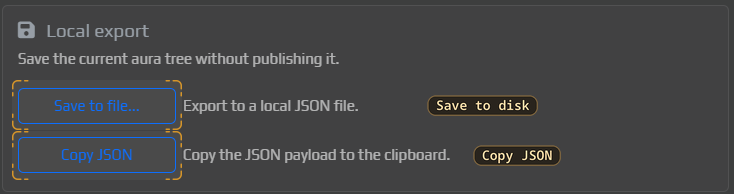
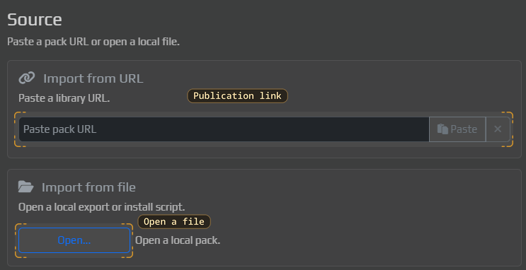
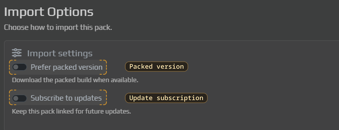

# Save your aura set and open an independent copy

Export saves a selected aura, tree or folder with its contents to JSON. For example, before changing a set you can export it, import a copy next to it and compare the two. You do not need to publish anything online for this.

For the first try, take your own small folder named `Transfer test` with one disabled aura. Someone else's private pack will not do: its permissions may forbid export.

1. Select the folder in the tree and open **Share/Export** with the export button or **Ctrl+S**. In **Content**, check that the folder and its contents are in the set.
2. If you see **Missing linked objects detected**, check the dependencies. **Add linked objects** adds linked objects that are not yet in the set. Look through **Content** again afterwards.
3. Choose **Destination → Local export → Save to file…** and save the JSON to your own folder. **Open in Explorer** finds the saved file. Close the export dialog.

   
4. Click **Import**, then **Source → Import from file → Open…** and select the saved file. Check the contents and paths in **Preview**.
5. The original objects already exist, so choose **Copy** in **Import Options**. The originals stay, and the new objects get their own IDs. Do not choose **Replace** here.
6. Find the imported copy in the tree. Rename its aura and make sure the name of the original aura has not changed. Leave both disabled until you have checked their settings and external dependencies.

Ordinary import puts items at the paths stored in the file. A folder selected before you open the dialog does not become the destination. See where the items will go in **Preview**.

## Choose what to transfer

| Option | What it transfers |
| --- | --- |
| Selected aura or tree | The settings of the selected item. |
| Folder | The folder with all its nested folders, auras and trees. |
| Save to file… / Copy JSON | Local JSON of the selected set. Copy JSON puts it on the clipboard. |
| Publish | Uploads the set and gives a publication link. |
| Portable pack | A separate bundle of EyeAuras and configuration for launching the set. See [Packs](/en/features/packs). |

Embedded resources are exported together with the data. A path to an external file, a window name, an installed driver or access to a service will not start working on another PC by themselves. When a copy is made, links inside the set can be remapped. EyeAuras does not fix arbitrary strings in your code or references to objects left outside the set. If the other PC has a different EyeAuras version, check that the set works there.

Export does not remove secrets from your settings. Before you share, check tokens, passwords, addresses and embedded resources.

## Import a publication and choose how it updates

1. Paste the publication link into **Source**. Look at its name, description and owner.
2. Click **Download**. The contents are downloaded and **Preview** opens. On **Overview** and **Pack Options** you can read the author's description and settings before importing.
3. Choose a mode in **Import Options**, then click **Import** or the conflict button you need. The whole downloaded set is imported, not the item highlighted in the preview.

| Import option | When to use it |
| --- | --- |
| Prefer packed version | To get the contents prepared by the author, if there are any. It does not download a portable ZIP. With the Packed Only policy this choice can be forced. |
| Subscribe to updates | To link the local folder to the publication and receive updates. The current version is applied right away. Not used for ordinary JSON without a publication. |
| Clone locally | Available together with a subscription. Creates separate local IDs but keeps the link to the source. Good for several copies of one pack. Older text calls this Local Clone. |
| No subscription | A one-time import. The author's next version does not replace this copy by itself. |

| Conflict choice | Result |
| --- | --- |
| Replace | Conflicting existing items are replaced with the imported ones. Individual settings are not merged. |
| Copy | Old items stay, and new ones are added as separate copies with different IDs and adjusted paths. |
| Ignore Conflicts | Conflicting new items are skipped, and the rest are imported. |

An ordinary import can ask **Ignore / Replace / Copy** for each conflict, with **… All** choices. With a subscription the folder is synchronized with the source. It is not a one-time independent copy. A local clone is not meant to be published again as the original.

The source form also accepts a prepared installation file and JSON from the clipboard.

Before publishing, use [folder permissions](/en/features/permission-model) to set what the recipient can view and change. For example, **Configurable** lets them adjust exposed properties and keeps actions and triggers read-only.

Publish a new set or update your publication

1. For a new publication, leave the URL in **Destination** empty. Set the name and description in **Overview**. The description supports Markdown. Check **Content** and **Pack Options**.
2. Click **Publish**. After the upload a link appears.
3. To release a new revision, paste the address of the existing publication into **Destination**, check the loaded details and click **Update**.

The export dialog checks the owner against the account you are signed in with and can stop you from updating someone else's publication.

A link and a listing in the public library are different things. A URL that nobody knows is not protection: content restrictions and publication permissions are set separately.

