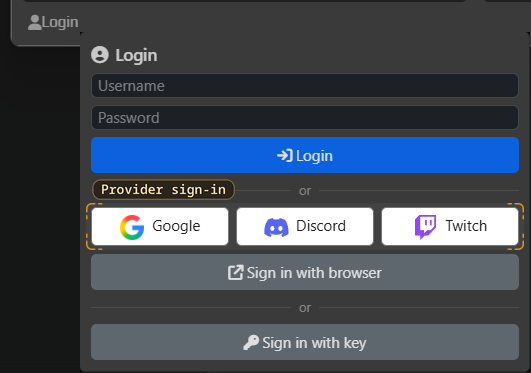

# Use another service to sign into EyeAuras

You can sign into EyeAuras with Google, Twitch or Discord. You type that service's password on its own site. EyeAuras never gets that password, only its own session.

Which services are offered depends on the site's settings.

## Link your existing account first

If your EyeAuras account already has licenses and history, link the service to that account first. Otherwise the first sign-in through an unlinked service can create a different account.

1. Sign into [EyeAuras](https://eyeauras.net/my) the way you usually do and open `Profile`.
2. In the sign-in methods, choose a service and link it. In the browser, confirm your own account on that service.
3. Go back to the profile and check that the service is shown as linked to your EyeAuras account.
4. In the app, open `Login` and click that service's button. Finish signing in on the site and confirm the app's request.
5. Return to EyeAuras. The app should show your account with the licenses you had. If it is a different account, check the link in the profile before you change anything else.

The Google, Discord and Twitch buttons are below the username and password fields.

If you are a new user, the first sign-in through a service can create an EyeAuras account without a separate registration.

Automatic linking by email only happens when it is turned on in the site's settings, the address is verified and exactly one account matches it. If several accounts match, they are not merged. If the address is taken and the service cannot be linked safely, sign into the existing account and link the service in `Profile`.

| Sign-in method | What it uses |
| --- | --- |
| A Google, Twitch, Discord or other available service button | The service you chose and its link to your EyeAuras account. |
| `Sign in with browser` | An open EyeAuras website session, if there is one, and a confirmation of the app's request. |
| EyeAuras username and password | Your EyeAuras account details. The external service's password does not work here. |
| `Sign in with key` | [Sign-in with a license key](/en/features/keylogin), a separate method. |

The app protects saved sign-in data with Windows protection.

If `Login` closes when the browser opens, open it again. You can continue the request or cancel it. If the request has expired or you restarted the app, start signing in again.

## Sign out or change accounts

`Logout` ends the **app** session. The browser sessions for the EyeAuras website and the external service stay separate. To change users, switch accounts on the website and, if needed, in the service itself. Then start signing in from the app again.

You can unlink a service in the profile with a separate, confirmed action when the current session allows it. First make sure you still have another way to sign in.

Create, change or recover an EyeAuras password

If you know your current EyeAuras password, change it in `Profile`: enter the current password and the new one. You will have to sign in again afterwards.

If you have no password or have forgotten it:

1. Open `Password` in `Profile`. If you already have a password, choose `Forgot this password?`.
2. Confirm your account with a service that is **already linked and available right now**: `Confirm your linked … account`.
3. When you come back, click `Create password` or `Reset password` separately. Confirming the service does not create a password by itself. `Cancel` drops the preparation.
4. Save the `Username` and password you are shown, then select `I've saved it`. The password is shown only once, in that response. It is not a one-time code, so you keep signing in with it. Do not guess and use the service's email address in place of the username.

A reset replaces the old EyeAuras password, and you have to sign in again. Links to external services stay. If the confirmation has expired, go back to the profile and start over. If no linked service is available, use the sign-in methods you already have. This section does not change your username.

