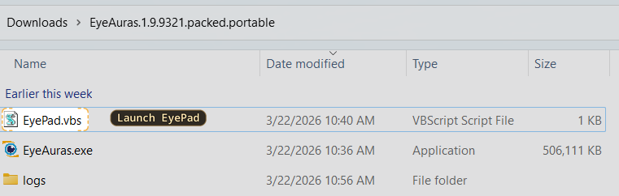
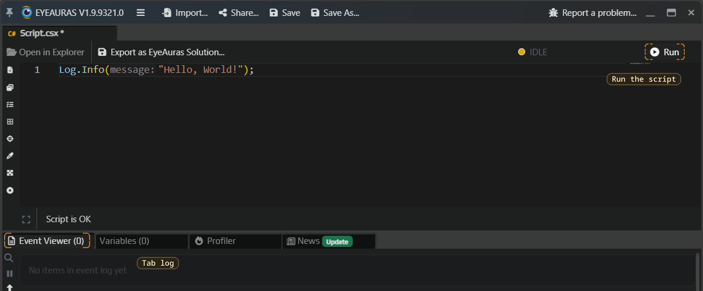

# Open a standalone script in EyePad

EyePad runs your own C# file without an aura in the main tree. It is a mode of the same `EyeAuras.exe`. The EyeAuras scripting engine runs the code, and the tab gives you an editor, a log and run buttons.

You need an installed or portable EyeAuras with EyePad support, and your own `Script.csx`. Start with the [minimal log example](/en/scripting/examples/basic/hello-world). Read code you did not write before you run it. Tabs have separate trees, but that does not protect your system from the code.

1. In the application folder, run `EyePad.vbs` if your copy includes it. Or run this from the same folder:

```text
EyeAuras.exe --pad
```



2. Choose **File → Open...** and select your `Script.csx`.
3. Click **Run**. The script's message appears in the log of the selected tab. A script that only writes one log line finishes by itself. For a script that keeps running there are **Stop** and **Restart**.
4. Save your changes with **Save**. For a new file, choose **Save As...** and pick your own path.



## Choose what to open

| Format | What EyePad opens |
| --- | --- |
| `.csx`, `.cs` | A standalone C# script. Top-level code gets the EyeAuras context. An ordinary library class is not an entry point by itself. |
| `.sln` | A solution with a script project, synchronized from disk. Its files are read-only in EyePad, so edit them in the IDE. |
| `.dll` | A prepared script assembly. A random DLL may not have a suitable entry point. |
| `.json` | An EyeAuras aura or script configuration, not just any JSON document. |

To open a file at startup, pass its path after `--pad`. Replace the paths below with your own:

```text
EyeAuras.exe --pad "config\auras\HW\Script.json"
```

```text
EyeAuras.exe --pad "D:\Projects\MyTool\MyTool.sln"
```

```text
EyeAuras.exe --pad "D:\Projects\MyTool\Script.csx"
```

The mode flag itself is:

```text
--pad
```

## Continue in an IDE or work on a pack

If the project has several files, open its exported `.sln`. EyePad loads the project and starts **Live Import**. Save the code in the IDE, wait for the update and run again. How to export a project and what the limits of synchronization are is covered in [IDE integration](/en/scripting/ide-integration).


With **Import...** you can load an existing pack into a temporary workspace and change the scripts and settings you have access to. You have to export or publish the result yourself. Importing publishes nothing. What you can edit depends on [pack permissions](/en/features/permission-model).


Each tab has its own virtual aura tree and its own state. A new or imported pack has to be saved explicitly.

<details>
<summary>Larger projects and custom interfaces</summary>

EyePad uses C# and Roslyn and supports [NuGet](/en/scripting/nuget), [embedded resources](/en/scripting/embedded-resources), [Blazor Windows](/en/scripting/blazor-windows/1-intro) and [ImGui](/en/scripting/imgui/getting-started).

Triggers, actions, macros and behavior trees are easier to set up in the main EyeAuras interface. If you want to run your own app on top of the scripting engine, see [mini-app](/en/features/mini-app).

</details>
