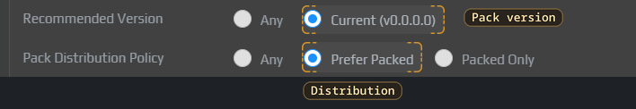

# Package your own EyeAuras mini-app

A mini-app is your script with a window, packaged together with EyeAuras and the configuration it needs. The user starts it and sees your panel right away, with no aura to build by hand. You can make a utility, a launcher, a control panel or an automation project this way.

You need your own working project, the right to distribute it and the components it uses. For a first panel, take one window from the [Blazor window example](/en/scripting/blazor-windows/getting-started), with no external actions. The main `Script.csx` has to wait until the window is closed, for example with `ShowDialog(cancellationToken)`, and then dispose it in an explicit resource block. If the script opens a window and ends right away, this kind of launch will not work.

## Prepare a panel and its launch path

1. Create your own folder **HW** with an aura **Script** and a **C# Script** action. Set up the window from the guide above. Use **Run** to check that the panel opens, then close it or use **Stop**. Do not hide the EyeAuras interface yet. You will need it for troubleshooting.
2. Open **Share/Export** for the folder. Check **Content** and the dependencies. In **Pack Options**, set **Application name**, for example `MyPanel`, and the **Recommended Version** you need.

   
3. In **Command line**, set the EyePad mode and the target file. An example for the HW/Script structure:

```text
--pad --ui normal "config/auras/HW/Script.json"
```

4. Check the path against the real configuration file. The path includes your folder and aura names, so a path from someone else's example will not fit. **Publish** creates a publication, and **Update** changes your existing one. Both send data to the server. How to prepare and pack a set locally is in [Packs](/en/features/packs).
5. Get the bundle for your publication with **Download pack**, extract it into a separate folder and run its executable. Compare it with your original run: your panel should open and have the resources it needs. A link appearing does not yet mean the build finished successfully.
6. When the normal launch works, you can use **--ui splashOnly** and **--readiness script**. In this mode the main window is hidden, and EyePad closes the application when the target run ends. Closing your panel should end the script that waits for it.

The shortest way to open EyePad without a target file:

```text
EyeAuras.exe --pad
```

A portable copy may include the helper `EyePad.vbs`. The flag works without it too.


## Choose startup behavior

| Option | Effect |
| --- | --- |
| --pad | Uses the EyePad host to open and run the target file |
| --ui normal | Keeps the normal interface. Handy for the first check of the bundle |
| --ui splashOnly | Shows the splash without the main window. Your script has to open its own UI |
| --readiness app | Reports readiness when the application has started |
| --readiness script | Reports readiness while the script run is being prepared. Your windows, models and external connections may not be ready yet |
| --read-only | Stops normal configuration changes from being saved. Your code can still write files and call services |
| --publish-single-file | Asks the server-side packer for a single-file distribution. Not every project fits into one file |
| --acceptLicense | Accepts the standard agreement at startup |
| Final path argument | What to open and run. For an aura it is its actual configuration file |

A full example for a prepared set:

```text
--pad --read-only --publish-single-file --ui splashOnly --readiness script --acceptLicense "config/auras/HW/Script.json"
```

You change the settings of a published folder in **Synchronization → Pack Options**. In the older screenshot this section is called Pack Config. After a change, save the settings and prepare a new revision. A copy that was already downloaded does not change by itself. Some packing options are experimental and need author access.


## Choose a project structure

| Structure | Suitable use |
| --- | --- |
| One .csx or .cs file | A small utility or prototype. [ImGui](/en/scripting/imgui/getting-started) needs its own SDK/runtime prerequisites |
| Several files, Razor and NuGet | A panel with its own logic, [Blazor windows](/en/scripting/blazor-windows/1-intro) and [embedded resources](/en/scripting/embedded-resources) |
| A .sln and an IDE | Development through export and [Live Import](/en/scripting/ide-integration). Not every helper project in the solution ends up in the script that runs |
| Background work or an overlay | A separate window is optional. The main run has to stay alive while the work goes on and own its resources |

An ordinary pack hands over a set that the user works with in EyeAuras. In a mini-app, your logic and your UI are the main thing. It can include auras, macros, trees, image capture, memory access and other connected features.

Code, DLLs, images, fonts, videos and models have to get into the bundle the right way. A link to an external file does not replace an [embedded resource](/en/scripting/embedded-resources). Permissions, [script protection](/en/features/script-protection), [sublicenses](/en/features/sublicenses) and updates are set up separately.

The [mini-app example](https://eyeauras.net/share/S20251105201607zPUUkZryl4CY) shows what such a bundle looks like.


What to read next: [EyePad](/en/features/eyepad), [scripting basics](/en/scripting/getting-started) and [mini-app problem reports](/en/features/problem-reports).
