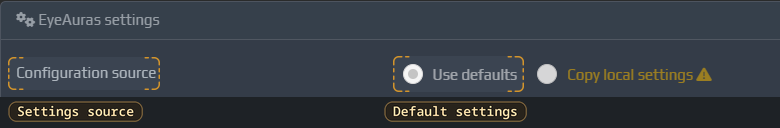
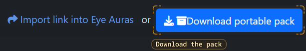
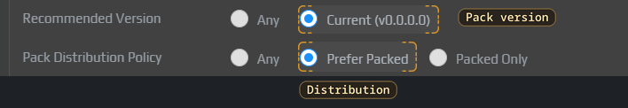

# Package your set for a separate launch

A **Pack** is your aura folder bundled with EyeAuras and the configuration it needs. The recipient extracts the archive and runs it separately from an installed EyeAuras. For example, you can hand over a ready status display with all its auras, and the other person does not have to import them one by one.

You need your own tested set, an account to publish under your name, and access to the EyeAuras website. Before packing, turn off automatic actions you do not want and remove personal secrets. If you only need a copy of the auras without the application, [JSON export](/en/features/export-import) is enough.

## Publish the set and download its portable bundle

1. Select the set's root folder. Open **Publish/Synchronize** from its context menu, or use the export dialog. For a new set, leave the destination address empty, check **Content** and give it a name in **Overview**.
2. In **Pack Options**, start with **Configuration source = Use defaults**, **Recommended Version = Current** and **Pack Distribution Policy = Any**. If the set can be shared with its source, keep **Script Compilation Mode = Script Only** and protection **None**. Do not hide the main window until the set has a working interface of its own.

   
3. Click **Publish**. In the older dialog this button was called **Publish folder**. After publishing, the folder shows its source and revision.
4. Open the publication link and select **Download portable pack**. Wait until it is prepared and download the ZIP.
5. Extract the archive into a separate folder, not over your working installation. Run the executable from the archive and check that it loaded your set. The external windows, files, drivers and services the set needs must be on that PC too.

The synchronization info shows which publication the folder is linked to. The link next to it opens the set's page on the website.

## What the bundle contains

| Part | Transfer scope |
| --- | --- |
| Application | A prepared EyeAuras version with the files for a separate launch. The application's system requirements still apply. |
| Configuration | The settings the author chose for the bundle. Use defaults takes the default values with the chosen overrides. Copy local settings carries over more local settings. |
| Folder contents | The set's auras, macros, trees and script projects with prepared resources. Check external dependencies separately. |
| Working data | The bundle's own data folder. The history of your installed copy is not passed to the recipient. |

A normal **Standalone** installation and an extracted Pack do not depend on each other. A Pack does not have to be registered as an installed program.

## Choose distribution and compilation separately

| Pack Distribution Policy | Recipient's options |
| --- | --- |
| Any | Content import and a portable bundle. |
| Prefer Packed | The prepared version is preferred. This setting does not protect source code. |
| Packed Only | An ordinary recipient needs the prepared version. This is a distribution policy. It does not compile scripts or remove their text. |

The import option **Prefer packed version** asks for the prepared contents of the publication. This is not the same as downloading a ZIP with the application: the contents can be imported into an EyeAuras that is already running. Which options are available is decided by the ownership check and the server policy.

| Script Compilation Mode | Prepared contents |
| --- | --- |
| Script Only | Script source. It is compiled on the recipient's machine. |
| Script w/ Binaries | Source and precompiled files. |
| Binaries Only | Prepared assemblies instead of script source. The logic can still be recovered from them. |

**Script Protection Mode** is chosen separately and is available with **Binaries Only**: **None**, **Performance-first** or **Security-first**. Its limits and preparation are described in [C# script protection](/en/features/script-protection). Where the feature came from is in the [binary-packaging announcement](/en/changelogs/7994).

If the recipient should change only selected values, set [folder permissions](/en/features/permission-model) before you distribute the pack. If access should require a key, use [sublicenses](/en/features/sublicenses). The product's current lease and the handling of lost access work through them.

Additional settings and local packing

| Setting | Purpose |
| --- | --- |
| Output Directory | Where the locally packed result goes. Pick a separate folder for it. |
| Application name / Icon | The application's name and icon. |
| Recommended Version: Any / Current | Any allowed version, or a recommendation of the author's current version. |
| Configuration source | Use defaults carries over fewer personal settings. After Copy local settings, check the result. EyeAuras sign-in data is cleared on purpose, but secrets in your scripts are not removed automatically. |
| Packing Mode | Embed everything puts the prepared contents into the bundle. Install on startup adds installation material for the first launch. |
| Security Measures / Check for Updates / Pause Everything if Active | Override the bundle's behavior: Not set, Enable or Disable. |

In the application the folder also has a **Pack…** command. This local route needs Alpha access and file-based configuration storage. Choose **Output Directory**, look at **Preview** and click **Pack**. After **Packed Successfully**, **here** opens the result folder and **run** starts the bundle.

For your own interface you can prepare a [Blazor window](/en/scripting/blazor-windows/getting-started) or a [mini-app](/en/features/mini-app). Make it work first, and only then hide the main window.

