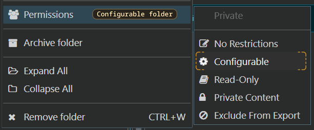
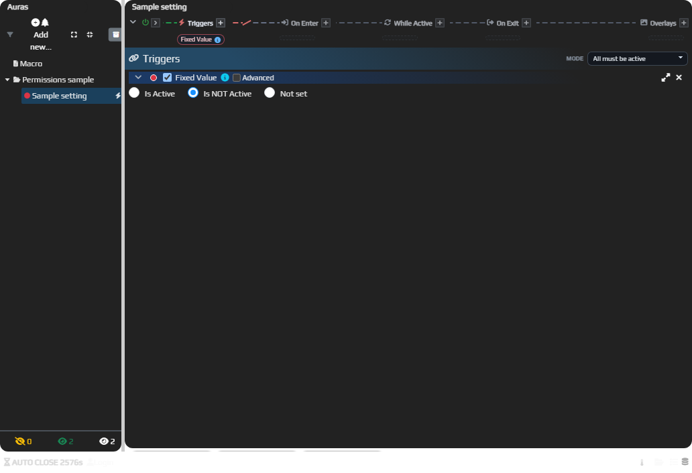
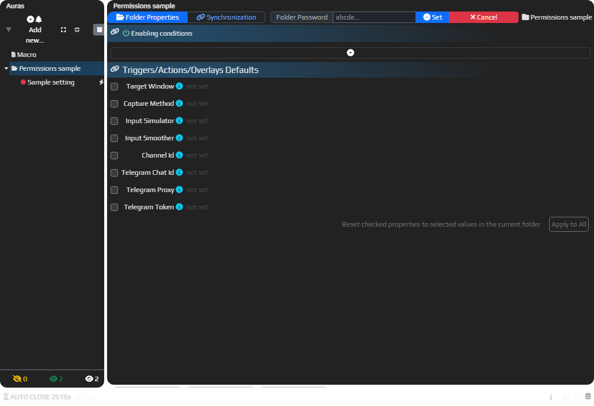
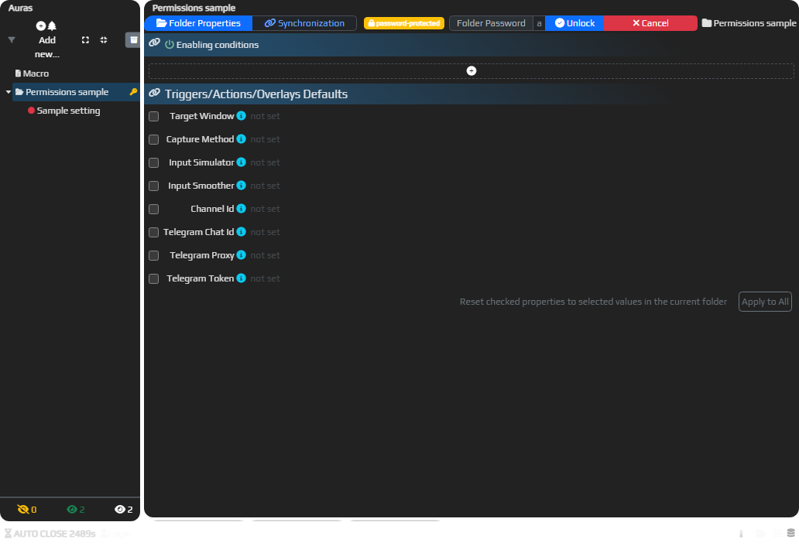
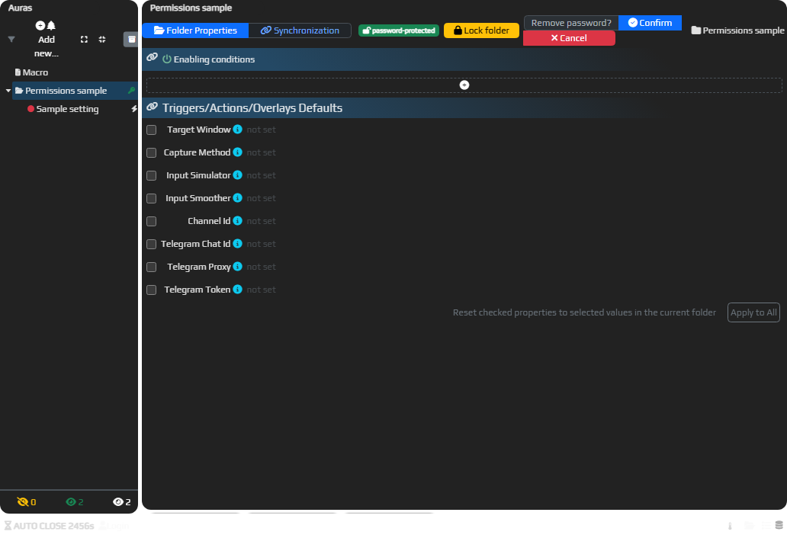

# Let recipients configure a set without changing its structure

Folder permissions define what a recipient can do with your set. For example, you can let them change the values of existing elements but not add or delete parts of the folder. The **Configurable** mode does that.

You need your own folder, a signed-in EyeAuras account and the right to change the folder's restrictions. Testing a restriction as the owner is pointless: the owner always has full access.

1. Select your folder and choose **Permissions → Configurable** from its context menu.
2. Look at the **Folder Properties** header. It should now show the level and **owned by you (…)**. The first time restrictions are assigned, the current user becomes the owner.
3. Prepare the values the user will be able to change, such as the target window name in an existing trigger. The recipient configures elements that already exist and does not rebuild the structure.
4. To see the set the way a recipient does, open a test copy under another account that is not the owner. The settings of existing elements are available within the chosen mode, and adding to or deleting from the structure is restricted.
5. To remove the restriction, choose **Permissions → No Restrictions**. Changing the mode also resets that folder's password.

In the current menu the private mode is called **Private Content**, and the ordinary mode is **No Restrictions**.

On your own folder the owner info is green. On someone else's folder it looks different:

## Choose a level

| Permissions option | Ordinary recipient's access |
| --- | --- |
| No Restrictions | Normal editing, adding and deleting. Named Default in the model. |
| Configurable | The settings of existing elements can be changed, but not the set's contents and structure. |
| Read-Only | Viewing without editing. It does not stop already configured logic from running. |
| Private Content | The recipient cannot view, edit, copy or export the contents in the ordinary way. Named Private in the model. |
| Exclude From Export | Marks local contents as LocalOnly. Synchronization snapshots leave them out. Do not count on the mark to remove secrets in every serialization route. |

Restrictions are inherited from the parent. So for a nested folder, look at the resulting level of the whole chain, not only at its own. The owner and anyone who unlocked the folder with a password get full access in the application.

## Temporarily unlock a folder with a password

A password is for letting someone into a closed folder without giving them your account. It is a folder password, not the EyeAuras sign-in password and not a license key.

1. In the header of your **Private Content** folder, choose **add password…**, enter a password and click **Set**. The button is also there in the ordinary mode without restrictions. A password by itself locks the folder for a recipient until they unlock it.
2. The recipient chooses **unlock…**, enters **Folder Password** and clicks **Unlock**. After that they have full access locally. The folder's owner does not change.
3. When the work is done, choose **Lock folder**. To remove the password, choose **remove password… → Confirm**. You need sufficient access for that.

Local folder permissions do not decide who can change the publication on the website. A publication has its own owner and the server roles **Viewer / Editor / Manager**. Viewing source, editing a folder, updating a publication and running a product under a [sublicense](/en/features/sublicenses) are four separate permissions. A hidden editor does not guarantee that the code cannot be extracted. For distribution, see [packing](/en/features/packs) and [script protection](/en/features/script-protection).
