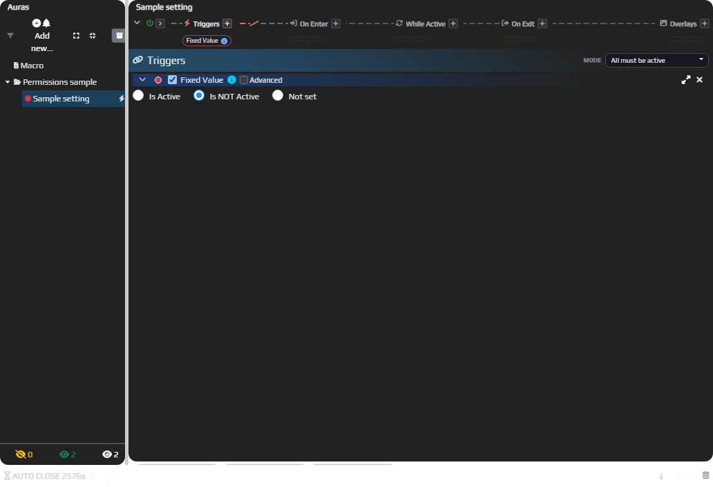
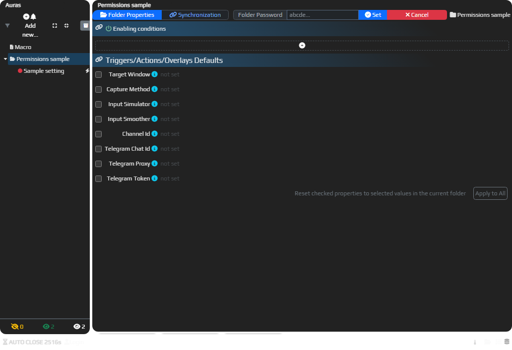
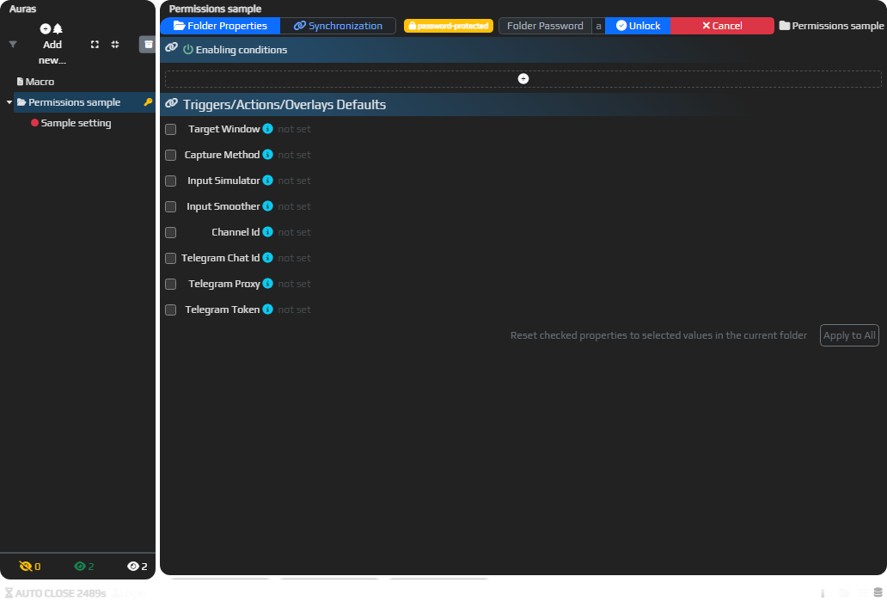
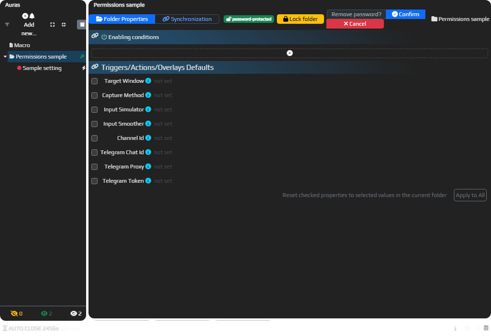

# Let recipients configure a set without changing its structure

Folder permissions separate a recipient's settings from the set's internal structure. **Configurable**, for example, allows changes to existing elements while restricting additions and deletions.

You need your own folder, a signed-in EyeAuras account and permission to change its restrictions. The owner keeps full access, so testing only as the owner will not show a recipient's restrictions.

1. Select your folder and choose **Permissions → Configurable** from its context menu.
2. Check **Folder Properties** for the level and **owned by you (…)**. The first assignment of restrictions makes the current user the owner.
3. Provide the settings a recipient needs in existing elements, such as a trigger's target window name. They should not have to rebuild the folder to configure it.
4. Check your test copy with an already prepared account that is not its owner. Existing settings should remain configurable, while structural additions and deletions are restricted. Full access under the owner is expected.
5. To remove your restriction, choose **Permissions → No Restrictions**. Changing the mode also resets that folder's password.

The older menu below uses earlier names. The current private mode is **Private Content**, and the ordinary mode is **No Restrictions**.

The owner header and another user's header represent different effective access:

## Choose a level

| Permissions option | Ordinary recipient's access |
| --- | --- |
| No Restrictions | Normal editing, addition and deletion. Named Default in the model. |
| Configurable | Changes to existing elements' settings without freely changing the set's contents and structure. |
| Read-Only | Viewing without editing. This does not prohibit execution of already configured logic. |
| Private Content | Hides contents from viewing, editing, copying and ordinary recipient export. Named Private in the model. |
| Exclude From Export | Marks local contents as LocalOnly; synchronization snapshots exclude them. It is not a universal secret scrubber for every serialization route. |

The first image below is a current unrestricted local sample. The next three retain the earlier recipient views for configuration, viewing and hidden contents.

In this isolated sample, no account is signed in and no owner is assigned. With no restriction or folder password, the existing **Fixed Value** settings and add controls are available. A setting was changed through the UI and returned to **Is NOT Active** before this capture; this is an editing baseline, not a recipient restriction test.

Restrictions inherit from parents. Check effective access along the whole folder chain, rather than considering a nested folder alone. Ownership and a successful password unlock grant full access in the application; a restricted parent can affect visibility and editing below it.

## Temporarily unlock a folder with a password

A folder password can grant access without sharing the owner's account. It is separate from the EyeAuras sign-in password and a license key.

1. In your **Private Content** folder's header, choose **add password…**, enter your password and click **Set**. The button is also available without restrictions: a password itself locks the folder for a recipient until unlocked.
2. The recipient chooses **unlock…**, enters **Folder Password**, and clicks **Unlock**. A successful unlock gives full access locally without changing ownership.
3. After editing, choose **Lock folder**. To remove the password, use **remove password… → Confirm** with sufficient access.

The current panels below use that same local sample without a signed-in account or an assigned owner. Its unrestricted header exposes **add password… → Folder Password / Set**. The field is empty; this is password entry, not owner-only permission assignment.

A fictional folder password was then set through the real UI. The session remained a non-owner and effective access became Private. **unlock…** opens the empty **Folder Password / Unlock** panel below. This demonstrates the non-owner password path, not a different owner’s signed-in account.

After a real UI unlock, the same non-owner session regained full local access. The capture shows **Lock folder** alongside **Remove password? → Confirm**. It records available controls and an unconfirmed removal prompt; it does not show a completed removal.

Local folder permissions do not determine website publication rights. A publication has its own owner and **Viewer / Editor / Manager** roles. Viewing source, editing a folder, updating a publication and running a product under a [sublicense](/en/features/sublicenses) are separate permissions. Hiding the editor does not guarantee that code cannot be extracted; also consider [packing](/en/features/packs) and [script protection](/en/features/script-protection).
