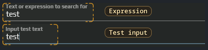
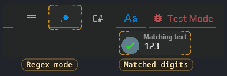
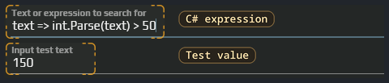

# Text Matching Expressions — check the string you receive

A text matching expression decides whether the text from a trigger fits. Say an aura should react to the message “Processing complete”. You choose what counts as a match: the whole string, a fragment found by a pattern, or the result of a C# check. Where the text comes from, a message or recognition, is set in the trigger itself.

This field appears in [Text Search](/en/triggers/images/text-search), [Network Message](/en/triggers/network-message), [Telegram Message](/en/triggers/telegram-message) and other editors. It is handy to test the rule on your own text first, without waiting for a real message.

## Match one complete message

1. Open the text condition in a trigger you already have, such as Telegram Message. Choose **Text**, next to Regex and C#.
2. In the expression field, called **Text or expression to search for** in the older editor, enter `Processing complete`. Do not add quotation marks or Markdown. They would become part of the text.
3. Turn on **Ignore Case** if `PROCESSING COMPLETE` should also match.
4. Turn on **Test mode** and enter `Processing complete` in the test-text field. A match with this text should appear.
5. Change the test text to `Processing complete: 3 files`. The match should disappear, because Text compares the whole string.
6. Put a matching test text back, check the result and **turn Test mode off**. While it is on, the test text is checked instead of the string from the trigger.

## Choose the evaluator

| Mode or control | Use |
| --- | --- |
| Text | The whole string must equal the text you entered, spaces included. |
| Regex | You need to find a fragment or describe a pattern: a number, a word, the start and end of the string. |
| C# — called Lambda in older descriptions | You need to check the string with an expression that returns bool, such as a length or a numeric range. |
| Ignore Case | Turns case sensitivity on and off for Text and Regex. It does not affect C# code. |
| Test mode | Uses the test-text field instead of the real text. Turn it off when you are done. |

### Text compares complete strings

`Hello, world` matches only that exact string. `12345` matches the same digits **as text**, with no extra quotes. With Ignore Case on, `HELLO` also matches `hello` and `Hello`.

### Regex finds a matching fragment

Enter `\d+` without slashes around it. In `test 123 text` the match is `123`. Regex does not need the whole string to match. If you want the whole string, say so in the pattern, for example `^Processing complete$`.

[View the expression and test input](/assets/legacy/eyeauras_jb1lvsh9pz.png).

| Pattern | What it finds |
| --- | --- |
| `\d+` | One or more digits, including a number inside other text. |
| `\b\w+\b` | A word made of \w characters: letters, digits and underscore. Cyrillic is supported. |
| `\b[a-zA-Z]{2}\b` | A word of exactly two Latin letters, such as ab. |
| `\b\d{3}\b` | Exactly three digits at word boundaries, such as 123. |
| `\bH\w*\b` | A word that starts with Latin H, such as Hello. Cyrillic Н is a different letter. |
| `\b\w*e\b` | A word that ends with Latin e, such as code. |

The evaluator uses .NET regex with **Singleline**, so `.` can match a newline. Ignore Case makes matching case-insensitive. Only the first match is used. The result field shows the first capturing group, or the whole match if there is no group. The flags are explained in [Microsoft's regex options guide](https://learn.microsoft.com/en-us/dotnet/standard/base-types/regular-expression-options).

An external [regex editor](https://regex101.com/) helps you learn the syntax, but its engine and flags may differ. Do the final check here, in Test mode.

C# / Lambda conditions and their context

This field takes an expression that receives a string and returns bool, not a whole Script.csx file. `Log`, `AuraTree`, `Variables`, `cancellationToken` and other top-level script features are not available here. Using directives and script package imports do not go in this field either.

| Expression | Check and prerequisite |
| --- | --- |
| `text => string.IsNullOrEmpty(text)` | An empty string or null. |
| `text => text.Contains("Hello")` | Whether the text contains Hello. This call is case-sensitive regardless of Ignore Case. |
| `text => text.Length < 5` | Fewer than five characters. Assumes text is not null. |
| `text => double.Parse(text) >= 1 && double.Parse(text) <= 100` | A number from 1 to 100 inclusive. Assumes valid numeric text. |

The last example does **not** return false for every nonnumeric text: `double.Parse` can fail with an error. It also depends on the current culture, including the decimal separator. Check what format your text arrives in. To test the numeric range, enter `50`, then `150`, and compare the results.

The expression must return bool. Syntax and evaluation errors are shown as evaluator errors.

