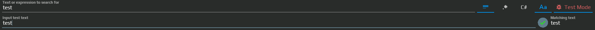
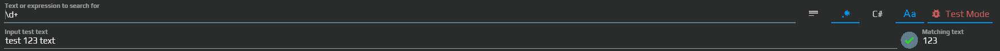
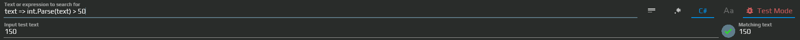

# Text Matching Expressions — check the string you receive

To react to “Processing complete”, decide whether the whole message must match, whether a pattern should find a fragment, or whether a C# condition should return true. The evaluator receives a **string** from its trigger. Receiving a message or recognizing text is configured in that trigger, not in the expression.

The control appears in [Text Search](/en/triggers/images/text-search), [Network Message](/en/triggers/network-message), [Telegram Message](/en/triggers/telegram-message) and other editors. Test the rule on your own text before waiting for a real event.

## Match one complete message

1. Open the text condition in an existing trigger, such as Telegram Message. Choose **Text**, next to Regex and C#.
2. In the expression field, called **Text or expression to search for** in the older editor, enter `Processing complete`. Do not add quotation marks or Markdown: they would become part of the text.
3. Enable **Ignore Case** if `PROCESSING COMPLETE` should also match.
4. Enable **Test mode** and enter `Processing complete` in the test-text field. The match indicator and result should show a successful match.
5. Change the test text to `Processing complete: 3 files`. The match should disappear: Text compares the whole string.
6. Restore a matching test value, inspect the result, then **turn Test mode off**. While enabled, it substitutes test text for the trigger's real input.

The condition is ready to evaluate real input. It does not send a reply or run an action on its own; those depend on the aura and its configured reaction.

## Choose the evaluator

| Mode or control | Use |
| --- | --- |
| Text | The whole input must equal the entered text, including spaces. |
| Regex | Find a fragment or specify a pattern for numbers, words, or string boundaries. |
| C# — called Lambda in older descriptions | A string condition returning bool, such as a length or numeric-range check. |
| Ignore Case | Controls Text and Regex comparisons. It does not change C# code. |
| Test mode | Uses the test-text field instead of real input. Disable it when finished. |

### Text compares complete strings

`Hello, world` matches exactly that string. `12345` matches those digits **as text**, entered without extra quotes; there is no separate numeric input type. With Ignore Case, `HELLO` also matches `hello` and `Hello`. A full sentence such as `The quick brown fox jumps over the lazy dog` is compared in the same way.

The older screenshot uses `test` in both fields. Current styling and field placeholders can differ; the comparison remains the same.

### Regex finds a matching fragment

Enter `\d+` without outer slashes. In `test 123 text`, the match is `123`; a pattern need not cover the whole input. Use boundaries when required, for example `^Processing complete$`.

| Pattern | What it finds |
| --- | --- |
| `\d+` | One or more digits, including a number inside other text. |
| `\b\w+\b` | A word made of \w characters, which include letters, digits and underscore. Cyrillic is supported. |
| `\b[a-zA-Z]{2}\b` | A word of exactly two Latin letters, such as ab. |
| `\b\d{3}\b` | Exactly three digits at word boundaries, such as 123. |
| `\bH\w*\b` | A word beginning with Latin H, such as Hello; Cyrillic Н is a different character. |
| `\b\w*e\b` | A word ending with Latin e, such as code. |

The evaluator uses .NET regex with **Singleline**, so `.` can match a newline. Ignore Case adds case-insensitive matching. It uses the first match and displays the first capturing group when present, otherwise the whole match. [Microsoft's regex options guide](https://learn.microsoft.com/en-us/dotnet/standard/base-types/regular-expression-options) explains these flags.

An external [regex editor](https://regex101.com/) can help explore syntax, but its engine or flags may differ. Verify the final expression in this control's Test mode.

C# / Lambda conditions and their context

This field parses a string-to-bool expression, not a complete Script.csx file. It does not supply top-level script globals such as `Log`, `AuraTree`, `Variables` or `cancellationToken`. Namespace using directives and script package imports do not belong in this field; available expression types come from its parser context.

The older screenshot checks whether a number is greater than 50; `150` passes. A conversion error is different from an ordinary false result.

| Expression | Check and prerequisite |
| --- | --- |
| `text => string.IsNullOrEmpty(text)` | Empty or null string. |
| `text => text.Contains("Hello")` | Contains Hello; this call is case-sensitive regardless of Ignore Case. |
| `text => text.Length < 5` | Fewer than five characters; assumes text is not null. |
| `text => double.Parse(text) >= 1 && double.Parse(text) <= 100` | Number from 1 to 100 inclusive; assumes valid numeric text. |

The last expression can throw for nonnumeric input; it does not return false for every invalid string. `double.Parse` also uses the current culture, including its decimal separator. For a known numeric source, compare `50` with `150` in Test mode. Choose a rule appropriate to your real input rather than treating Parse as a universal message filter.

The expression must return bool. Syntax and evaluation errors appear as evaluator errors and must be distinguished from a normal “condition not met” result. Ordinary C# helpers and Razor components also require their own explicit dependencies; this evaluator does not grant them a script host.

All modes work with Unicode strings, including numbers represented as text. Similar-looking Latin and Cyrillic letters remain different characters. After checking representative values, turn Test mode off and verify that the real source now controls the condition.
