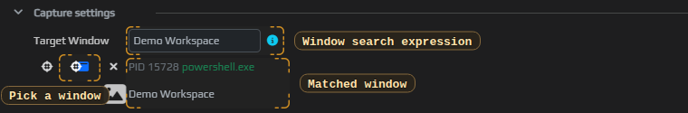

# Window Matching Expressions — keep the right window selected

The expression in a window field tells EyeAuras which window to work with. You need it when a program has several windows open, for example so that capturing a report does not suddenly switch to another window of the same viewer. The editor shows the window it found below the expression.

Triggers, actions and overlays have this field. The capture source, the window checked for activity and the input target can each have their own. Changing one does not change the others.

## Select a report window

1. Open your report and a second window of the same application. In a capture trigger, expand **Capture settings → Target Window**.
2. Click **Click to select Window** and pick the report. Check the selected window below the expression. Hover over it to see details.
3. To find the window by name after the document is reopened, enter a distinctive part of the title, such as `October report`. This is plain text without quotes. It is searched as a substring in several window fields.
4. For a complete match, put the **whole actual title** in quotes. If the title is exactly `October report — Viewer`, enter `"October report — Viewer"`. The application's suffix is part of the title too.
5. Switch to the other window. The selected-window display and the capture preview should still show the report. Close and reopen the report and check that the expression finds it again.

If the document is renamed, the exact title stops matching. A handle you got by picking a particular window can also change when the window is created again.

If several checks need the same window, set the expression once in the folder’s [Default Properties](/en/features/default-properties) and bind their Target Window fields to it. Then you will not have to edit every copy when the window changes.

## Simple expressions

The expression is compared with the **process path, process name, window title and process arguments**. A match in one suitable field is enough.

| Expression | Meaning |
| --- | --- |
| `notepad` | A substring in the path, title or arguments. The process name is compared as a whole. |
| `"My document"` or `'My document'` | A complete match of a field. |
| `/^My document/` | A regular expression for the path, title or arguments. |
| `0x5A` or `&H5A` | A native window handle. The numbers here only show the syntax. |
| `notepad #2` | The second match after the results are sorted. |
| `#1` | The first window in the eligible list. |

Plain text and quoted text **ignore case**: they use **OrdinalIgnoreCase**. Regex also uses IgnoreCase.

Write regex as `/pattern/`, without quotes around it. `"/fire/"` is exact text, not regex, while `/fire/` searches by a pattern. The [text evaluator's Regex mode](/en/features/text-match-expressions) is the other way round: it needs no outer slashes.

Put an index **outside** the quotes: `"Firefox" #2`, not `"Firefox #2"`. Counting starts at one, after sorting by process creation time, Z-order, title length, title text and PID. The list and its order can change, so `#2` is not a permanent identifier of a document.

## Combine criteria

| Expression | Meaning |
| --- | --- |
| `notepad && /report/` | Narrows step by step: first the windows that match notepad, then /report/ among them. |
| `notepad \|\| calc` | The first nonempty alternative. If notepad matches something, calc results are not added. If not, calc is checked. |
| `!title` or `NOT title` | There is no negation operator. Do not use these to exclude windows. |

Operators are processed in order. Do not count on parentheses or the usual C# precedence. Start with a simple expression, then add conditions and look at which window is selected after each change. Negation inside a regex is ordinary regex syntax, and the regex is still compared with several fields.

Selector filters and the script API boundary

The candidate list also depends on the window provider and on the filters of the selector, the mechanism that picks the window. The selector parses properties in brackets itself. They are not searched as ordinary text.

| Setting or suffix | Scope |
| --- | --- |
| `[type=toplevel]` | Picks main windows. type=child and type=any also exist. Results are limited to the window list in use. |
| `[ownedBy=external]` / `[ownedBy=any]` | Excludes EyeAuras's own windows or lifts that restriction. The defaults are external and toplevel. |
| `[visible]` / `[focus]` | On their own, these flags do not turn on filtering by visibility or focus. |
| OnlyVisible | The selector property that turns on the visible-window filter. Adding `[visible]` does not replace it. |
| ProcessName | To limit the match strictly to a process, you need an explicit process filter in a context that has one. Broad text is not the same as AutoHotkey ahk_exe. |

**Click to select Process** writes the name of the chosen process as an expression. It follows the usual rules and is compared with several fields.

In scripts, `IWindowMatcher.FindMatches` understands compound expressions with `&&` / `||`. `IsMatch` for a single window and `WindowMatchParams` take a simple expression. For the script side, start with the [API reference](/en/scripting/api/reference).

To check whether the chosen window is active, use it in [Window Is Active](/en/triggers/window-is-active). For pixel searches, set up [capture and region](/en/triggers/images/imagecapturetriggers) separately after choosing the window.
