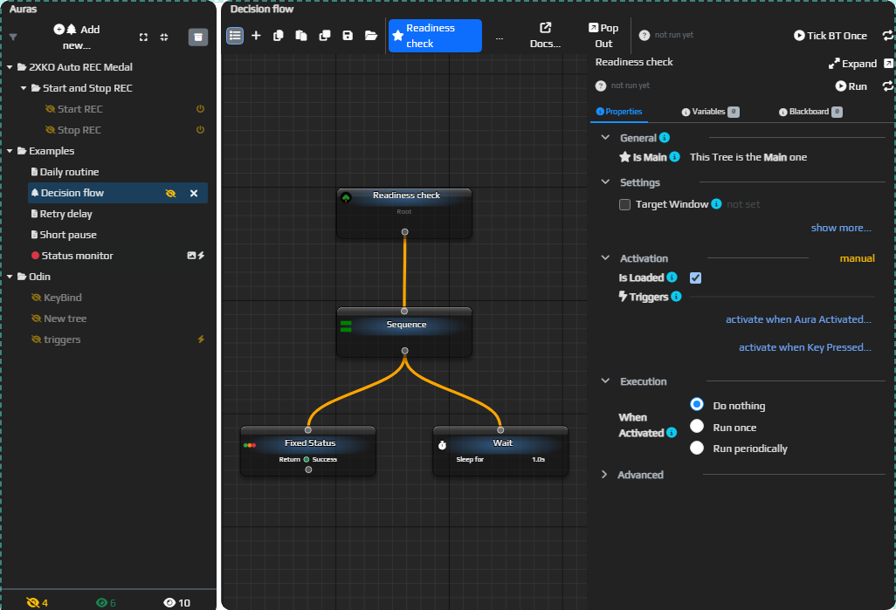
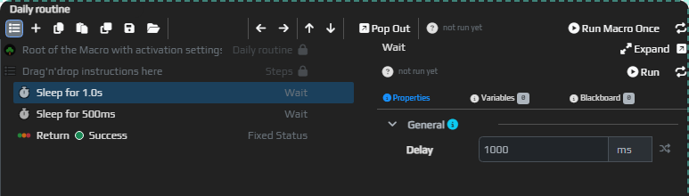
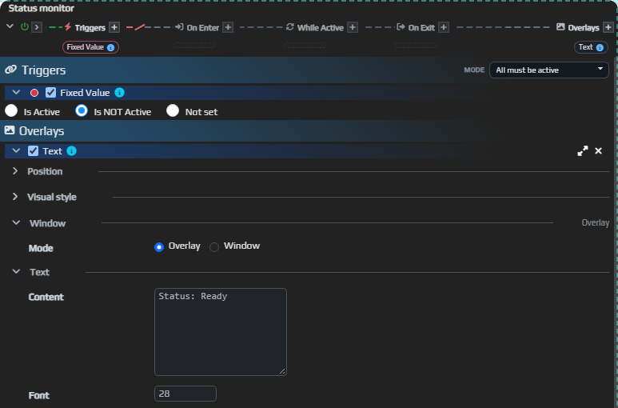
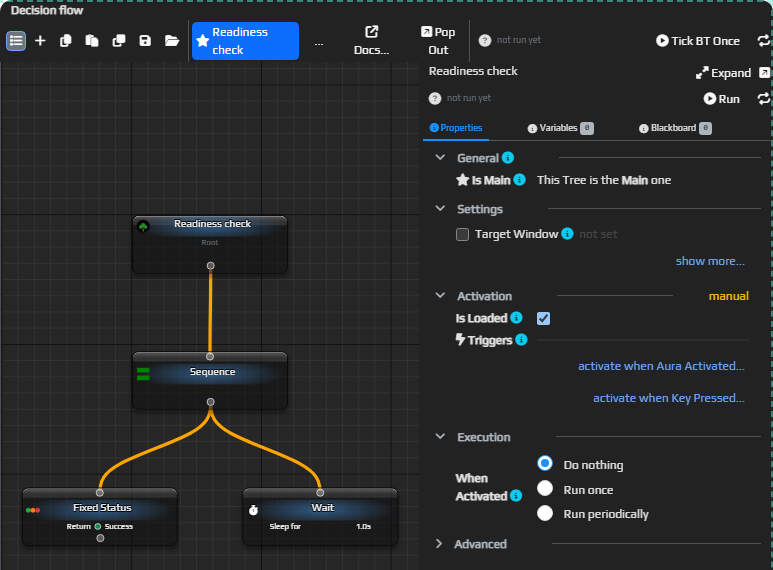
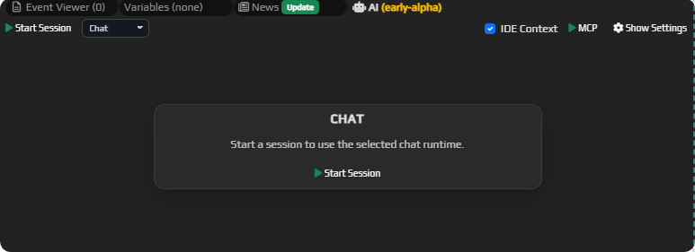

# What is EyeAuras

EyeAuras is a clicker with computer vision. It watches the screen and, on its own, presses keys, moves the mouse, plays a sound or messages you on Telegram.

[Download EyeAuras](https://eyeauras.net/#downloads) and start with one simple task.

## Three tools

Almost any task can be built in one of three ways.

### Macro — steps in order

“Press, wait, check, repeat.” If you can describe the task like that, use a macro. [How to build a macro](/en/macros/getting-started).

### Aura — watch and react

An aura keeps checking a condition: is the image found, is the window active, is the key held down. When the condition is met, the aura runs actions: presses a button, plays a sound, shows an overlay.

Conditions are called triggers. The simplest one is [Fixed Value](/en/triggers/fixed-value), a good place to start.

### Behavior tree — complex logic

This is the bot's “brain”. The tree decides what to do next: check a condition, pick a branch, try again. Use it when a macro gets too cramped. [How to build your first tree](/en/behavior-trees/gettings-started).

Not sure which one to pick? Here is a [short guide](/en/getting-started/choose-a-tool).

## AI assistant

EyeAuras has a built-in AI chat. It sees the macro or script you have open, so you can ask what is wrong and how to make it better. [How to set up AI Assistant](/en/features/ai-assistant).

## Your first macro in a couple of minutes

This macro presses nothing. It just waits and finishes, so you can safely see how things work.

1. Select **Macro** in the tree on the left.
2. Click the top row of the macro and choose **Execution → When Activated → Do nothing**. Now it only starts manually.
3. Through **Add new Node**, add two **Wait** nodes and one **Fixed Status** to the **Drag'n'drop instructions here** block, in that order.
4. Set **Delay** to 1000 ms for the first Wait and 500 ms for the second. For **Fixed Status**, choose **Status → Success**.
5. Click **Run Macro Once**. After a second and a half the last node shows **Success**: the macro has finished.

Conditions, loops and everything else are in the [macro guide](/en/macros/getting-started).

## What next

- [Recipes](/en/recipes) — ready-made solutions for specific tasks.
- What an aura is made of: the [Fixed Value](/en/triggers/fixed-value) trigger, the [Play Sound](/en/actions/play-sound) action and the [Text](/en/overlays/text) overlay.
- [C# scripts](/en/scripting/getting-started) — when the built-in blocks are not enough.
- [FAQ](/en/faq) and [Known Issues](/en/known-problems) — if something goes wrong.
