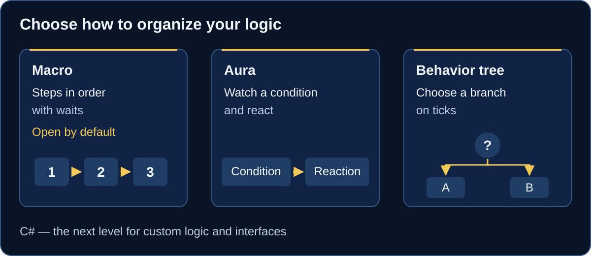
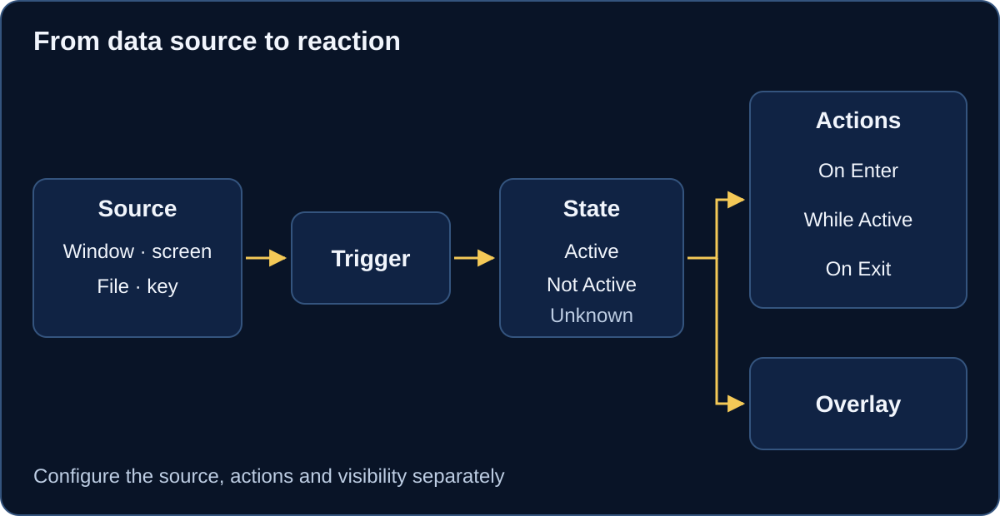

# Get started with EyeAuras

EyeAuras helps automate tasks in applications: run ordered steps, watch conditions and build branching logic. [Download EyeAuras](https://eyeauras.net/#downloads) and start with the **Macro** that opens in an empty configuration.

## Three tools

Choose a **macro** for ordered steps with waits, an **aura** to watch a condition and react, or a **behavior tree** for branches and work driven by ticks. The macro editor is the starting view. [C# scripts](/en/scripting/getting-started) add custom logic and interfaces when built-in steps are not enough.

## Your first macro

Use the already open **Macro** for a small sequence without keyboard or mouse actions:

1. Select the top root-settings row in the editor. Keep **Activation → Is Loaded** enabled and set **Execution → When Activated → Do nothing** for a manual run.
2. Through **Add new Node**, add two macro **Wait** nodes and one **Fixed Status** as siblings inside **Drag'n'drop instructions here**, in that order.
3. Set the waits' **General → Delay** to **1000 ms** and **500 ms**, with randomization off. Set **Fixed Status → General → Status → Success**.
4. Click **Run Macro Once**. After both waits, the final node and the block should show **Success**.

Continue with the [full macro guide](/en/macros/getting-started) for conditions, loops and calls.

## An aura reacts to a condition

A trigger reads a source and contributes to the aura's state. Configure **On Enter**, **While Active** and **On Exit** reactions separately; an overlay can show a visual cue. Start with [Fixed Value](/en/triggers/fixed-value) to change a condition manually and observe its reaction.

## A behavior tree chooses a branch

Use a tree when checks determine the next branch. Nodes return **Success**, **Failure** or **Running**, and ticks advance the work. These are execution results, distinct from an aura's state. Follow the [first behavior tree guide](/en/behavior-trees/gettings-started).

## What next

- Explore [triggers with Fixed Value](/en/triggers/fixed-value), [actions with Play Sound](/en/actions/play-sound) and [overlays with Text](/en/overlays/text).
- Choose a complete [recipe](/en/recipes) or continue to [C# scripts](/en/scripting/getting-started).
- Open [FAQ](/en/faq) for common questions or [Known Issues](/en/known-problems) when something behaves differently.

For a particular source or reaction, [choose a tool by task](/en/getting-started/choose-a-tool).
