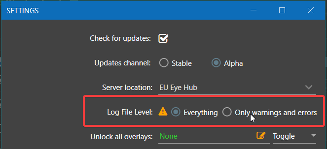

# Reduce log detail

Choose **Warnings/Errors** when you only need warnings and errors in ordinary application logging. This reduces diagnostic detail; it does not guarantee faster execution. Existing files remain, and messages skipped now cannot be recovered later.

## Change the application setting

1. Open **Settings** and find **Log File Level** in the main EyeAuras settings.
2. Select **Warnings/Errors**. **Disabled** restricts ordinary logging further, but retaining warnings is more useful for diagnosis.
3. Click **Save**. The change applies to the running application without restarting.
4. Reopen settings to check the selection. Subsequent ordinary logs should contain fewer detailed messages. Before reproducing a problem for support, restore **Default** and save again.

| Log File Level | Effect |
| --- | --- |
| Everything | Removes the shared restriction for detailed logging; Trace still requires the individual logger to allow it |
| Default | Uses the normal logger configuration. The supplied root level is DEBUG; named loggers can differ |
| Warnings/Errors | Sets the shared Warn threshold for ordinary messages, filtering Debug and Info where that threshold applies |
| Disabled | Restricts ordinary messages through the shared threshold; it does not stop arbitrary third-party output or a script writing its own file |

The screenshot uses an earlier arrangement. Use the current labels above.



| Level | Typical purpose |
| --- | --- |
| TRACE | Very detailed diagnostic events |
| DEBUG | Component behavior useful for finding a cause |
| INFO | Main execution events |
| WARN | An unexpected situation that may allow work to continue |
| ERROR | An operation or component failed; the entry alone does not mean the whole process exited |

This differs from filtering [Event Viewer](/en/features/event-viewer). A display filter hides rows; it cannot restore messages that were never recorded. The ordinary release profile stores logs under `%appdata%\EyeAuras\release\logs`; other profiles and portable data locations differ.

<details>
<summary>Edit log4net.config for a particular installation</summary>

Use the UI for a persistent choice of ordinary log detail. Editing `log4net.config` changes the installation's logger configuration itself.

1. Find the directory of the **running instance**, rather than assuming the highest version folder is active. An installed version may use `%localappdata%\EyeAuras\app-<version>`; a portable copy has its own directory. Back up `log4net.config` first. The old `app-1.2.4177` example names one historical version, not today's required path.
2. In the existing `root` section, find this level element. This is a **fragment inside root**, not a complete configuration file:

```xml
<level value="DEBUG" />
```

3. Change only `DEBUG` to `WARN` and save, preserving the rest of the root section, appenders and file. The application watches this configuration file, so a restart is normally unnecessary.
4. Account for individual logger levels and overrides as well as the shared UI threshold. A root edit does not impose one level on every output source. To undo the edit, restore your saved value or file.

An application update or replacement can replace this file. **Settings → Save** stores the ordinary mode in application configuration and avoids editing each installed version.

</details>
