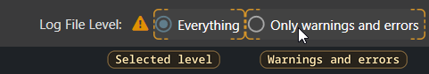

# Reduce log detail

If you only need warnings and errors, change **Log File Level** in the settings. EyeAuras will write less diagnostic detail, but it will not necessarily run faster. Existing files stay as they are. Details of events that were not written cannot be recovered later.

## Change the application setting

1. Open **Settings** and find **Log File Level** in the main EyeAuras settings.
2. Select **Warnings/Errors**. You can also choose **Disabled** to restrict ordinary logging further, but warnings are worth keeping for troubleshooting.
3. Click **Save**. The setting applies right away, without a restart.
4. Open the settings again and check the value. From now on the ordinary logs should have fewer detailed entries.

| Log File Level | Effect |
| --- | --- |
| Everything | The most detailed mode, including Trace where the individual logger allows it |
| Default | The normal logger configuration. The supplied root level is DEBUG. Named loggers can differ |
| Warnings/Errors | A shared Warn threshold for ordinary logs. Debug and Info are not written where that threshold applies |
| Disabled | Ordinary messages are restricted by the shared threshold. A third-party library or a script writing its own file can still write something |

In the screenshot, Warnings/Errors is called Only warnings and errors.



| Level | Typical purpose |
| --- | --- |
| TRACE | Very detailed diagnostic events |
| DEBUG | How components work. Helps to find the cause of an error |
| INFO | Main execution events |
| WARN | Something went wrong, but the program can keep working |
| ERROR | An operation or component failed. The whole process may not have exited |

This setting decides what gets written to the log. The filter in [Event Viewer](/en/features/event-viewer) is different: it only hides rows on screen and cannot bring back messages that were never recorded. Logs of the ordinary release profile are in `%appdata%\EyeAuras\release\logs`. Other profiles and portable installations use a different path.

If you need help with a failure that repeats, set **Default** again and reproduce it. Then follow [Report a problem](/en/report-a-problem) to select that run's logs and save an archive.

<details>
<summary>Edit log4net.config for a particular installation</summary>

This way edits the logger configuration file itself. If you just want less detail, the setting above is enough.

1. Find the directory of the **running instance**, not the folder with the highest version number. For an installed version it may be `%localappdata%\EyeAuras\app-<version>`. A portable copy has its own directory. Back up `log4net.config` before you edit it.
2. Open `log4net.config` in a text editor and find the level inside the `root` section. This is a fragment inside root, not a complete configuration file:

```xml
<level value="DEBUG" />
```

3. Change only `DEBUG` to `WARN` and save the file. Leave the rest of the root section and the appenders alone. The application watches this file, so a restart is normally not needed.
4. Named loggers can have their own levels, and the shared threshold from Settings also affects ordinary messages. So one root edit does not set a single level for every source. To undo the edit, restore your saved value or file.

An application update or reinstall can replace this file. The **Settings → Save** setting is stored in the application configuration, so it is more convenient for a permanent choice.

</details>
