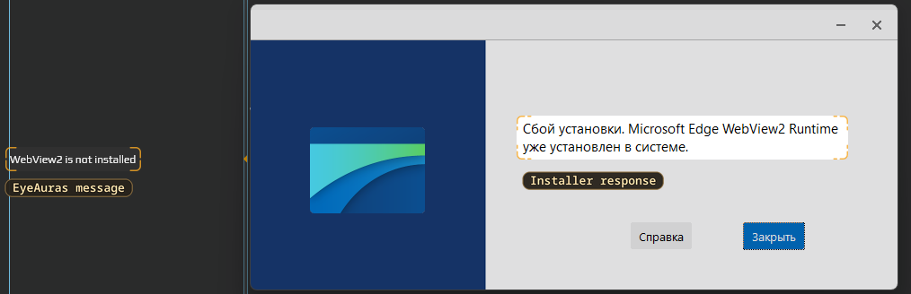

# Diagnose startup, connection and unavailable components

EyeAuras does not open its interface, shows Not connected or does not load pack items? First work out at which stage it stopped.

| Symptom | Start here |
| --- | --- |
| WebView2 is not installed | The WebView2 check below |
| Not connected or sign-in does not complete | The Eye Hub connection check |
| Connected, but an item says Proxy Not Available | Sign-in, distribution and module availability |
| Hourglass icons or a list containing only C# Script | Both the connection and the modules. The icon alone does not tell you the cause |
| The process closes without an error window | [How to prepare data after a crash](/en/report-a-problem) |

## Windows lists WebView2, but EyeAuras cannot use it

The EyeAuras interface runs on Microsoft WebView2 Runtime. Having Microsoft Edge installed does not yet mean the runtime is available to the process.

1. Close EyeAuras and open Microsoft's [WebView2 Runtime page](https://developer.microsoft.com/en-us/microsoft-edge/webview2/consumer). The direct link to the installer EyeAuras itself uses: [WebView2 Runtime installer](https://go.microsoft.com/fwlink/p/?LinkId=2124703).
2. Install or repair the runtime following Microsoft's instructions. In a case from April 2026, a normal installer run said the runtime was already installed, and running the installer as administrator helped.
3. Start EyeAuras again. The interface should open instead of the missing-runtime message.
4. If that did not help, restart Windows and save the exact EyeAuras and installer messages for a [report](/en/report-a-problem).

## Not connected and sign-in fails

**Not connected** means there is no connection to Eye Hub. That is not the same as a missing license or one unavailable module. Without the connection, sign-in, network functions and loading of some features can all fail at once. If the editor list is short, check the modules too, not just the Internet.

1. Write down the EyeAuras version and the exact connection status. If a newer version is out, compare its [release notes](/en/changelogs/9339) with yours before applying an old fix.
2. Open **Settings → Network**. Enable **Auto-select server location** and click **Save**. Now the application switches the regional endpoint by itself when connection checks fail.
3. To test one particular route, disable automatic selection, choose **Preferred server location** and save. The list has **Default Eye Hub**, **EU Eye Hub** and **RU Eye Hub**. Change one setting at a time.
4. Try another network you are allowed to use. Keep in mind the system proxy, VPN, network filter and corporate policy: changing the route can help or hurt. You do not need to turn off security software for this check.

| Setting | Effect |
| --- | --- |
| Auto-select server location | Lets the application switch among regional endpoints when connection checks fail |
| Preferred server location | You pick the endpoint yourself. Unavailable while automatic selection is enabled |

Automatic selection appeared in [1.9.9339](/en/changelogs/9339), and the separate RU hub in [1.9.9164](/en/changelogs/9164).

If Eye Hub is connected but an AI session will not start, check the **Endpoint**, **Model Id** and **API Type** of the selected profile using the [AI Assistant guide](/en/features/ai-assistant).

With this problem the list shows only C# Script or an incomplete set of items.

## Connected, but saved items remain unavailable

**Proxy Not Available** or **Not Available** means EyeAuras could not turn a saved item into a working component. The cause can be the distribution, module loading or the permissions the module needs.

1. Check the connection separately from sign-in. In the case with old auras after the move to 1.9.9339, an ordinary **Login** followed by reopening or restarting helped. Buying a subscription was not required for that.
2. If you are already signed in, compare your EyeAuras version with the pack author's requirements. The component must be part of the distribution and must load. Signing in does not give access to every optional module.
3. If the author released a fixed pack, [save your copy](/en/features/export-import) first, then look through the new version before replacing anything.
4. If the component is still unavailable, write down its full name, the pack name, the version and the connection state. Attach the logs of that run through a [report](/en/report-a-problem).
