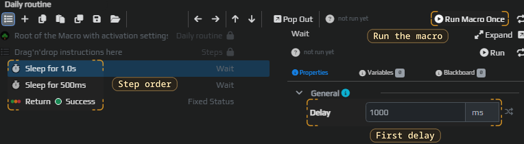
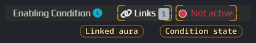
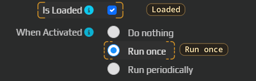
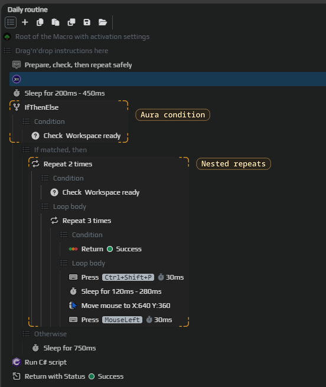
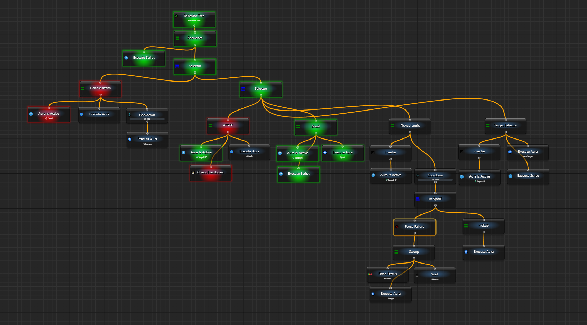

# Build your first macro

A macro is a list of steps with waits, conditions and loops. It runs the steps one by one and waits for each to finish. We start with two waits and a result you can see in the editor.

## Run two waits in one command

1. In the aura tree's creation menu, choose `New Macro` and open the new item. `My Macro` already contains a `Drag'n'drop instructions here` block. This is where the steps go.
2. Click the top row with the root settings. Keep `Activation → Is Loaded` enabled and set `Execution → When Activated → Do nothing`. Do not add activation conditions yet.
3. Through `Add new Node`, add two `Wait` nodes and one `Fixed Status`, one after another. They must sit side by side inside that block, in the order shown below. In the node list, pick the macro Wait.
4. Set the first Wait to `General → Delay = 1000 ms` and the second to `500 ms`. Turn randomization off. Set Fixed Status to `General → Status → Success`.

```text
My Macro
└─ Block
   ├─ Wait: 1000 ms
   ├─ Wait: 500 ms
   └─ Fixed Status: Success
```



5. Click `Run Macro Once` at the top. The macro waits out both delays and runs the last step. After about a second and a half (plus a little overhead) the result is Success.
6. Change Fixed Status to `Failure` and add another Fixed Status with Success **after it**. Run again. The last step still runs, but the result of the whole Block is Failure. A normal Failure of one step does not cut the list short.

This is how a macro differs from a [BT Sequence](/en/behavior-trees/nodes/sequence). If you need a fork, use macro IfThenElse. If you need to exit early, use [Break](/en/behavior-trees/nodes/Break) or [Return](/en/behavior-trees/nodes/Return).

| Element | Execution |
| --- | --- |
| Block | Runs enabled steps in order. A normal Failure goes into the overall result, but later steps still run |
| Macro Wait | Waits for Delay inside the current run. This is not the BT Wait, which returns Running until a later tick |
| Macro IfThenElse | Checks Condition and runs only one branch: If matched, then or Otherwise. Returns the result of that branch |
| Macro Repeat | Checks Condition before each iteration, then runs Loop body |
| Break | Exits its enclosing loop or block. What happens next depends on where it is placed |
| Return | Finishes the currently invoked macro with the selected Success or Failure |

Running means the work is not finished yet. Success and Failure are node results, not the Active/Inactive state of an aura. An error or cancellation does not necessarily become a normal Failure. `Stop` asks to cancel the manual run. A macro cannot force arbitrary code to stop or roll back actions already done.

## Add automatic activation after the manual example

Test the macro by hand first. Then create an aura with a trigger you have checked, such as [Hotkey Is Active](https://wiki.eyeauras.net/en/triggers/hotkey-is-active), and link it to the macro through `Activation → activate when Aura Activated... → Enabling Condition → Links`. [Enabling Conditions](https://wiki.eyeauras.net/en/features/enabling-conditions) decide whether the macro may run. The commands themselves stay in the macro.



| When Activated | Behavior |
| --- | --- |
| Do nothing | Manual run only. A met condition does not start the macro |
| Run once | One run when activation goes from false to true |
| Run periodically | Runs again and again while activation is allowed. Tick every is a pause after a finished pass, not an exact period: the duration of the pass itself is not included |



A macro without conditions or triggers has the activation state `manual`. A loaded macro can still be run by hand. Loading, activation and execution mode are different things. They are described under [Root](/en/behavior-trees/nodes/root).

<details>
<summary>From key sequences to nested logic</summary>

Instead of Fixed Status you can put [Key Press](/en/behavior-trees/nodes/KeyPress), [Mouse Move](/en/behavior-trees/nodes/MouseMoveAbs) or [Send Text](/en/behavior-trees/nodes/SendText). First set your own window and input backend through defaults and check which window is shown as the target. A held key needs its own Release: leaving a block does not release it.


In the Daily routine macro, IfThenElse checks the Workspace ready aura. The If matched, then branch contains Repeat 2 times, with Repeat 3 times inside its Loop body. Set up the aura that supplies the condition first.



From a macro you can call another macro with Run Macro, run aura actions with [Run Aura](/en/behavior-trees/nodes/execute-aura) and write custom steps in [C# scripts](https://wiki.eyeauras.net/en/scripting/getting-started). The target window and variables are not shared automatically when you call something.


</details>

<details>
<summary>Choose among the four ways to organize logic</summary>

| Approach | Useful for |
| --- | --- |
| [Auras](https://wiki.eyeauras.net/en/home) | Separate checks on pixels, windows or events with On Enter / While Active / On Exit reactions |
| [C# scripts](https://wiki.eyeauras.net/en/scripting/getting-started) | Your own algorithm, data and programmatic interface. Needs a suitable runtime context |
| [Behavior Trees](https://wiki.eyeauras.net/en/behavior-trees/gettings-started) | Picking branches by Success/Failure and work that stays Running between ticks, such as a priority flow with cooldowns |
| Macros | Ordered steps with waits, blocks, conditions, loops and calls in one place |


With C# you can add what the built-in nodes lack. But an ordinary class or Blazor component does not get every top-level script capability by itself.

  

The old large tree shows why separate branches and priorities can be useful:



</details>
