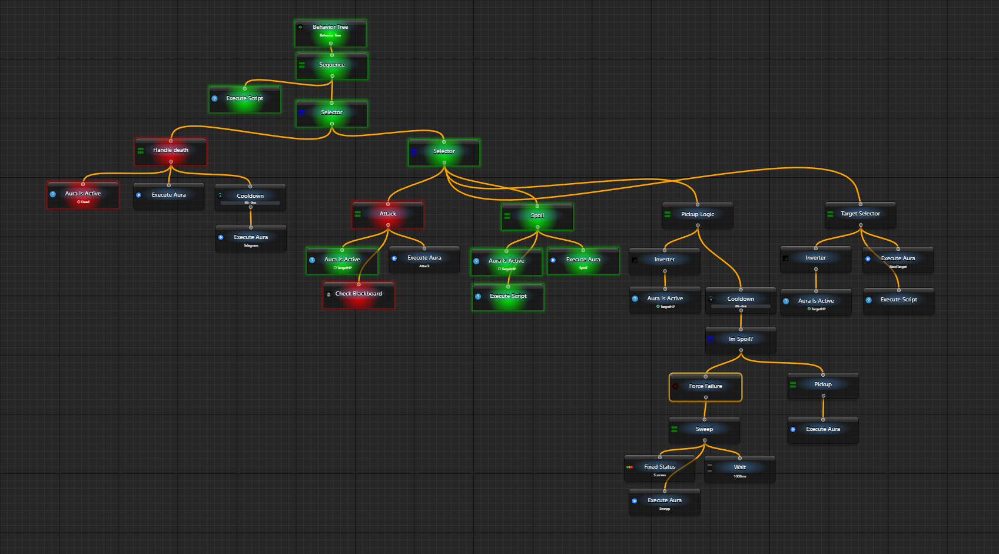

# Build your first macro

A macro runs ordered steps with waits, conditions and loops without requiring a whole program. Its Block waits for each step to finish before continuing. Start with two delays and an observable result, without input to another window.

## Run two waits in one command

1. In the aura tree's creation menu, choose `New Macro` and open it. `My Macro` already contains a `Drag'n'drop instructions here` block. A new macro opens as a nested list.
2. Select the top root-settings row. Keep `Activation → Is Loaded` enabled and set `Execution → When Activated → Do nothing`. Add no activation conditions yet.
3. Through `Add new Node`, add two `Wait` nodes and one `Fixed Status` as siblings in that block, in the order below. Choose the macro Wait template.
4. Set the first Wait to `General → Delay = 1000 ms`, the second to `500 ms`, randomization off. Set Fixed Status to `General → Status → Success`.

```text
My Macro
└─ Block
   ├─ Wait: 1000 ms
   ├─ Wait: 500 ms
   └─ Fixed Status: Success
```

5. Click the upper `Run Macro Once`. The macro waits for both delays, then executes the last step. Expect Success after roughly 1.5 seconds plus execution overhead. These Wait nodes do not need a second external tick to finish.
6. Set Fixed Status to `Failure` and add another Fixed Status with Success **after it**. Run again: the last step still executes, but the Block's aggregate result is Failure.

That differs from a [BT Sequence](/en/behavior-trees/nodes/sequence). Use macro IfThenElse for conditional routing and [Break](/en/behavior-trees/nodes/Break) or [Return](/en/behavior-trees/nodes/Return) for early exit; normal Failure alone does not end the sibling list.

| Element | Execution |
| --- | --- |
| Block | Run enabled children in order; collect normal Failure while still running later siblings |
| Macro Wait | Await Delay inside this invocation; distinct from BT Wait returning Running for a later tick |
| Macro IfThenElse | Check Condition and execute only If matched, then or Otherwise; return the chosen branch result |
| Macro Repeat | Check Condition before each admitted iteration, then execute Loop body |
| Break | Exit its enclosing loop or block according to its placement |
| Return | Finish the currently invoked macro with the selected Success or Failure |

Running means unfinished work; Success and Failure are node results, not aura Active/Inactive states. Errors and cancellation need not become a normal Failure. `Stop` requests cancellation of the issued manual run; it cannot forcibly stop arbitrary code or roll back effects already performed.

## Add automatic activation after the manual example

Create your own aura with a configured trigger such as [Hotkey Is Active](https://wiki.eyeauras.net/en/triggers/hotkey-is-active). Link it through `Activation → activate when Aura Activated... → Enabling Condition → Links`. [Enabling Conditions](https://wiki.eyeauras.net/en/features/enabling-conditions) control admission; the macro still contains the commands.


| When Activated | Behavior |
| --- | --- |
| Do nothing | Manual execution only; satisfying the condition does not start the macro |
| Run once | One invocation on an activation transition from false to true |
| Run periodically | Repeat while activation is allowed; Tick every is a pause after a completed pass, not a fixed period independent of work duration |


Without conditions or triggers, activation is `manual`; a loaded macro can still run manually. Loading, activation and execution mode are separate, as described under [Root](/en/behavior-trees/nodes/root).

<details>
<summary>From key sequences to nested logic</summary>

Replace the practice Fixed Status with [Key Press](/en/behavior-trees/nodes/KeyPress), [Mouse Move](/en/behavior-trees/nodes/MouseMoveAbs) or [Send Text](/en/behavior-trees/nodes/SendText) when needed. First configure your own window/backend through defaults and check the resolved target. A held key needs its own Release; leaving a block does not release it automatically.

The earlier key-sequence example combines a key, Wait and separate Ctrl Down/Up steps:


The nested example uses Repeat, Condition and IfThenElse. Rebuff and Can do anything must already be configured auras supplying real conditions; macros do not supply internal game state.


Use Run Macro to invoke another macro, [Run Aura](/en/behavior-trees/nodes/execute-aura) for existing aura actions, and [C# scripts](https://wiki.eyeauras.net/en/scripting/getting-started) for custom steps. Calls do not automatically merge the target window or variable context of the invoked work.


</details>

<details>
<summary>Choose among the four ways to organize logic</summary>

| Approach | Useful for |
| --- | --- |
| [Auras](https://wiki.eyeauras.net/en/home) | Pixel, window or event conditions with On Enter / While Active / On Exit reactions |
| [C# scripts](https://wiki.eyeauras.net/en/scripting/getting-started) | Custom algorithms, data and programmatic interfaces in the appropriate runtime context |
| [Behavior Trees](https://wiki.eyeauras.net/en/behavior-trees/gettings-started) | Branch selection by Success/Failure and retained Running work between ticks, such as a priority flow with configured cooldowns |
| Macros | Ordered steps with waits, blocks, conditions, loops and calls in one flow |

Auras can react to image matches or received events. Coordinate simultaneous reactions deliberately rather than assuming that independent auras form a single ordered program:


C# and related technologies extend built-in steps. Ordinary classes and Blazor components still need explicit dependencies; they do not inherit every top-level script capability.

  

The historical larger tree illustrates branches and priorities, not a ready integration with application internals:



</details>
