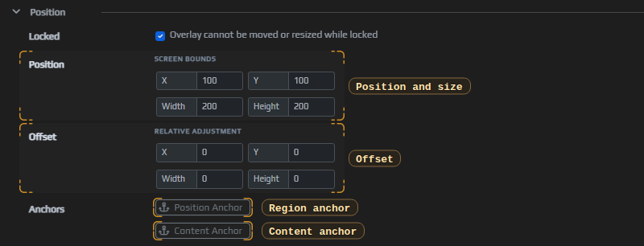

# Common Options — place an overlay and control visibility

Every overlay has these common options. Use them to put the overlay where you want it, set its size and transparency, stop it from being moved and let clicks pass through it to the application underneath.

What to show is up to the overlay itself: [Text](/en/overlays/text) shows your words, [Image](/en/overlays/image) a loaded picture, and [Replica](/en/overlays/replica) a copy of another window. Whether the overlay is visible normally depends on the aura's state.

## Place a reminder and let clicks pass through

1. In an aura with [Fixed Value](/en/triggers/fixed-value) set to Is Active, add Text. Set **Content** to “Check the microphone”.
2. Leave **Window → Mode** on **Overlay**. Under **Position**, turn **Locked** off, drag the reminder where you want it and resize it by its edge. You can also type X, Y, Width and Height as numbers.
3. Under **Visual style**, set **Opacity** to `1` (shown as **100%**) and pick a **Background** that keeps the text readable.
4. Enable **Locked**, then **Click-through**. Switch to another application and click one of its controls under the reminder. The click should reach the application.
5. Check hiding: set Fixed Value to Is NOT Active, select another aura in the tree and go back to your working application.

The reminder hides. Make the aura active again and it comes back in the same place. An unlocked overlay stays visible even when the aura is inactive. The overlay of the selected aura is also visible while the EyeAuras editor window is active, so that you can set it up. So check visibility outside the editor.

## Position and appearance

| Setting | What it does |
| --- | --- |
| Locked | Prevents normal movement and resizing. Called IsLocked in older interfaces. |
| Position / Screen bounds | Overlay X, Y, Width and Height. |
| Offset | Adjusts position and size. With the standard anchors, position `(100, 100)` plus offset `(10, 20)` gives `(110, 120)`. |
| Anchors | Reference points for placement and content. Start with the defaults. See [coordinates](/en/features/coordinate-system) for details. |
| Opacity | Transparency of the whole overlay. `0` is invisible, `1` is fully opaque. |
| Background | Background color, can be transparent. Older label: Background Color. |
| Border / Border Thickness | Border color and thickness. |
| Click-through | Passes clicks through a locked overlay. While the EyeAuras window is active, the overlay can temporarily catch the mouse again so you can edit it. |
| Aspect Ratio | Keeps the content's proportions when they are known. Unavailable while position is linked to a source. |

Show the content as a normal window

If you need a title bar and a taskbar entry, choose **Window → Mode — Window**. The content and its link to the aura stay.

| Setting | What it does |
| --- | --- |
| Mode — Overlay | Borderless overlay above other windows. |
| Mode — Window | Normal window with a title and taskbar entry. |
| Title | Title text in Window mode. |
| Stacking — Always on top | Keeps the normal window above other windows. |
| Movement — Movable even if locked | Lets you move a locked window. Click-through still passes the mouse through it. |
| Minimum Size / Maximum Size | Limit resizing. Pick current takes the current size, Reset removes that limit. |
| Window Icon | Load from file... loads a window icon, Clear removes it. |

To move an overlay again, turn off Locked in its editor.
