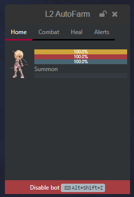
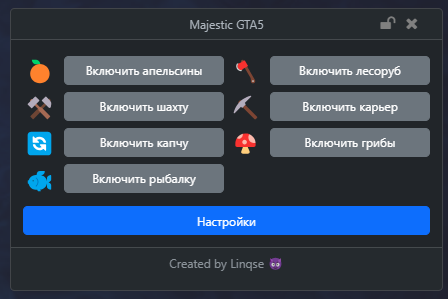
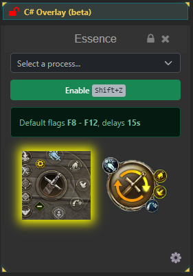
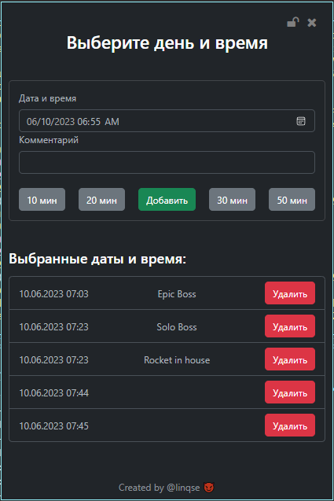

# Display a counter with C# Overlay

Add your own buttons and values above a window with **C# Overlay**. It hosts a Blazor Razor component in WebView2. Earlier material calls it Custom UI or WebUI; it is separate from ASP.NET Razor Pages and does not restyle the EyeAuras shell.

For this first example, use ordinary EyeAuras with C# Overlay available. The counter needs no external service or extra package.

## Create the panel

1. Create an aura **Panel** with **Fixed Value → Is Active**, then add **C# Overlay**. Its visibility does not need an image search or game event. Turn **Click-through** off for this button exercise.
2. Open the generated **UserOverlay.razor** and **UserOverlay.cs** files. Replace them with the pair below. The `PanelExample` namespace must match. Keep just this user component for the exercise: the overlay selects the first exported component type from the assembly.
3. Leave the generated **Script.csx** as its short entrypoint. Its default statement is `Log.Debug("This script is entry point for Overlay");`. Do not create a separate IBlazorWindow or block this entrypoint in ShowDialog: the overlay owns the result window and runs the entrypoint before hosting the component.
4. After recompilation, click **Add** in the visible panel. The count increases. Switch Fixed Value to **Is NOT Active** to hide it under normal activity-based visibility, then enable it again. Deselect the overlay for the visibility check: editing preview or an unlocked overlay can keep it visible.

**UserOverlay.razor**

```razor
@namespace PanelExample
@inherits PoeShared.Blazor.BlazorReactiveComponent

<div class="p-3">
    <p>Clicks: @count</p>
    <button class="btn btn-primary" @onclick="IncrementCount">Add</button>
</div>
```

**UserOverlay.cs**

```csharp
using System.Threading.Tasks;
using PoeShared.Blazor;

namespace PanelExample;

public partial class UserOverlay : BlazorReactiveComponent
{
    private int count;

    private async Task IncrementCount()
    {
        count++;
        await Refresh(nameof(IncrementCount));
    }
}
```

The value belongs to the component instance, not a persisted configuration variable. Recompilation or component recreation starts it again. Merely hiding a panel should not be used as a persistence or reset operation.

To make the panel reflect changes made outside its buttons, follow the [reactive toggle example](/en/scripting/blazor-windows/reactive-toggle). It observes a trigger in your own aura through an injected tree service, with the subscription owned by the component, instead of keeping the displayed value only in a local counter.

## Know which context owns each part

| Part | Responsibility |
| --- | --- |
| Script.csx | Top-level project entrypoint. Its Log and GetService are not globals in ordinary classes or Razor |
| Razor and component class | Markup, fields and event handlers. Supply dependencies through parameters or registered injected services |
| C# Overlay | Compilation, component hosting, window, visibility and common overlay settings. Project code is saved in its properties |
| Refresh(reason) | The supported BlazorReactiveComponent update request; this event handler awaits it |
| A property binding | A separate [Bindings](/en/features/bindings) mechanism. A local count field does not become a bindable aura property automatically |
| Linked auras | Explicit linked-project context when needed; not an automatic source of game data |

Use [Common Options](/en/overlays/common-options) for position, size, opacity, Window/Overlay mode, locking and Click-through. If buttons do not receive clicks, check locking and mouse pass-through. The code runs in the same application; compilation is not a security sandbox.

Dispose subscriptions, timers and JavaScript registrations with the component that creates them. Use its owned lifetime and Anchors rather than leaving an observer active after replacement. Hiding is not the same as disposal. An independently created [Blazor window](/en/scripting/blazor-windows/getting-started) is owned by its script; a [mini-app](/en/features/mini-app) also defines the launch and distribution flow.

## Edit and transfer the project

| Editor command | Purpose |
| --- | --- |
| File Tree | Opens project files. Current editing is separate from the earlier AvalonEdit-based interface |
| Pop-out editor in separate window | Moves the editor, not the overlay's result, to a separate window |
| Export... / Open in IDE... | Exports a solution or opens it in an IDE such as Rider or Visual Studio. Use the generated references and packages rather than guessing an SDK version |
| Import... | Applies a project back to EyeAuras; its dependencies must be available to that project |
| Live... | Watches a solution and imports changes; see [IDE integration](/en/scripting/ide-integration) for its ownership and stop controls |
| Dev Tools | Opens WebView2 tools for the overlay. F12 also depends on browser-hotkey settings and focus |
| Clone as Action | Creates an On Enter C# Script from the overlay and disables the original overlay; this is a separate conversion |

EyeAuras.SDK provides API references; adding it does not register the overlay host or application services in an unrelated program.

CSS styles your component. Use [JavaScript modules and cleanup](/en/scripting/blazor-windows/js-loadscript) for JS and [embedded resources](/en/scripting/embedded-resources) for files. Built-in Bootstrap classes suffice for the counter; CDN files remain external dependencies. Open native dialogs through the application's UI-scheduler wrappers, not Task.Run from Razor events.

<details>
<summary>Earlier community interfaces and references</summary>

These projects show custom panels combined with their own behavior and data. C# Overlay itself does not supply their game integrations.

[Lineage 2 Scryde autofarm tree](https://eyeauras.net/share/S202403150219539BfeOJ0eRl1q): state and behavior controls.



[GTA 5 RP Majestic helper, Alt:V](https://eyeauras.net/share/S20240121210358gpJJuNtIZRSQ): task buttons.



[Lineage 2 Essence auto flags](https://eyeauras.net/share/S20240325120506y5CPVmuwLvC3): target selection and scenario parameters.



[Time Alert](https://eyeauras.net/share/S20230424095833g0ccyvLqWNNo): dates and comments.



Framework background: [WebView2](https://docs.microsoft.com/en-us/microsoft-edge/webview2/), [Chromium](https://www.chromium.org/Home), [Blazor](https://dotnet.microsoft.com/apps/aspnet/web-apps/blazor), and [Bootstrap](https://getbootstrap.com/docs/5.0/getting-started/introduction/). Follow the generated project's versions. The earlier [AvalonEdit](http://avalonedit.net/) and [SharpDevelop](http://www.icsharpcode.net/OpenSource/SD/Default.aspx) references describe older tooling; current [Rider](https://www.jetbrains.com/rider/) or [Visual Studio](https://visualstudio.microsoft.com/) workflows are covered in IDE integration. [WebView2 DevTools documentation](https://docs.microsoft.com/en-us/microsoft-edge/webview2/how-to/webview2-devtools) explains the browser tools separately.

</details>
