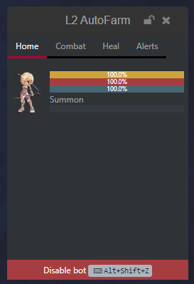
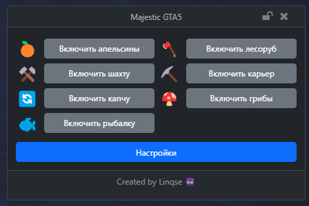
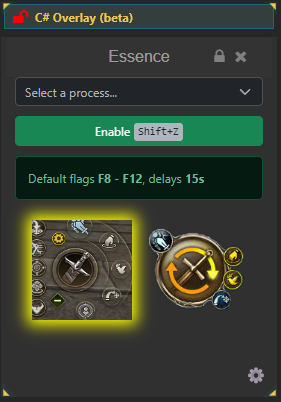
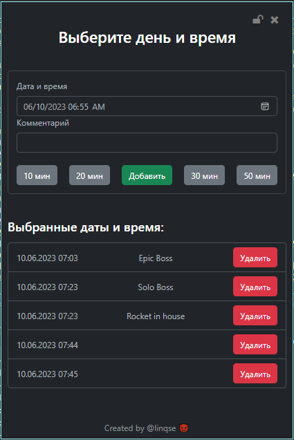

# Display a counter with C# Overlay

**C# Overlay** shows your own buttons and values on top of a window. Inside it is a Blazor Razor component running in WebView2. Earlier material calls it Custom UI or WebUI.

To begin, we make a click counter in your own aura. It needs no external service or extra package.

## Create the panel

1. Create an aura named **Panel**, add **Fixed Value → Is Active**, then add **C# Overlay**. This way the panel is always visible and does not depend on a search or a game event. Turn **Click-through** off so the button can be clicked.
2. In the overlay editor, open the generated **UserOverlay.razor** and **UserOverlay.cs** files. Replace both with the code below. The `PanelExample` namespace must be the same in both. Do not add other components of your own yet: the overlay takes the first exported component type from the assembly.
3. Leave the generated **Script.csx** with its short entry statement as it is. Do not create a separate IBlazorWindow or wait for it in ShowDialog: the overlay itself manages the window and shows it.
4. Wait for recompilation. Click **Add** in the panel and the count goes up. Switch Fixed Value to **Is NOT Active** and the panel hides (with normal activity-based visibility). Then turn the condition back on. Deselect the overlay for this check: an overlay that is being edited or is unlocked can stay visible.

**UserOverlay.razor**

```razor
@namespace PanelExample
@inherits PoeShared.Blazor.BlazorReactiveComponent

<div class="p-3">
    <p>Clicks: @count</p>
    <button class="btn btn-primary" @onclick="IncrementCount">Add</button>
</div>
```

**UserOverlay.cs**

```csharp
using System.Threading.Tasks;
using PoeShared.Blazor;

namespace PanelExample;

public partial class UserOverlay : BlazorReactiveComponent
{
    private int count;

    private async Task IncrementCount()
    {
        count++;
        await Refresh(nameof(IncrementCount));
    }
}
```

The count is stored in the component instance, not in a configuration variable. After a new compilation or when the component is recreated, counting starts again.

If the panel should show changes that do not come from its own buttons, see the [reactive toggle example](/en/scripting/blazor-windows/reactive-toggle). It watches a trigger in your own aura through an injected tree service.

## Know which context owns each part

| Part | Responsibility |
| --- | --- |
| Script.csx | Top-level entry point of the script project. Its Log and GetService are not visible as globals in an ordinary class or in Razor |
| Razor and component class | Markup, fields and event handlers. Dependencies come through parameters or registered injected services |
| C# Overlay | Compiles the project, hosts the component and is in charge of the window, visibility and common overlay settings. The project code is saved with its properties |
| Refresh(reason) | Asks a BlazorReactiveComponent to update after its state changes. In the example the event handler awaits it |
| A property binding | A separate [Bindings](/en/features/bindings) mechanism. A plain count field does not become a bindable aura property by itself |
| Linked auras | The context of project links, if your code needs it |

Position, size, opacity, Window/Overlay mode, locking and Click-through are set in [Common Options](/en/overlays/common-options). If the panel does not react to clicks, check locking and Click-through. Your code runs in the same application: compilation does not create a sandbox.

Subscriptions, timers and JavaScript registrations created by a component must be disposed together with it. For your own events use the owned lifetime and Anchors. Hiding is not disposal. A separate [Blazor window](/en/scripting/blazor-windows/getting-started), unlike an overlay, is created and held by the script itself. A [mini-app](/en/features/mini-app) also defines how the whole set is launched and distributed.

## Edit and transfer the project

| Editor command | Purpose |
| --- | --- |
| File Tree | Opens project files |
| Pop-out editor in separate window | Moves the editor to a separate window. The overlay itself stays where it is |
| Export... / Open in IDE... | Exports a solution or opens it in an IDE such as Rider or Visual Studio. Use the references and packages of the generated project, not a guessed SDK version |
| Import... | Applies a project back to EyeAuras. Its dependencies must be available to that project |
| Live... | Watches a solution and applies changes. [IDE integration](/en/scripting/ide-integration) explains how to stop watching |
| Dev Tools | Opens WebView2 tools for the overlay content. F12 also depends on the browser-hotkey settings and focus |
| Clone as Action | Creates an On Enter C# Script from the overlay and disables the original overlay. The result is a separate script, not an ordinary recompilation |

EyeAuras.SDK gives you API references. Adding it does not register the overlay host or application services in an unrelated program.

CSS styles only your component, not the whole EyeAuras shell. For JavaScript use [JavaScript modules and cleanup](/en/scripting/blazor-windows/js-loadscript), for files use [embedded resources](/en/scripting/embedded-resources). Built-in Bootstrap classes are enough for the counter. Open native dialogs from Blazor handlers through the application's UI-scheduler wrappers, not through Task.Run.

<details>
<summary>Earlier community interfaces and references</summary>

In these projects the authors combined their own panel with the pack's logic.

[Lineage 2 Scryde autofarm tree](https://eyeauras.net/share/S202403150219539BfeOJ0eRl1q): a panel for state and tree control.



[GTA 5 RP Majestic helper, Alt:V](https://eyeauras.net/share/S20240121210358gpJJuNtIZRSQ): task buttons.



[Lineage 2 Essence auto flags](https://eyeauras.net/share/S20240325120506y5CPVmuwLvC3): target selection and scenario parameters.



[Time Alert](https://eyeauras.net/share/S20230424095833g0ccyvLqWNNo): a list of dates and comments.



About the frameworks: [WebView2](https://docs.microsoft.com/en-us/microsoft-edge/webview2/), [Chromium](https://www.chromium.org/Home), [Blazor](https://dotnet.microsoft.com/apps/aspnet/web-apps/blazor) and [Bootstrap](https://getbootstrap.com/docs/5.0/getting-started/introduction/). Use the versions from the generated project. [AvalonEdit](http://avalonedit.net/) and [SharpDevelop](http://www.icsharpcode.net/OpenSource/SD/Default.aspx) are older tooling. Work in [Rider](https://www.jetbrains.com/rider/) or [Visual Studio](https://visualstudio.microsoft.com/) is covered in IDE integration. The browser tools are described in the [WebView2 DevTools documentation](https://docs.microsoft.com/en-us/microsoft-edge/webview2/how-to/webview2-devtools).

</details>
