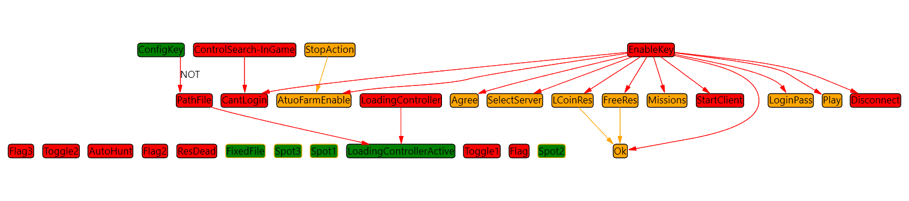

# Trace an aura's condition dependency

Use **Dependencies Viewer** to see which linked aura supplies a condition. Its edges come from conditions that reference other auras. The graph does not execute those conditions or replace the property Binding Editor.

## Check one link without actions

1. Create an aura **Source** with **Fixed Value → Is NOT Active** and no actions.
2. Create **Dependent** with an **Aura Is Active** trigger. In **Links**, select Source and configure an active-state check as described in [Aura Is Active](/en/triggers/aura-is-active).
3. Create **Graph** with **Fixed Value → Is Active** and a **Dependencies Viewer** overlay. It only displays the graph.
4. Open **Graph → Auras → Links** in the overlay editor and select Dependent. Leave **Show dependencies** and **Show connections** enabled. The graph should contain Dependent, Source and their connection.
5. Toggle Source to **Is Active**, then **Is NOT Active**. Check the Aura Is Active result in Dependent's editor. Use the graph to inspect the node set and connection, not action completion.

If it is hidden, check Graph's activity and [overlay visibility](/en/overlays/common-options). If an edge is missing, verify the link in Dependent's trigger: selecting an aura for display does not create that condition link.

| Graph setting | Effect |
| --- | --- |
| Auras → Links | Initial auras or folders to display; choose a folder to inspect a group |
| Show dependencies | Adds dependencies of the selected auras |
| Show connections | Shows connection lines; hiding them does not delete configuration links |
| Show background | Shows the graph background |

Activity and On Enter/While Active/On Exit busy-state indicators are not connected to this graph's current display. Check the editor and [Event Viewer](/en/features/event-viewer) rather than treating colors in the old screenshot as live state. Active and an action group being busy are different facts.

Arrangement fields

| Field | Stored choice |
| --- | --- |
| Auto-arrange after updates | Automatic arrangement preference |
| Arrange Direction | Direction, default Down |
| Arrange Algorithm | Algorithm, default Layered |

These fields are persisted, but the current graph component does not apply them to arrangement. Changing them is not a check that a particular layout algorithm ran.

The graph covers linked-aura condition evaluators, not all C# calls or property bindings. Use [Binding Editor](/en/features/bindings) for a specific property's source. Moving graph nodes does not create dependencies or change action order.

This applies to your own set in any application, including a game-oriented set with independently configured conditions. It does not read game state. The [older URL guide](/en/overlays/dependenciesviewer) explains how to interpret earlier state/action-group illustrations. [Common Options](https://wiki.eyeauras.net/en/overlays/common-options) covers placement and visibility.
