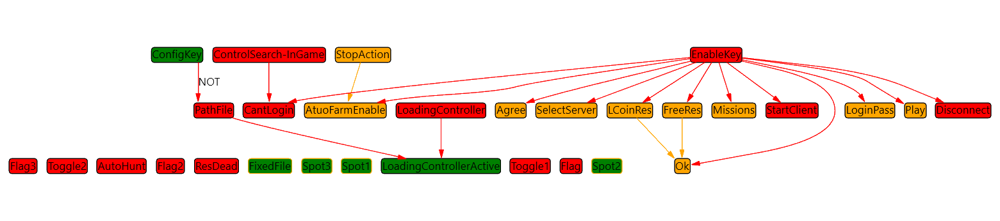

# Trace an aura's condition dependency

**Dependencies Viewer** is an overlay that draws a graph of auras and the links between them. A link appears when a condition in one aura refers to another aura.

## Check one link without actions

1. Create an aura **Source** with **Fixed Value → Is NOT Active**. Do not add actions.
2. Create an aura **Dependent** with one **Aura Is Active** trigger. In its **Links**, select Source and set up an active-state check, as described in [Aura Is Active](/en/triggers/aura-is-active).
3. Create a third aura **Graph** with **Fixed Value → Is Active** and a **Dependencies Viewer** overlay. It is only there to show the graph, so it is always active.
4. In the overlay editor, open **Graph → Auras → Links** and select Dependent. Leave **Show dependencies** and **Show connections** on. The graph shows Dependent, Source and the link between them.
5. Switch Source to **Is Active**, then back to **Is NOT Active**. Watch the Aura Is Active result in Dependent's editor. It changes along with Source.

Can't see the graph? Check that the Graph aura is active and check the [overlay visibility settings](/en/overlays/common-options). No link? The link has to be created in Dependent's trigger. Selecting an aura in the list of displayed auras is not enough.

## Choose what the graph shows

| Graph setting | Effect |
| --- | --- |
| Auras → Links | The auras or folders the graph starts from. Choose a folder to look at a whole group. |
| Show dependencies | Adds the dependencies of the selected auras. If you turn it off, only the selected nodes remain. |
| Show connections | Shows the connection lines. If you hide them, the links stay in the configuration. |
| Show background | Shows the graph background. |

The graph does not show whether an aura is active or whether its On Enter, While Active and On Exit groups are busy. Look for that in the editor and in [Event Viewer](/en/features/event-viewer).

Arrangement fields

| Field | Stored choice |
| --- | --- |
| Auto-arrange after updates | Automatic arrangement preference |
| Arrange Direction | Direction, default Down |
| Arrange Algorithm | Algorithm, default Layered |

These fields are saved in the configuration, but for now they do not affect how the nodes are arranged.

Dependencies Viewer shows the references made by linked-aura condition evaluators. To find where a specific property gets its value, use [Binding Editor](/en/features/bindings).

The [page at the older URL](/en/overlays/dependenciesviewer) explains how to read action groups and how the earlier interface maps to the current one.
