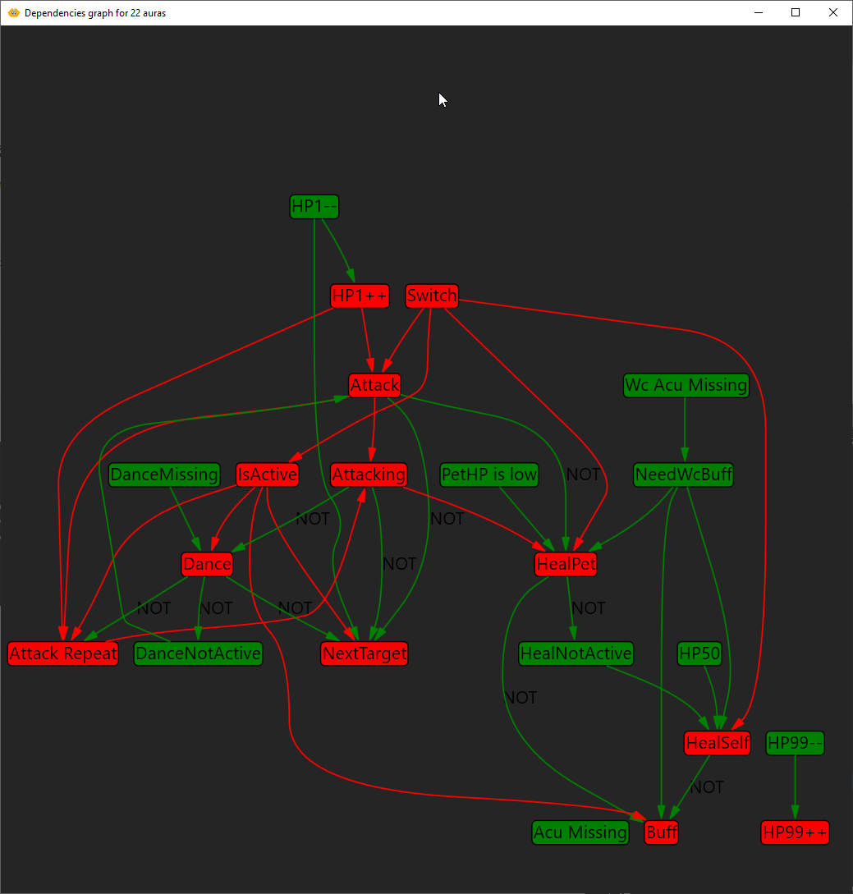
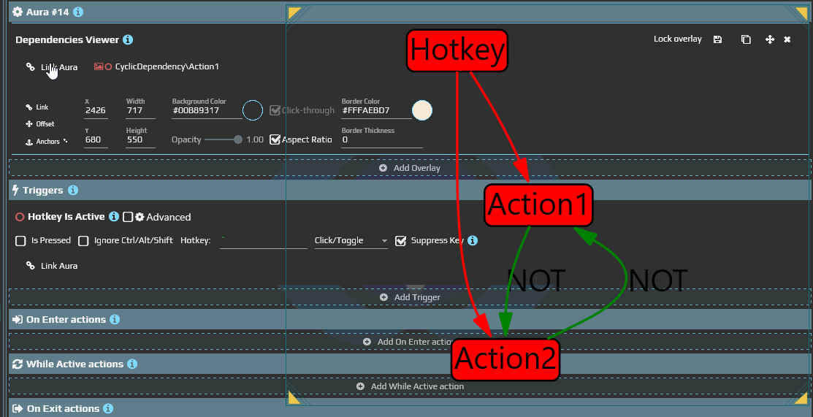

# Read an older dependency graph using current controls

Separate relationship structure from execution markers when inspecting an old configuration. This address describes the same Dependencies Viewer as the [overlay guide](/en/overlays/dependencies-viewer); the alternate URL does not identify a second node type.

## Trace a condition and its waits

1. Build Source, Dependent and Graph from the [small example](/en/overlays/dependencies-viewer). Check that both auras and their connection appear.
2. In Dependent, add **Delay** of **1000 ms** to **On Enter** and **On Exit**, and **2000 ms** to **While Active**. No other actions are needed.
3. Open Dependent's **Event Viewer** and editor. Toggle Source from **Is NOT Active → Is Active**, then back. Compare the trigger result with action-group starts and completions in the log.
4. Return to the graph to identify where the condition came from. Use the log for wait order and completion: the current graph display does not deliver the activity and busy markers shown in earlier images.

The result is a traceable chain: Source, Dependent's condition, then its actions. Delay gives you time to notice the work; it does not stop every other aura.

| Earlier graph marker | Where to check it now |
| --- | --- |
| Active or inactive aura | The aura and trigger state in the editor. Unknown is separate from Not Active |
| Disabled, paused or unloaded aura | Enable/load state and editor messages; a color or missing node alone does not establish the cause |
| On Enter | Start and completion of the entry action group in the log |
| While Active | The repeating active group's work |
| On Exit | The exit action group's work |
| Connection | A condition's reference to another aura, not a wire between arbitrary properties |

This earlier large graph used state colors. It helps interpret old configurations, but does not define the current display's capabilities.

## Find the corresponding editor

Earlier versions described an interactive window opened by **Show dependencies** in a context menu, with node dragging and zoom, and an overlay form. Use the registered **Dependencies Viewer** overlay and **Graph → Auras → Links** for this current route; it does not require the historical menu command.

| Change you need | Where to make it |
| --- | --- |
| Initial nodes and dependency display | The overlay's Graph settings, Show dependencies and Show connections |
| The dependency condition | Links in Aura Is Active or another supported condition |
| A property's value source | [Binding Editor](/en/features/bindings), not a graph line |
| Placement, locking or visibility | [Common Options](/en/overlays/common-options). Mouse interaction depends on window mode and Click-through; an overlay is not always non-interactive |

The graph does not predict future actions or retain every short transition. Use the [aura's event log](/en/features/event-viewer) for order and completion.
