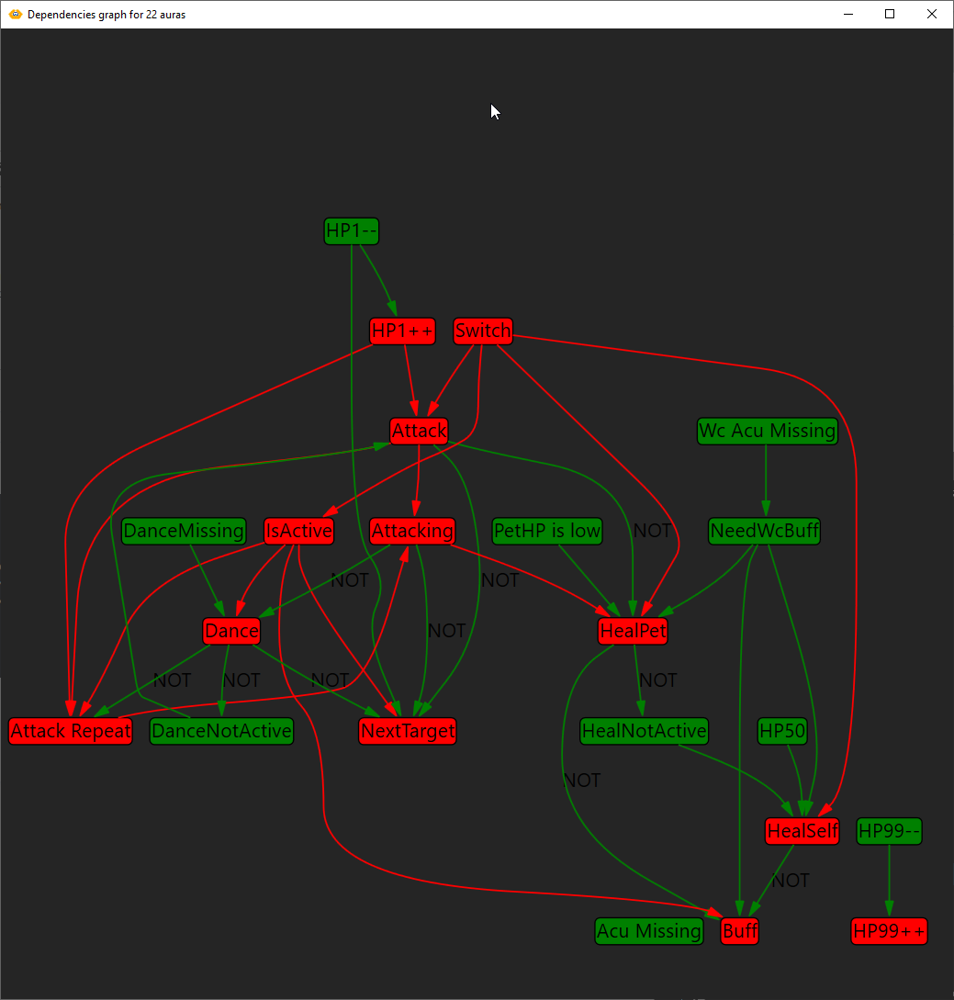
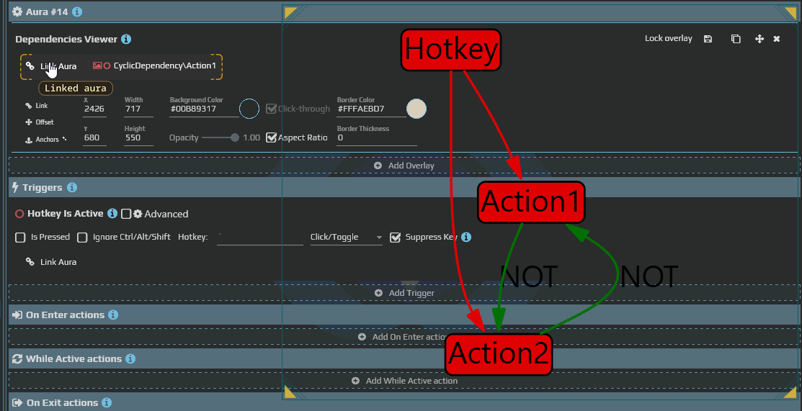

# Read an older dependency graph using current controls

This page helps you work through an old configuration from a picture of its graph. The main thing is not to mix up the links themselves with the execution markers. This address leads to the same Dependencies Viewer as the [overlay guide](/en/overlays/dependencies-viewer).

## Trace a condition and its waits

1. Build Source, Dependent and the Graph overlay from the [small example](/en/overlays/dependencies-viewer). Check that the graph shows both auras and the connection between them.
2. In Dependent, add a **Delay** of **1000 ms** to **On Enter** and **On Exit**, and a Delay of **2000 ms** to **While Active**. No other actions are needed.
3. Open Dependent's **Event Viewer** and its editor. Switch Source from **Is NOT Active → Is Active**, then back. Compare the Aura Is Active state with the starts and ends of the action groups in the log.
4. Go back to the graph. It shows where the condition came from. For the order and completion of the waits, use the log. The current graph has no activity or busy markers like the ones in earlier images.

You get a clear chain: Source, then Dependent's condition, then its actions.

| Earlier graph marker | Where to check it now |
| --- | --- |
| Active or inactive aura | The aura and trigger state in the editor. Unknown is a separate result, not the same as Not Active. |
| Disabled, paused or unloaded aura | The enable and load state, and the editor messages. |
| On Enter | The start and end of the group in the log. It runs when the aura becomes active. |
| While Active | The work of the group that repeats while the aura is active. |
| On Exit | The work of the group that runs when the aura stops being active. |
| Connection | A condition's reference to another aura. |

## Find the corresponding editor

The earlier interface had two ways in: **Show dependencies** in a context menu and the **Dependencies Viewer** overlay. Now use the overlay and **Graph → Auras → Links**.

| Change you need | Where to make it |
| --- | --- |
| Initial nodes and dependency display | The overlay's Graph settings, Show dependencies and Show connections. |
| The dependency condition | Links in Aura Is Active or another supported condition. |
| A property's value source | [Binding Editor](/en/features/bindings), not a graph line. |
| Placement, locking or visibility | [Common Options](/en/overlays/common-options). Whether you can interact with the overlay depends on the window mode and Click-through. |

For the order of events, use the [aura's event log](/en/features/event-viewer).
